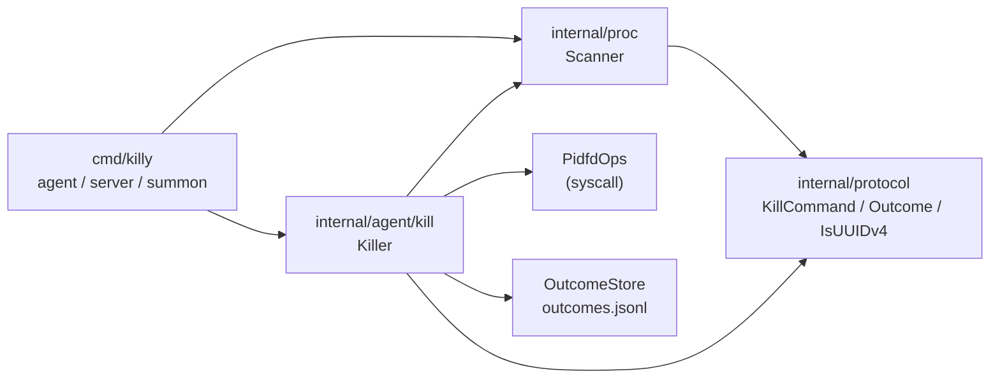
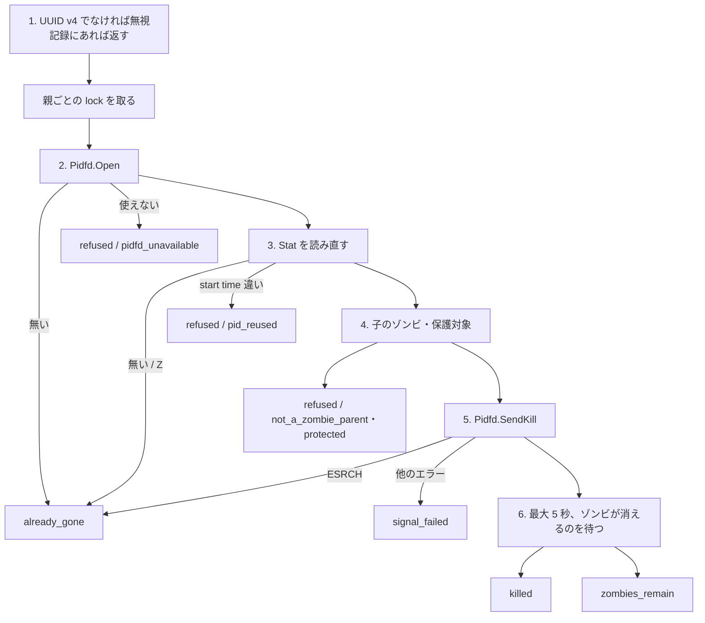

# Design: agent-process-control

## Overview

`/proc` を読む処理と、kill を確かめてから送る処理を、Killy server との通信から切り離して作る。どちらも外部への副作用（`/proc` の読み取り、pidfd の操作、時刻、ファイル）を interface の向こうに置き、テストから差し替えられるようにする。Killy の安全の保証を担う部分なので、Go の標準ライブラリだけで書く（[ARCHITECTURE: Go dependencies](../../../docs/ARCHITECTURE.md#go-dependencies)）。

手順そのものの正は [ARCHITECTURE: Kill procedure](../../../docs/ARCHITECTURE.md#kill-procedure)。この文書には、その手順をどの部品に割り当てるかと、テストの方法だけを書く。

## Architecture



図から読み取ること：`Killer` は `/proc` を `Scanner` 経由でしか読まず、signal は `PidfdOps` 経由でしか送らない。この 2 つを差し替えれば、ゾンビを実際に作らずに全分岐を確かめられる。

## Components and Interfaces

### `internal/proc`

| 型・関数 | 役割 |
|---|---|
| `Scanner{Root fs.FS}` | `/proc` に当たるディレクトリを受け取る。本番は `os.DirFS("/proc")`、テストは `testdata/` の fixture |
| `ParseStat([]byte) (Stat, error)` | `stat` を読む。`comm` は最初の `(` と最後の `)` の間として取り、空白や `)` を含んでも残りの値を取り違えない |
| `Scanner.Scan() ([]protocol.Parent, error)` | 全プロセスを読み、状態 `Z` を親ごとにまとめる。親が PID 1 のものは除く。読めないプロセスは飛ばす |
| `Scanner.Stat(pid)` / `Scanner.Children(pid)` | kill の確かめ直しで使う。子は全プロセスの `stat` の ppid から求める |

`Stat` は pid・comm・state・ppid・starttime を持つ。

### `internal/agent/kill`

```go
type PidfdOps interface {
    Open(pid int) (Pidfd, error)       // pidfd_open。ENOSYS/EPERM は ErrPidfdUnavailable
    SendKill(fd Pidfd) error           // pidfd_send_signal(fd, SIGKILL)。ESRCH をそのまま返す
    Close(fd Pidfd) error
}

type Killer struct {
    Proc    *proc.Scanner
    Pidfd   PidfdOps
    Store   OutcomeStore
    Clock   Clock          // 5 秒の待ちと記録の時刻
    SelfPID func() int
}

func (k *Killer) Kill(ctx context.Context, cmd protocol.KillCommand) protocol.Outcome
```

`Kill` の流れ（ARCHITECTURE の手順の番号）：



- **同じ ID の同時の要求**：ID ごとの「実行中」の表を持ち、2 つ目はその完了を待って同じ outcome を返す（Requirement 3.3）
- **同じ親の同時の kill**：`(ppid, starttime)` ごとの mutex で 1 つずつ処理する（Requirement 2.15）
- **保護対象**：kill のたびに `SelfPID()` から `/proc/<pid>/stat` の ppid を PID 1 まで辿り、その集合と PID 1 を保護する
- **`cmd` の作り方**：`cmdline` の NUL を空白に置き換え、末尾の NUL を除く。空なら `comm` を使う
- **ゾンビが消えたかの判定**：確かめ直しのときのゾンビを `(pid, starttime)` で覚え、同じ組の `stat` が状態 `Z` で残っていれば「残っている」とする。PID が別のプロセスに再利用されても数えない
- **pidfd が使えるか**：`Available() bool` を公開し、`killy agent run`（relay-and-pairing）が起動時に呼ぶ

### `OutcomeStore`

`/var/lib/killy/outcomes.jsonl` に、1 行 1 件で `{"id","outcome","reason","reaped","at"}` を追記する。`signal_failed` の errno は `reason` に名前（例 `EPERM`）で入れる（[ARCHITECTURE: Agent API](../../../docs/ARCHITECTURE.md#agent-api) の results に errno の欄は無いため）。起動時に全行を読み、最後の行が JSON として壊れていれば捨てる。ファイルが無ければ空として始める。ファイルは mode 0600 で作る。

**書き込みに失敗したとき：** 記録できなかったことをログに出し、outcome はそのまま返す。書き込みは繰り返さない（#1 の D24）。この ID と、signal を送ってから記録するまでの間に agent が落ちた ID は、再起動の後に届くと新しい ID として扱われる。PRD はこの例外を受け入れている（[PRD: Duplicates and identity](../../../docs/PRD.md#duplicates-and-identity)）。そのときも確かめ直しは働くので、signal が届くのは条件を満たし続けている親だけである。

### `internal/protocol`

`Parent{PID, StartTime, Cmd, Zombies []int}`、`Snapshot`、`KillCommand{ID, PPID, StartTime}`、`Outcome{Outcome, Reason, Reaped}` と、outcome と reason の定数、`IsUUIDv4(string) bool`。JSON の形は [ARCHITECTURE: Agent API](../../../docs/ARCHITECTURE.md#agent-api) に合わせる。

### `cmd/killy`

`killy agent` / `killy server` / `killy summon` の入口だけを置く（中身は後の spec）。標準ライブラリの `flag` で十分なので、CLI のライブラリは使わない。

## Error Handling

| 起きたこと | 扱い |
|---|---|
| `/proc` の 1 プロセスが読めない（走査中） | そのプロセスを飛ばす |
| `/proc` 自体が読めない | `Scan` がエラーを返す。呼び出し側（`killy agent run`）が記録して次の走査を待つ |
| 記録ファイルが読めない | 起動時に、ファイルはあるのに読めなければエラーで止める（無ければ空として始める） |
| 記録ファイルに書けない | ログに出して outcome を返す。繰り返さない（#1 の D24） |

## Testing Strategy

- **書く順**：各 Acceptance Criteria のテストを先に書き、最小のスタブで期待した理由の赤を確かめてから実装する（testing スキル）
- **`internal/proc`**：`testdata/proc-*/` に小さな fixture を置き、`fs.FS` で渡す。境界（空白と `)` を含む `comm`、空の `cmdline`、途中で消えたプロセス）を 1 テスト 1 ルールで確かめる
- **`Killer`**：`PidfdOps` の偽物で、呼び出しの回数と順番（Open → Stat → SendKill）を記録する。`refused` と `already_gone` のテストでは `SendKill` が 0 回であることを見る
- **ミューテーション確認**：保護対象の 3 つの確認、記録を引く処理、同時の要求の待ち合わせを 1 つずつ取り除き、対応するテストが落ちることを PR 本文に書く
- **Linux の実機**：`//go:build linux` のテストと手元の確認で、`sh -c 'sleep 1 & exec sleep 600' &` で作ったゾンビの親を実際に kill する。pidfd の呼び出しは実機でしか確かめられない
- **並行**：`go test -race ./...`
