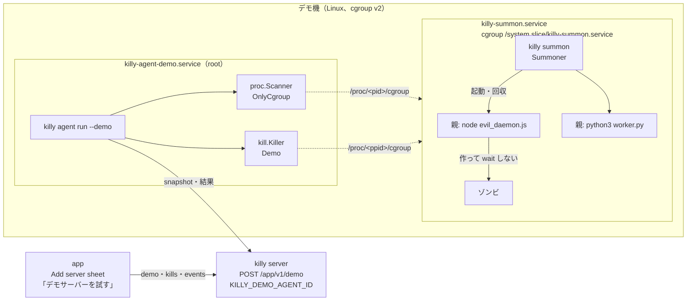
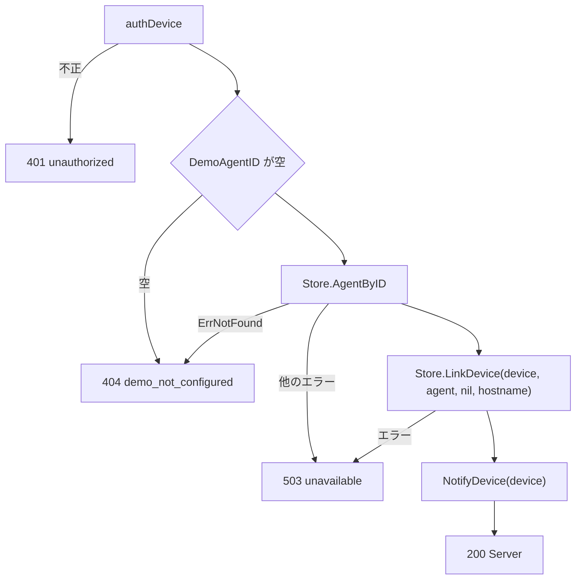

# Design: demo-environment

## Overview

デモ機で動く 2 つの systemd の service と、それを app から使えるようにする Killy server と app の小さな追加でできている。`killy summon`（新しい `internal/summon`）が、自分とは別のプロセスとしてゾンビの親を作り続ける。`killy agent run --demo` は、M1 の `proc.Scanner` と `kill.Killer` に cgroup の確認を 1 つ足したもので、summon の cgroup に属する親だけを報告し、kill する。Killy server は `POST /app/v1/demo` で、`KILLY_DEMO_AGENT_ID` の agent を claim と同じ紐付けで device に付ける。app は Add server sheet にそのボタンを足す。

公開デモで守ること（summon の親しか kill しない）は agent だけが担う。Killy server と app は、通常のサーバーと同じ経路（表示・kill・削除・接続確認）でデモを扱い、デモのための分岐を持たない（#24）。

手順の正は [ARCHITECTURE: Kill procedure](../../../docs/ARCHITECTURE.md#kill-procedure) と [Demo environment](../../../docs/ARCHITECTURE.md#demo-environment)。この文書には、それをどの部品に割り当てるかと、テストの方法だけを書く。

## Architecture



図から読み取ること：summon の親とそのゾンビは summon の cgroup の中にいて、agent はその外から `/proc` で cgroup を読む。summon 由来かを確かめるのは agent の 2 か所（報告の前と kill の直前）だけで、Killy server と app は確かめない。

## Components and Interfaces

### `killy summon`（Requirement 1、#22）

`internal/summon` に置き、`cmd/killy` の `summon` の入口（M1 では `not implemented yet`）から呼ぶ。

```go
package summon

const (
    MaxParents = 3
    Interval   = 2 * time.Minute
)

// Commands are the command lines a demo parent shows.
var Commands = [][]string{
    {"node", "evil_daemon.js"},
    {"python3", "worker.py"},
    {"ruby", "cron_runner.rb"},
    {"php", "queue_worker.php"},
}

type Process interface{ Wait() error }

type Summoner struct {
    Start func(argv []string) (Process, error) // 親を 1 つ起動する。本番は ExecStart
    Pick  func(n int) int                       // 候補を選ぶ。本番は math/rand/v2.IntN
    Log   *slog.Logger
}

func (s *Summoner) Tick()                                    // 生きている親が MaxParents 未満なら 1 つ作る
func (s *Summoner) Alive() int                               // 生きている親の数
func (s *Summoner) Run(ctx context.Context, ticks <-chan time.Time) // ticks ごとに Tick
```

| 項目 | 選択 | 理由 |
|---|---|---|
| コマンド名の候補 | 上の `Commands` の 4 つ。選ぶのは `Pick(len(Commands))`（M2 の spec の確認で sumire が決めた） | ARCHITECTURE と #22 の例（`node evil_daemon.js`・`python3 worker.py`）に、同じ形のものを 2 つ足した。battle 画面で本物のサーバーと同じように読める |
| 間隔 | `Run` は `ticks` を受け取り、`cmd/killy` が M1 の `every(ctx, summon.Interval)` を渡す。テストは `Tick` を直接呼ぶ | 間隔をテストから与える（#22 の完了条件 1）。`Reporter.Tick` と同じ形 |
| 起動直後 | `every` は最初の値をすぐ送るので、summon は起動直後に親を 1 つ作り、その後 2 分ごとに作る（M2 の spec の確認で sumire が決めた） | デモ機の再起動の後、2 分待たずに敵が出る。PRD UC7 の「たいてい 1 つはいる」に近づく |
| 回収 | 親を起動するたびに goroutine で `Wait` し、戻ったら生きている数を減らす。`Tick` と数は mutex で守る | 回収しないと summon 自身が自分の cgroup の中で「ゾンビを持つ親」になり、公開デモの敵として現れ、kill されるとデモが止まる（#22、D18 c） |
| 親の作り方 | `ExecStart` は `/proc/self/exe`（killy 自身）を、`argv` をコマンド名にして起動し、役を環境変数 `KILLY_SUMMON_ROLE=parent` で伝える。`main` は `run` の前にこの変数を見て、`parent` なら `summon.RunParent`、`zombie` ならすぐに終了する（M2 の spec の確認で sumire が決めた） | `/proc/<pid>/cmdline` が `node evil_daemon.js` のように読める。デモ機に node や python を入れずに済む。agent が summon 由来を確かめるのは cgroup で、この変数は確認に使わない（#22、#23） |
| ゾンビの作り方 | 親（`RunParent`）は、`/proc/self/exe` を `KILLY_SUMMON_ROLE=zombie` で起動し、`Wait` しない。子はすぐに終了してゾンビになる | Go は fork だけをできないので、子も exec で作る。外のコマンドに頼らない |
| 親ごとのゾンビ | 起動時に 2〜4 体（`Pick` で選ぶ）、その後 30 秒ごとに 1 体ずつ足し、6 体で止める（#22 の PR で決めた。`FirstZombies`・`ExtraFirstZombies`・`MaxZombies`・`ZombieInterval`） | 数はどの文書にも無く、#22 が PR で決めることにしている。案の理由：DESIGN の battle 画面のゾンビの枠が 6 つで、それを超えると `+N` の表示になる。デモの途中で「新しいゾンビが現れる」動き（PRD UC3 の代替フロー）も見せられる。上限で、デモ機のプロセス表を 3 × 6 = 18 体までに抑える |
| 親の寿命 | 親は自分では終わらない。kill されるか、summon の service が止まると終わる | 生きている親が 3 つで止まり、kill されるたびに次の間隔で補われる |
| summon は signal を送らない | summon のコードは親にもゾンビにも signal を送らない。service を止めると systemd が cgroup ごと止める（既定の `KillMode=control-group`） | signal を送る呼び出しを agent の 1 か所に保つ（agent-process-control の Requirement 2.16）。止めるのは systemd に任せる |
| 失敗 | 親やゾンビを起動できなければログに出し、次の間隔でまた試す | summon が止まるとデモが止まる |

#### `deploy/systemd/killy-summon.service`

| 項目 | 選択 | 理由 |
|---|---|---|
| `ExecStart` | `/usr/local/bin/killy summon` | バイナリの置き場所を #33 と揃える（D14 a） |
| 実行するユーザー | `DynamicUser=yes`（root で動かさない）（M2 の spec の確認で sumire が決めた） | summon と親は特権が要らない。cgroup は unit で決まるので、ユーザーを変えても `/system.slice/killy-summon.service` のまま。root の agent は他のユーザーのプロセスを kill できる |
| 再起動 | `Restart=always`、`RestartSec=5s`（M2 の spec の確認で sumire が決めた） | summon が落ちるとデモに新しい親が出なくなる |
| cgroup | `Delegate=` を付けない（子の cgroup を作らせない） | 親が `…/killy-summon.service/<sub>` に入ると、#23 の完全一致に通らない |
| `WantedBy` | `multi-user.target` | デモ機の再起動の後も起動する（#34） |

### demo mode の agent（Requirement 2、#23）

#### `internal/protocol`

`ReasonNotDemo = "not_demo"` を refused の理由に足す（app は M1 で `reasonNotDemo` の訳を持っている）。

#### `internal/proc`

```go
// SummonCgroup is the cgroup v2 path of killy-summon.service; demo mode kills only its processes.
const SummonCgroup = "/system.slice/killy-summon.service"

// ErrNoUnifiedCgroup means /proc/<pid>/cgroup has no "0::" line (cgroup v1 only).
var ErrNoUnifiedCgroup = errors.New("no cgroup v2 line")

type Scanner struct {
    Root fs.FS
    // OnlyCgroup, when set, makes Scan return only parents whose cgroup v2 path is exactly this.
    OnlyCgroup string
}

func (s *Scanner) InCgroup(pid int, path string) (bool, error)
```

| 項目 | 選択 | 理由 |
|---|---|---|
| 読む場所 | `Scanner.Root` の `<pid>/cgroup`。`0::` で始まる行の残りを path とし、`path` と `==` で比べる | #23 の内容。比べる処理を `InCgroup` の 1 か所にし、報告と kill が同じ規則を使う。完全一致を末尾一致・前方一致に変えると、両方のテストが落ちる |
| 読めないとき | `InCgroup` はエラーをそのまま返す（プロセスが無ければ `fs.ErrNotExist` か `ESRCH` に当たる）。`0::` の行が無ければ `ErrNoUnifiedCgroup` | 呼ぶ側が「無い」と「読めない」を分けられる（Requirement 2.4・2.5） |
| 報告から除く | `OnlyCgroup` が空でなければ、`Scan` は親ごとに `cmdline` を読む前に `InCgroup` を呼び、`(true, nil)` 以外の親を結果から除く | 除いた親の command line を読まないので、公開デモに出ない（D7）。報告の部分は `Reporter` を変えずに済む |
| 依存 | Go の標準ライブラリだけ | kill の処理の一部（[ARCHITECTURE: Go dependencies](../../../docs/ARCHITECTURE.md#go-dependencies)） |

#### `internal/agent/kill`

`Killer` に `Demo bool` を足す。`check` の最後（ゾンビの子と保護対象の確認の後、ゾンビの一覧を返す前）に、`Demo` のときだけ次を行う。並びは ARCHITECTURE の手順 4 の項目の順と同じ。

```go
if k.Demo {
    in, err := k.Proc.InCgroup(cmd.PPID, proc.SummonCgroup)
    switch {
    case gone(err):
        return nil, &protocol.Outcome{Outcome: protocol.AlreadyGone}
    case err != nil || !in:
        o := refused(protocol.ReasonNotDemo)
        return nil, &o
    }
}
```

| 項目 | 選択 | 理由 |
|---|---|---|
| 確かめる時点 | pidfd を開いた後、`SendKill` の前（手順 4） | kill の要求を受けた時点だけで確かめると、確かめた後に相手が入れ替わる余地が残る。pidfd は確かめた相手を指したまま（#23） |
| 読めないとき | 対象が無い（`gone(err)`、手順 3 の `stat` と同じ判定）なら `already_gone`、それ以外のエラーと `ErrNoUnifiedCgroup` は `not_demo`。どちらも signal を送らない | sumire が決めた（#15）。由来を確かめられない親を kill しない。同じ PR で、この扱いを ARCHITECTURE と ARCHITECTURE.ja.md の Kill procedure の 4 に書き足す（#23） |
| 通常の agent | `Demo` が false なら cgroup を読まない | 通常の agent は由来を確かめず、すべての親を報告する（#23） |
| 環境変数 | `environ` は読まない | agent に `CAP_SYS_PTRACE` が要らない（#23） |

#### `cmd/killy`

`killy agent run` に `--demo` を足す。`--demo` のとき、`proc.Scanner` の `OnlyCgroup` に `proc.SummonCgroup` を入れ、`kill.Killer` の `Demo` を true にし、起動時に `demo mode` とログに出す。この 2 つを組み立てる処理を関数（`newAgentParts(demo bool, root fs.FS, …)`）に切り出し、`--demo` で両方が設定されることを `cmd/killy` のテストで確かめる（片方だけ設定し忘れると、報告と kill の規則が食い違うため）。

#### `deploy/systemd/killy-agent-demo.service`

| 項目 | 選択 | 理由 |
|---|---|---|
| `ExecStart` | `/usr/local/bin/killy agent run --demo`、root で動かす | 他のユーザーのプロセスに signal を送るため（[ARCHITECTURE: Kill procedure](../../../docs/ARCHITECTURE.md#kill-procedure) の後の段落）。置き場所は #33 と揃える |
| 通常用との同時起動 | `Conflicts=killy-agent.service` を付ける（M2 の spec の確認で sumire が決めた） | 同じ `/etc/killy/agent.json` で demo mode でない agent が動くと、summon 以外の親も公開デモに出て kill できる（#34 の制約） |
| 再起動 | `Restart=always`、`RestartSec=5s`（M2 の spec の確認で sumire が決めた） | summon の unit と揃える |
| `WantedBy` | `multi-user.target` | デモ機の再起動の後も起動する（#34） |

### 公開デモの追加（Requirement 3、#24）

#### Killy server

`Server` に `DemoAgentID string` を足し、`POST /app/v1/demo` を（新規）`internal/server/demo.go` の `addDemoServer` で受ける。



| 項目 | 選択 | 理由 |
|---|---|---|
| 公開デモの agent | `cmd/killy/server.go` が起動時に `KILLY_DEMO_AGENT_ID` を読み、`Server.DemoAgentID` に入れる | agent が自分でデモと名乗る方法は、誰でも agent を登録できるので採らない（#24、#1 の D10） |
| 形の違う値 | 起動時に `uuid.Parse` で読めなければ、ログに出して未設定と同じに扱う（`404`）。読めたら小文字の形（`uuid.UUID.String()`）にして使う（M2 の spec の確認で sumire が決めた） | PostgreSQL は uuid の列に UUID でない文字列を渡すとエラーを返すので、そのままだと `503` になり、存在しない agent（`404`）と扱いが分かれる。memstore は文字列で比べるので、テストではこの違いが出ない |
| 紐付け | claim と同じ `LinkDevice`（`name` は nil、`fallback` は agent の hostname）。2 回目は表示名も通知の設定も変えない | 通常のサーバーと同じ経路で、表示・kill・削除・接続確認が動く（#24） |
| 本文 | 読まない（openapi に requestBody が無い） | — |
| `state` | 紐付けた後に `NotifyDevice(device.ID)`。他の device には送らない | claim と同じ（relay-and-pairing の Broker） |
| 回数制限 | 掛けない | [ARCHITECTURE: Rate limits](../../../docs/ARCHITECTURE.md#rate-limits) に無い。1 回の呼び出しは紐付けを 1 つ upsert するだけで、kill は既存の device ごとの制限が掛かる |
| デモの親の確認 | しない | デモ機で kill できるのは summon の親だけで、それは agent が守る。Killy server に確認を重ねて作らない（#24 の制約） |

複数の来訪者が同じ親を kill したとき：Killy server は ID の違う kill をそれぞれ agent に送る。agent は同じ `(ppid, starttime)` への kill を 1 つずつ処理し、kill された後で回収前の親も `already_gone` にする（agent-process-control の Requirement 2.15、D18 a・b）。そのため Killy server に新しい処理は要らない。

#### app

```ts
interface KillyClient {
  // …M1 のもの
  addDemoServer(): Promise<Server>; // ClaimError: demo_not_configured | unreachable | not_registered | other
}
```

| 項目 | 選択 | 理由 |
|---|---|---|
| エラーの型 | `ClaimError` の `ClaimErrorKind` に `demo_not_configured` を足し、`addDemoServer` も `ClaimError` を投げる。`error` が `demo_not_configured` のときだけその種類にし、届かなければ `unreachable`、それ以外（`unauthorized`・`unavailable`・JSON でない応答）は `other` | Add server sheet の `claimMessages` の表 1 つで文言を選べる。`other` は M1 の `pairFailed`、`unreachable` は `pairUnreachable`（#24、#12） |
| ボタン | フォームの下（「キャンセル」「追加する」の下）に、モックの `.ghost-btn`（幅いっぱい、高さ 44、角丸 12、1px の `line` の枠、背景なし）の見た目で「デモサーバーを試す」。#18（「QR コードを読み取る」）と #24 の先に着手したほうが副ボタンの部品を作り、後のほうはそれを使う | DESIGN の 5 は secondary button。モックで同じ種類のボタンは「QR コードを読み取る」の `.ghost-btn` で、#18 も Add server sheet に同じ副ボタンを足す |
| 押せる時 | フォームの状態で、device の登録が途中（`registration === 'pending'`）でない間。コードの入力には関係しない | M1 の「追加する」と同じ。登録の途中は長くても 15 秒 |
| 登録できていないとき | 押すと何も送らず、`rate_limited` なら `deviceRateLimited`、それ以外なら `deviceNotRegistered` を sheet のエラーに出す | M1 の Add server sheet と同じ（`AddServerSheet.tsx`、#24） |
| 状態 | 「追加する」と同じ `Phase`（`adding` → `added`）を使い、「追加しています…」（`pairing`）、「‹name› を追加しました」（`paired`）を出して `addedFor`（1.3 秒）で閉じる。名前は応答の `name` | DESIGN の Add server sheet の状態はデモにも当たる（#24） |
| 文言 | `tryDemo`（「デモサーバーを試す」/「Try the demo server」）と `demoNotConfigured`（「デモサーバーは今使えません」/「The demo server is not available right now」）を `ja.json`・`en.json` に足す | 翻訳ファイルが文言の正（DESIGN の冒頭）。文言は DESIGN と #24 のとおり |

## Error Handling

| 起きたこと | 扱い |
|---|---|
| summon が親かゾンビを起動できない | ログに出し、次の間隔でまた試す。親の数は増やさない |
| summon の親が終わる（kill・異常終了） | すぐに `Wait` で回収し、生きている数を減らす。次の間隔で補う |
| demo mode で `/proc/<ppid>/cgroup` が無い（対象が終わった） | signal を送らず `already_gone` |
| demo mode で `/proc/<ppid>/cgroup` が読めない（対象はある）、または `0::` の行が無い | signal を送らず `refused` / `not_demo` |
| demo mode の走査で、親の cgroup が読めない | その親を snapshot に入れない。走査全体は失敗させない |
| `KILLY_DEMO_AGENT_ID` が未設定 | `POST /app/v1/demo` は `404`（`demo_not_configured`）。Killy server は起動する |
| `KILLY_DEMO_AGENT_ID` の agent が DB に無い | `404`（`demo_not_configured`）。紐付けを作らない |
| `POST /app/v1/demo` の途中で DB に届かない | `503`（`unavailable`）。app は `pairFailed` |

## Testing Strategy

- **書く順**：各 Acceptance Criteria のテストを先に書き、最小のスタブで期待した理由の赤を確かめてから実装する（testing スキル）
- **summon**：`Start` を偽物にし、偽物の親の `Wait` をテストが終わらせる。`Tick` を直接呼んで、3 つで止まること、1 つ終わって `Alive()` が 2 になった後の `Tick` で作ることを確かめる。`Pick` を差し替えて、違う値で違うコマンド名が選ばれることを確かめる。回収（Requirement 1.6）は `//go:build linux` のテストで、test binary を親の役として本物の親を起動する（`TestMain` が `KILLY_SUMMON_ROLE` を見て親・ゾンビの役をする）。テストから親に `SIGKILL` を送り、親が回収されて test のプロセスの子として状態 `Z` で残らないことを `/proc` で確かめる。signal を送るのはテストのコードだけ
- **cgroup の確認（kill）**：M1 の偽の /proc（`internal/agent/kill/world_test.go`）に、プロセスごとの cgroup のファイルの中身、読み取りを失敗させるエラー、cgroup を読む直前に親を消す差し込みを足す。Requirement 2.3 の 4 つの cgroup と 2.4・2.5 の読めない場合を、それぞれ 1 テストにし、`SendKill` が 0 回であることを見る（M1 の `assertNoSignal`）
- **cgroup の確認（報告）**：`internal/proc` の `fakeRoot` に cgroup のファイルを足し、`OnlyCgroup` があるときに Requirement 2.3・2.4 の親が `Scan` の結果に入らないこと、無いときに入ることを確かめる。`--demo` で `OnlyCgroup` と `Demo` の両方が設定されることは `cmd/killy` のテストで見る
- **ミューテーション確認**：Killer の cgroup の確認を取り除くと Requirement 2.3 のテストが落ち、`InCgroup` の `==` を末尾一致（`strings.HasSuffix`）に変えると user unit のテストが、前方一致（`strings.HasPrefix`）に変えると名前に文字を足したもののテストが落ちることを確かめ、PR 本文に書く（#23 の完了条件 6）
- **`POST /app/v1/demo`**：M1 の `newTestServer`（`internal/server/pairings_test.go`）に `DemoAgentID` を入れて確かめる。2 回目の前に `memstore.Memory.SetLink` で表示名と通知の設定を変え、2 回目の後もそのままであることと、`Links()` が 1 つであることを見る。2 台の device の event stream を開き、紐付けた device にだけ `state` が届くことを見る（relay-and-pairing の Requirement 4.3 の仕組み）
- **2 人の来訪者**：`internal/relaytest` の形で、Killy server と `CommandClient` をつなぎ、`Killer` を `Demo: true` にして偽の machine に summon の cgroup のファイルを足す。2 台の device を `POST /app/v1/demo` で紐付け、ID の違う kill を順に送る場合と同時に送る場合で、`killed` と `already_gone` が 1 つずつで、`SendKill` が 1 回であることを見る
- **app**：M1 の `FakeServer` で `POST /app/v1/demo` の応答を与え、成功・`demo_not_configured`・届かない・`unauthorized`・`unavailable`・JSON でない応答の文言と、登録できていないときに `FakeServer.count('POST /app/v1/demo')` が 0 であることを確かめる。翻訳のキーの一致は M1 の `i18n.test.ts` が確かめる
- **並行**：`go test -race ./...`
- **Linux の実機**：`killy-summon.service` の親の cgroup（#22 の完了条件 4）、summon と `killy agent run` で snapshot に親が 3 つまで入ること（#22 の 5）、`killy-agent-demo.service` で summon 由来でない親が snapshot に出ず `curl` の kill が `not_demo` になること（#23 の 7）、ローカルの Killy server と実機かエミュレータで「デモサーバーを試す」から追加して kill すること（#24 の 5）を、それぞれの PR 本文に書く
