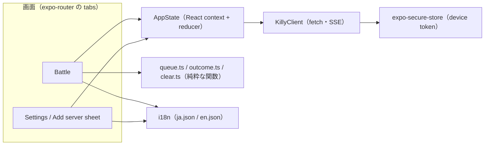

# Design: mobile-battle-slice

## Overview

`mobile/` に Expo（TypeScript）の app を作る。画面の振る舞いの多く（列の並べ方、outcome ごとの扱い、All clear の数え方、再接続の待ち時間）は、React に依存しない純粋な関数にして、画面のテストとは別に確かめる。通信（device の登録、claim、SSE、kill）は 1 つの `KillyClient` にまとめ、テストでは偽物に差し替える。

ライブラリの正は [ARCHITECTURE: Mobile app](../../../docs/ARCHITECTURE.md#mobile-app)。ここに無い選択は、この文書と各 PR に理由を書く。

## Architecture



図から読み取ること：画面は `AppState` と純粋な関数しか見ず、Killy server と話すのは `KillyClient` だけである。

## Components and Interfaces

### 設定と起動（Requirement 1）

| 項目 | 選択 | 理由 |
|---|---|---|
| Expo SDK | 58（`expo` ~58.0.25、React Native 0.88.1、React 19.3.0）。#11 の着手時点の `latest` | ARCHITECTURE の「current SDK」 |
| アプリの ID | iOS の bundle identifier と Android の package は `pink.sumire.killy` | Killy server の `killy.sumire.pink` を逆にした。EAS（#32）で登録するときに変えるなら、そのときに |
| 画面の切り替え | `expo-router` の tabs | Expo の標準。後の通知からの起動（#20）も URL で開ける |
| 接続先 | `EXPO_PUBLIC_KILLY_SERVER_URL`（http か https）。無ければ起動時にエラー画面で、どこにも何も送らない。Expo は build のときに値を埋め込むので、読むのは `buildServerURL()` の 1 か所だけにし、画面のテストではこの関数を差し替える | build ごとに staging と production を分けられる。app はこの Killy server にだけ接続する（ARCHITECTURE Pairing の QR） |
| 翻訳 | `expo-localization` で端末の言語を取り、`ja.json`・`en.json` を引く小さな `t()` を自前で持つ | 2 言語と置き換えだけなので、ライブラリを足さない |
| フォント | Geist・Geist Mono・Zen Kaku Gothic New を `@expo-google-fonts/*` と `expo-font` で読む（読み終わるまで splash を出したまま） | DESIGN の Design tokens |
| タブ | `expo-router` の JS の `Tabs`（native tabs ではなく）。アイコン（幽霊と歯車）は M3 のアート（#26）で足し、#11 は文字だけ | DESIGN の Tab bar の色と高さを自分で付けるため |
| テスト | `jest-expo` と `@testing-library/react-native` | Expo の標準の組み合わせ |

翻訳のキーは `mock/app.js` の `I18N` のキーをそのまま使う。移した時点で翻訳ファイルが文言の正になる（DESIGN の冒頭）。

除外するキー（モックのロック画面の再現と、モック操作の文言。app では使わない）：`lockDate`、`now`、`pushText`、`tapToOpen`、`mock` で始まるキー（`mockTitle`・`mockNote`・`mockSpawn`・`mockTarget`・`mockAddParent`・`mockOffline`・`mockReset`・`mockLock`・`mockFailPair`）。push の文面は Killy server が作る（DESIGN: Push notification）。

### KillyClient（Requirement 2・3）

```ts
interface KillyClient {
  registerDevice(): Promise<{ deviceToken: string }>;           // 429 は RateLimited
  claim(code: string, name?: string): Promise<Server>;           // ClaimError: code_unknown | code_used | code_expired | rate_limited | unreachable | other
  events(onState: (s: State) => void): Unsubscribe;              // 再接続は内側で行う
  kill(req: { id: string; serverId: string; ppid: number; starttime: number }): Promise<KillResult>;
}
```

- エラーは本文の `error` で見分ける。値と status の正は [openapi.yaml](../../../docs/openapi.yaml)
- SSE の受信は `expo/fetch`（Expo が global の `fetch` に入れている）の streaming で読み、`SSEParser` で行に分ける。`react-native-sse` は足さない：最終の公開が 2024-03 の 1.2.1 で、XHR の上に作られていて、Killy server が送る形（名前付きの event、1 行の data、コメント行）だけなら数十行で読めるため
- 再接続の待ち時間は `backoff(n, rand)` の純粋な関数にする（1・2・4・8・16・30・30 秒の基準値に、基準値の 0〜25% 未満の揺らぎを足す。agent の再接続と同じ幅）。つながって 200 が返ったら次の待ちは 1 秒から。200 以外の応答（`401`・`503` など）も切断と同じに待つ
- device token が無い間（登録の失敗、`429`）は stream を開かない。登録は起動ごとに 1 回だけ試す
- 保存した token を読めなかったとき（iOS は端末のロック中に読めない）は新しく登録せず、登録の失敗として扱う。上書きすると、その token に紐付いたサーバーがすべて消えるため
- 登録の途中は「追加する」を押せない（長くても要求の待ちの 15 秒）
- stream が 60 秒何も送ってこない（20 秒ごとの heartbeat も無い）ときは切ってつなぎ直す。切れたことに気づかない接続で、古い状態を出し続けないため。agent の命令の stream と同じ長さ
- 応答が 15 秒無い要求（stream を除く）は届かないとして扱う。Add server sheet が待ち続けないため
- テストでは `makeDeps()`（fetch・token の保存先・乱数）を差し替え、Killy server の代わりに `FakeServer` を置く。要求が送られないことは `FakeServer` が受けた要求の数で見る
- `kill` は応答が得られないときだけ同じ `id` で 1 回送り直す。`429` やほかの応答では送り直さない
- kill ID は `expo-crypto` の `randomUUID()` で作り、小文字にそろえる

### Add server sheet（Requirement 2）

| 項目 | 選択 | 理由 |
|---|---|---|
| コードの入力 | NFKC で正規化してから大文字にし、英大文字と数字以外を落として 6 文字で切る。キーボードは iOS で `ascii-capable`、Android で `visible-password` | 日本語のキーボードは全角で入力し、変換中の文字を重ねる。実機（シミュレーター）で `ａ３ｅ` のように入った |
| claim の失敗の文言 | `code_unknown`・`code_used`・`code_expired` は同じ 1 つ（`pairError`。`killy agent pair` をもう一度実行する）、`rate_limited` は `pairRateLimited`、届かない は `pairUnreachable`、ほか（`invalid_request`・`unauthorized`・`unavailable`・JSON でない応答）は `pairFailed` | 3 つのコードの失敗は、どれも operator がすることが同じ |
| 登録できていないとき | 「追加する」を押すと何も送らず、`429` なら `deviceRateLimited`、それ以外（届かなかったなど）なら `deviceNotRegistered` を sheet のエラーに出す。`429` は起動直後の Battle にも出す | Requirement 2.2・2.3 |
| 追加できたとき | 「‹name› を追加しました」を 1.3 秒出して閉じる。名前は claim の応答の `name` | DESIGN。Killy の絵は #27 |
| キーボード | `KeyboardAvoidingView` の `padding` を両 OS で | Android は Modal の窓が縮まず、キーボードが「追加する」を隠した |

### AppState

`state`（Killy server から受け取った丸ごとの状態）、接続の失敗の有無、battle の進み（隠している親、この battle の `killed` の記録、要求の途中か）を持つ。`state` を受け取るたびに丸ごと置き換え、隠している親のうち新しい `state` に無いものは隠すのをやめる。

### 純粋な関数

| 関数 | 決めること | Requirement |
|---|---|---|
| `buildQueue(state, hidden)` | 接続しているサーバーの親を最初の検出時刻の古い順に並べ、隠している `(サーバー, pid, starttime)` を除く。同じ時刻なら、サーバーの id、pid、starttime の順で比べる（1 つの snapshot で見つかった親は同じ時刻になるため、決めておかないと `state` のたびに先頭が入れ替わる） | 3.1, 3.2, 3.4, 3.12 |
| `applyOutcome(battle, parent, result)` | outcome ごとの表示の種類と、列から隠すか | 3.8, 3.9, 3.10, 3.11, 3.12 |
| `allClear(battle)` | `killed` の親の数と、kill を始めた時点のゾンビの数の合計 | 3.13 |
| `serverRow(server)` | Settings のサーバーの行の sub-line とバッジ。切断を先に見る | 2.12, 2.13, 2.14 |

### battle の区切り

battle は、列が空から 1 つ以上に変わったとき（起動直後を含む）か、All clear を閉じたときに始まり、記録（`killed` の親とゾンビの数）を空にする。All clear を出すのは、`killed` か `already_gone` の直後に列が空になったときだけにする。出した時点の 2 つの数を overlay に固定し、表示している間は新しい battle を始めない（閉じた時点で列に親がいれば、そこから始める）。外で回収されたり、サーバーが切断したりして列が空になったときは、All clear を出さずに空の状態を出し、記録を捨てる。モックも最後の kill の後にだけ All clear を出す。

### 長押し

`useHoldToKill(onFire, clock)`：押した時刻から 1000 ms たったら 1 回だけ `onFire` を呼ぶ。1000 ms より前に離されたら何もしない。時刻はテストから与える。

## Error Handling

| 起きたこと | 扱い |
|---|---|
| 接続先の設定が無い | 起動時のエラー画面。何も送らない |
| device の登録が失敗 | `429` ならその旨を出し、次の起動でやり直す。届かなければ Add server sheet のエラーで知らせる |
| SSE が切れた | 最後の状態を出し続け、`backoff` で再接続する |
| kill の応答が得られない | 同じ ID で 1 回送り直し、それも失敗したらボタンの下に赤い行 |

## Testing Strategy

- **書く順**：各 Acceptance Criteria のテストを先に書き、期待した理由の赤を確かめてから実装する
- **純粋な関数**：表の 1 行を 1 テストにする（outcome の表、サーバーの行の 3 つの状態、列の並べ方と隠し方、All clear の数え方）
- **画面**：`@testing-library/react-native` で、偽物の `KillyClient` をつないで確かめる。要求が送られないことは、偽物が受けた呼び出しの回数で見る
- **時刻**：長押しの 1000 ms と再接続の待ち時間は、jest の fake timers か `clock` の差し替えで確かめる
- **翻訳**：`ja.json` と `en.json` のキーの集合が一致することと、`mock/app.js` の `I18N` のキー（除外分を除く）を含むことをテストする
- **実機**：iOS と Android の development build で、ローカルの Killy server に `killy agent pair` のコードで追加し、Linux 上の実際のゾンビの親を長押しで kill して All clear まで進む（M1 の完了の確認）
