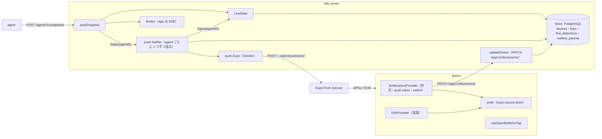
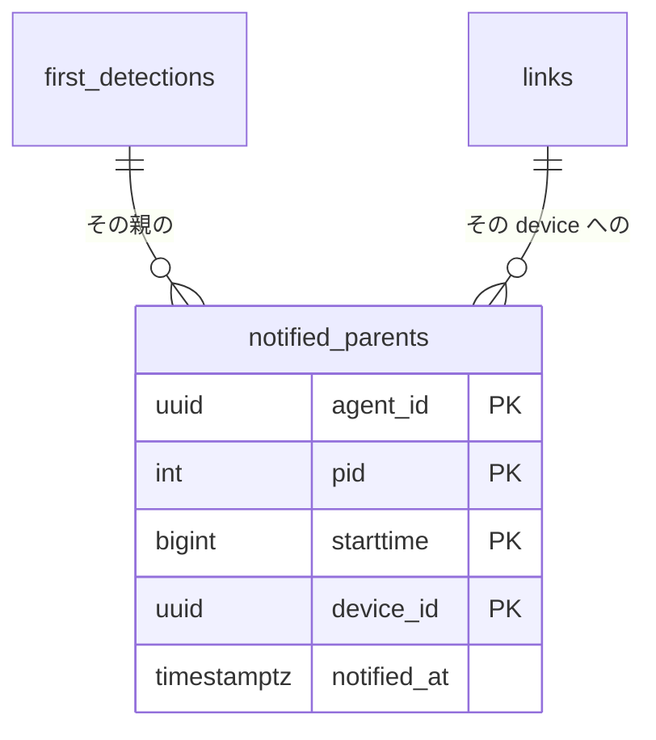

# Design: notifications-and-settings

## Overview

Killy server は、snapshot を受け付けるたびに、その agent の担当の送り手（`push.Notifier`）を起こし、送り手は snapshot の応答とは別に、まだ通知していない親と device の組を Expo Push Service に送る。通知済みの記録は PostgreSQL の新しい table に持ち、first_detections と links に外部キーでつなぐので、親が消えたときの記録の削除は、M1 の `SyncFirstDetections` の transaction の中で起きる。

app は `expo-notifications` で push token を取って `PATCH /app/v1/devices/me` で登録し、アプリ全体の switch と言語を `expo-secure-store` に保存する。OS の API は `Deps` の向こうに置き、テストでは偽物に差し替える（mobile-battle-slice と同じ形）。

送る規則の正は [ARCHITECTURE: Notifications](../../../docs/ARCHITECTURE.md#notifications)、文面の正は [DESIGN: Push notification](../../../docs/DESIGN.md#push-notification)。ここには部品の分け方、table、決めたこととその理由、テストの方法を書く。

## Architecture



図から読み取ること：push を送るのは `push.Notifier` だけで、snapshot の handler は起こすだけで待たない。app で端末に値を保存するのは `prefs` だけである。

## Components and Interfaces

### EAS の project と認証情報（Requirement 1）

この Requirement の作業の多くは sumire が account で行う。#20 を始めてよい条件は、Requirement 1 の Acceptance Criteria がすべて満たされていること。

| 項目 | 選択 | 理由 |
|---|---|---|
| project | sumire が `mobile/` で `eas init` を実行し、`extra.eas.projectId` を `app.json` に入れる | `projectId` は秘密ではない（#65）。app は `expo-constants` からこの値を読んで push token を取る（Requirement 3） |
| iOS | APNs の key を `eas credentials` で EAS に登録する（sumire） | key は EAS にだけ置き、リポジトリにもチャットにも書かない（#65） |
| Android | FCM V1 の service account の key を `eas credentials` で EAS に登録する（sumire）。JSON は渡した後に手元から消すか、`mobile/` の外に置く | `mobile/.gitignore` はこの JSON を除外していない（#65） |
| `google-services.json` | `app.json` の `android.googleServicesFile` に置き場所を書く。リポジトリに入れるかは #65 の PR で決める | 中身は Firebase の client の設定で、server の秘密ではない（#65）。`app.json` は静的な JSON で環境変数を読めないので、入れないときは、development build を作る人が同じ置き場所にファイルを置く手順を PR 本文に書く |
| development build | `npx expo prebuild --clean` で `ios/`・`android/` を作り直し、`npx expo run:ios`・`npx expo run:android` で起動する | `ios/`・`android/` は git に入れず、`app.json` が native の設定の正（#65）。手元の古い native の設定を残さないため |
| 配布用の build | #32 は、ここで作った project と認証情報をそのまま使う | #65 の決定 |

`expo-notifications` の plugin は #20 で足す（#20 の制約）。そのため #65 の build ではまだ push token を取らない。

### push.Notifier（`internal/server/push`、Requirement 2）

`postSnapshot` は `Live.Report` が snapshot を反映したとき（`applied`）だけ、`notifyAgent` の後に `s.Pushes.Wake(agent.ID)` を呼ぶ。捨てた snapshot では呼ばない（Requirement 2.21）。

| 項目 | 選択 | 理由 |
|---|---|---|
| 起こし方 | `Wake(agentID)` は待たずに戻る。その agent の送り手が動いていなければ goroutine を 1 つ始め、動いていれば「もう一度」の印だけを付ける。送り手は印が無くなるまで、`Live.Agent(agentID)` の最新の親で 1 回ずつ送る | snapshot の応答を Expo で待たせない（#19 の完了条件 10）。同じ agent の 2 つの snapshot で同じ組を同時に送ると、記録する前に二度送るため、agent ごとに 1 つずつにする。合図を 1 つにまとめるのは `Broker` と同じ考え（どうせ最新の親を丸ごと見る） |
| 送る相手 | `PushTargets(agentID)`（push token があり、`devices.notify` と `links.notify` が両方 true の device と、その device での表示名）から、`NotifiedOf(agentID)` にある組を除く | ARCHITECTURE Notifications の規則。後から紐付けた device と switch を on に戻した device は、まだ記録が無いので、次の snapshot で送られる（#19 の決定、Requirement 2.14） |
| 文面 | `{"to": <push token>, "title": "Killy", "body": "zombie ×<n> on <name>\n……！"}`。`<n>` は送る時点のその親のゾンビの数。`data` は付けない | DESIGN: Push notification と killy-character.md（system-log の行の後に Killy の記号だけ）。タップは常に Battle タブを開くので、親を app に渡す必要が無い |
| 音と優先度 | `"sound": "default"`、`"priority": "high"`（M2 の spec の確認で sumire が決めた） | 音が無いと iOS では鳴らずに届く。Android の既定の優先度（normal）は端末の省電力中に配信が遅れうるので、30 秒（PRD: Timeliness）を守りやすい high にする |
| まとめ方 | 1 回の送信で、全部の組を 100 件ずつの配列にして送る。ticket は送った順に並んで返る | Expo の push API の上限は 1 要求 100 件で、`data` の ticket は送った順（[Expo: Sending notifications](https://docs.expo.dev/push-notifications/sending-notifications/)） |
| ticket の扱い | `ok` → `RecordNotified`。`details.error` が `DeviceNotRegistered` → `ClearPushToken(deviceID, 送った token)`、その組は通知済みにも失敗にも数えない。それ以外のエラー → 失敗 | #19 の決定。receipt は取りに行かない |
| 要求そのものの失敗 | 通信の失敗、4xx・5xx、JSON でない応答、ticket の数が送った数と違う応答は、その要求に入れたすべての組の失敗 | #19 の決定。ticket と組を対応付けられないときは、どれも受け付けられたと言えない |
| 失敗の回数 | `push.Notifier` のメモリに、`(agentID, pid, starttime, 最初の検出時刻, deviceID)` ごとに数える。4 回目の失敗で `RecordNotified` し、送るのをやめる。Expo が受け付けたのに記録できなかった組（Error Handling）も同じ鍵で持つ。送るたびに、その agent の今の親に無い組の回数と印を消す | ARCHITECTURE Notifications（最初の送信の後、最大 3 回の送り直し）。最初の検出時刻を鍵に入れるのは、合図をまとめた間に親が消えて同じ `(pid, starttime)` で戻ったとき（first_detections は消えて作り直され、時刻が変わる）も、新しい回を 0 から数えるため |
| Expo の要求の待ち | 1 要求 10 秒で失敗とする（M2 の spec の確認で sumire が決めた） | 送り手は agent ごとに 1 つなので、止まった要求が後の通知を止め続けないため。失敗は次の snapshot（遅くとも 15 秒後）で送り直される |
| 宛先と認証 | `push.Expo` が `https://exp.host/--/api/v2/push/send` に送る。`EXPO_ACCESS_TOKEN` が空でなければ `Authorization: Bearer` に付ける。token はログに出さない | #19 の決定。Expo の push API は push security を有効にしない限り token を求めない |
| Go の依存 | 標準ライブラリ（`net/http`・`encoding/json`）だけで書き、ARCHITECTURE の Go dependencies に足さない | Expo の push API は JSON の POST 1 つ |
| 停止 | `killy server` の停止で、新しく送り手を起こさない。送っている途中の要求は context の取り消しで切る | Expo が受け付けた直後、記録する前に止まった 1 件は、再起動後にもう一度送られる。PRD が受け入れている例外 |

```go
// Sender is Expo Push Service; tests replace it.
type Sender interface {
	Send(ctx context.Context, msgs []Message) ([]Ticket, error)
}

// Store is what the notifier reads and writes; *store.Store (PostgreSQL) in production.
type Store interface {
	PushTargets(ctx context.Context, agentID string) ([]store.PushTarget, error)
	NotifiedOf(ctx context.Context, agentID string) ([]store.Notified, error)
	RecordNotified(ctx context.Context, agentID string, pairs []store.Notified) error
	ClearPushToken(ctx context.Context, deviceID, pushToken string) error
}
```

`push.New(clock, store, live, sender, log)` を `cmd/killy/server.go` で作り、`Server.Pushes` に入れる。`live` は `Agent(agentID) (live.Agent, bool)` を持つ interface で受ける。

### Store の追加（`internal/server/store`・`memstore`、Requirement 2）

migration `00004_notified_parents.sql`：



- `(agent_id, pid, starttime)` は `first_detections` を、`(device_id, agent_id)` は `links` を参照し、どちらも `ON DELETE CASCADE`
- 親が snapshot から消えると、`SyncFirstDetections` が first_detections の行を消し、同じ transaction の中で通知済みの記録も消える。Killy server が止まっている間に消えた親も、再起動後の最初の snapshot で同じように消える（Requirement 2.12・2.13）。新しい code は要らない
- 紐付けを外すと（#16）、その組の通知済みの記録も消える（Requirement 2.15）（M2 の spec の確認で sumire が決めた）

| メソッド | すること |
|---|---|
| `UpdateDevice(ctx, deviceID, pushToken *string, notify *bool) error` | nil の欄は変えない。`pushToken` があれば、同じ transaction の中で、同じ push token を持つ別の device の `push_token` を NULL にする（Requirement 2.16）。`server.Store` に足す（M2 の spec の確認で sumire が決めた） |
| `PushTargets(ctx, agentID) ([]store.PushTarget, error)` | `links` と `devices` を結び、`push_token IS NOT NULL AND devices.notify AND links.notify` の device の `{DeviceID, PushToken, Name}` を返す |
| `NotifiedOf(ctx, agentID) ([]store.Notified, error)` | その agent の通知済みの `{Parent ParentKey, DeviceID}` を返す |
| `RecordNotified(ctx, agentID, pairs) error` | 対応する first_detections と links の行がある組だけを入れ、すでにある組は何もしない（`ON CONFLICT DO NOTHING`）。送っている間に親が消えた、または紐付けが外れた組は、外部キーで失敗させずに捨てる |
| `ClearPushToken(ctx, deviceID, pushToken) error` | `push_token` が送った token と同じときだけ NULL にする。送っている間に app が登録し直した新しい token を消さないため |

`memstore` にも同じ規則を入れる：`DeviceRow` に `Notify`（初期値 true）を足し、first_detections の行を消すときと、紐付けを消すとき（#16 で足す `UnlinkDevice`）に通知済みの行も消す。テストが記録を見るための `Notified()` を足す。

### PATCH /app/v1/devices/me（`internal/server/devices.go`、Requirement 2）

| 項目 | 選択 | 理由 |
|---|---|---|
| 確かめる順 | device token（`401`）、本文（`400` `invalid_request`）、`UpdateDevice`（失敗は `503` `unavailable`）、`204` | M1 の handler と同じ順 |
| `push_token` の規則 | `registerDevice` の中の検証（`devices.go`）を関数に出し、両方で使う（空は不可、512 バイトまで） | 同じ値が入口によって通ったり拒まれたりしないため（#19 の決定） |
| `{}` と `null` の欄 | 何も変えずに `204`。`null` は欄が無いのと同じに扱う | openapi.yaml の `DevicePatch` に required の欄が無い。`POST /app/v1/devices` も `push_token` を `*string` で読み、`null` を無いのと同じに扱っている |
| state の送り直し | しない（`NotifyDevice` を呼ばない） | `state` にはアプリ全体の switch も push token も入っていない |
| push を起こすか | 起こさない。次の snapshot（遅くとも 15 秒後）で送る | #19 の決定（「次の snapshot で通知する」） |
| 回数制限 | 付けない | ARCHITECTURE の Rate limits に行が無い。device token が要り、変わるのはその device の行だけ |

同じ PR で、「受け付けた」は push ticket の `ok` のことで receipt は見ないこと、receipt にだけ出る `DeviceNotRegistered` には気づかないことを、`docs/ARCHITECTURE.md` と `docs/ARCHITECTURE.ja.md` の Notifications に書き足す（#19 の決定）。

### app の通知（`mobile/src/killy`、Requirement 3）

| 項目 | 選択 | 理由 |
|---|---|---|
| ライブラリ | `npx expo install expo-notifications`。`app.json` の `plugins` に足し、development build を作り直す | ARCHITECTURE: Mobile app。native module なので build を作り直す（#20 の制約） |
| OS の API の置き場所 | `Deps` に `notifications: NotificationsDeps` を足す：`permission()`（`granted` / `denied` / `undetermined`。iOS は `ios.status` で読み、`PROVISIONAL` と `EPHEMERAL` は `granted`）、`requestPermission()`、`pushToken()`、`onPushTokenChange(cb)`、`openSettings()`。`makeDeps()` が本物を作り、画面のテストは `makeDeps` を差し替える | M1 の `makeDeps()` と同じ形。iOS の許可は root の `status` より細かく、Expo は `ios.status` で読むよう案内している。今 `makeDeps` を差し替えているテストにも、この欄を足す |
| push token | `getExpoPushTokenAsync({ projectId })`。`projectId` は `Constants.expoConfig?.extra?.eas?.projectId`（Requirement 1） | Expo の手順（[Push notifications setup](https://docs.expo.dev/push-notifications/push-notifications-setup/)）。`expo-constants` は M1 で入っている |
| 許可を求める時点 | device の登録が済んだ起動で、許可が `undetermined` なら `requestPermission()` を呼ぶ（M2 の spec の確認で sumire が決めた） | Requirement 3.1 |
| Android の channel | plugin の `defaultChannel` を `default` にし、許可を求める前に `setNotificationChannelAsync('default', …)` で channel を作る。Killy server は `channelId` を付けない（入れたときに版の文書で確かめる） | Android 13 以降は channel が 1 つも無いと許可の画面が出ず、push token も取れない（[expo-notifications: Permissions](https://docs.expo.dev/versions/latest/sdk/notifications/#permissions)）。`channelId` の無い push は `defaultChannel` に届く |
| 登録 | `NotificationsProvider`（`KillyProvider` の内側）が、`registration === 'registered'` かつ許可が `granted` になったら、push token を取って `client.updateDevice({ pushToken })` を送る。`onPushTokenChange` のたびに Expo の push token を取り直し、前に送った値と違えば送る | #20 の内容（起動するたびと、変わったとき）。`onPushTokenChange` が渡すのは端末の token なので、Expo の token は取り直す |
| 登録の失敗 | 次の起動か push token の変化で送り直す。何も出さない（Requirement 3.5）（M2 の spec の確認で sumire が決めた） | 送り直す時点は #20 の決定（起動するたびと、変わったときに登録する）。何も出さないのは、失敗しても battle とサーバーの追加は使えるため |
| `KillyClient` | `updateDevice(patch: { pushToken?: string; notify?: boolean }): Promise<void>` を足す。`204` で成功、応答が無い・エラー・device token が無いときは `UpdateError`（`unreachable` / `not_registered` / `other`） | 今の `registerDevice` は push token を送らない（`client.ts`）。Killy server と話すのは `KillyClient` だけ（mobile-battle-slice の design） |
| アプリ全体の switch | 押すと新しい値を出し、要求の間は switch を押せなくして `{ notify }` を送る。成功したら `prefs.notify` に保存する。失敗したら元の値に戻し、`UpdateError` の種類ごとの文言を行の下に赤い行で出す。次に押したら消す | #20 の決定（失敗したら元に戻して理由を出す）。DESIGN の「失敗はそれが起きた場所で示す」 |
| 起動時の switch | `prefs.notify` を読んで出す。保存が無ければ on | #20 の決定（Killy server の初期値と同じ）。値を返す API は無い |
| OS のブロック | `permission()` が `denied` なら、行に `notifBlocked` とリンク（`openSettings()`）を出し、switch を `disabled` にする。`AppState` が `active` に戻るたびに確かめ直し、`granted` になっていれば登録する（Requirement 3.12）（M2 の spec の確認で sumire が決めた） | DESIGN: Settings tab。システム設定で変えて戻ったときに、古い表示を出し続けないため |
| 前面の push | `Notifications.setNotificationHandler` で `shouldShowBanner`・`shouldShowList`・`shouldPlaySound`・`shouldSetBadge` をすべて false にする。`src/killy/notifications.ts` の module の読み込み時に 1 回設定し、`_layout.tsx` が import する（入れたときに版の文書で確かめる） | #20 の決定（D6 3）。battle 画面はすでに最新の状態で動いている |
| タップ | `(tabs)/_layout.tsx` の `useOpenBattleOnTap()`：最初の描画で `getLastNotificationResponse()` を見て（動いていなかったとき）、`addNotificationResponseReceivedListener` で待つ（裏にあったとき）。どちらも `actionIdentifier` が既定の操作なら `router.navigate('/')` し、`clearLastNotificationResponse()` で消す（入れたときに版の文書で確かめる） | tabs の layout は splash（フォントと言語）の後に描かれるので、移る先の navigator がある。消さないと、次に layout を描いたときにもう一度移る |
| 開いている sheet | Settings が focus を失ったら（`useFocusEffect`）、Add server sheet と server sheet を閉じる（M2 の spec の確認で sumire が決めた） | sheet は `Modal` で、タブを移っても上に残り、Battle タブを隠すため |
| App のグループ | Settings の Servers の下に「アプリ」（`t('app')`）のグループを置き、「言語」（Requirement 4）と「通知」の行を並べる。#20 と #21 の先に着手したほうが作る | DESIGN: Settings tab。#20・#21 の内容 |
| 文言 | `ja.json`・`en.json` に、ブロックの表示の `notifBlocked`（「OS で通知がブロックされています」/「Notifications are blocked by the OS」）、リンクの `notifOpenSettings`（「設定を開く」/「Open Settings」）、失敗の理由の `notifNotRegistered`・`notifFailed`、Android の channel の名前 `notifChannel`（「ゾンビプロセス」/「Zombie processes」）を足す。`UpdateError` の `unreachable` は新しい key を作らず、既存の `pairUnreachable`（「Cannot reach the Killy server. Check your network.」）を使う（M2 の spec の確認で sumire が決めた） | ブロックの表示の文は DESIGN: Settings tab と #20 の決定。リンク・失敗の理由・channel の名前の文は DESIGN にも #20 にも無く、M2 の spec の確認で sumire が決めた。channel の名前は Android のシステム設定に出る |

### 言語（`mobile/src/i18n`、Requirement 4）

| 項目 | 選択 | 理由 |
|---|---|---|
| 保存先 | `expo-secure-store` の `language`（`ja` か `en`）。それ以外の値は保存が無いのと同じに扱う | #21 の決定。新しい native module を足すと build を作り直すため |
| 読む場所 | `RootLayout` が `prefs.language.get()` を 1 回読み、フォントと言語の両方がそろうまで `SplashScreen.hideAsync()` を呼ばず、`null` を描く | #21 の決定。今の起動はフォントを読み終えるまで splash を出す作り（`_layout.tsx` の `ready`）なので、同じところで待つ |
| `I18nProvider` | `initial: Lang` と `save: (lang: Lang) => Promise<void>` を props で受ける。`setLang` は state を変えてから保存する | 今は `getLocales()` だけで決まり保存しない（`context.tsx`）。読むのを `RootLayout` に移すので、provider は値を受け取るだけにする |
| 保存が無いとき | `initialLanguage(getLocales())` | mobile-battle-slice の Requirement 1.5 と同じ関数 |
| 読み書きの失敗 | 読めなければ `initialLanguage` を使い、上書きしない。保存に失敗しても切り替えた言語で表示を続ける。どちらも何も出さない（M2 の spec の確認で sumire が決めた） | 読めないとき（iOS で端末のロック中など）に上書きすると、選んだ言語が消える。device token と同じ考え |
| 切り替えの部品 | 日本語 / English の 2 つの押せる区切り（segmented）。表示は言語に関わらず「日本語」と「English」。選んでいるほうに `accessibilityState.selected` | DESIGN: Settings tab。自分の言語の名前で読めるようにするため |
| タブの名前 | 変えない（`(tabs)/_layout.tsx` は `useI18n()` の `t` で名前を作っているので、言語が変わると描き直される） | #21 の内容（タブの名前を含めてすぐに変わる） |

### prefs（`mobile/src/prefs.ts`）

`makePrefs()` は `{ language: Stored<Lang>, notify: Stored<boolean> }` を `expo-secure-store` の上に作る。画面のテストは `makeDeps` と同じく `makePrefs` を差し替える。`Deps` に入れないのは、言語を `KillyProvider`（`makeDeps()` を呼ぶ）より外の `RootLayout` で読むため。

## Error Handling

| 起きたこと | 扱い |
|---|---|
| Expo への要求が失敗した（通信、4xx・5xx、10 秒） | 入れたすべての組の失敗として数え、記録しない。次の snapshot で送り直し、4 回目の失敗で通知済みとして諦める。ログに出す |
| ticket が `DeviceNotRegistered` | その device の push token を、送った値と同じときだけ消す。app が次に起動して登録し直すまで送らない |
| 通知済みを記録する DB の書き込みが失敗した | その組を、Expo が受け付けた組として `push.Notifier` のメモリに持ち、もう送らない。次に起こされたときに記録だけをやり直す。記録できる前に Killy server が止まると、再起動後に一度だけまた送られる（PRD の例外と同じ形）。ログに出す |
| 送る相手を DB から引けない | その回は何も送らない。次の snapshot で起こされたときにまた試す |
| `PATCH /app/v1/devices/me` の DB の失敗 | `503`（`unavailable`）。app は switch を元に戻して理由を出す |
| app が push token を取れない（許可が無い、シミュレーター、通信の失敗） | 送らない。battle とサーバーの追加はそのまま使える |
| 保存した switch や言語を読めない | switch は on、言語は端末の言語で出し、保存した値を上書きしない（M2 の spec の確認で sumire が決めた） |

## Testing Strategy

- **書く順**：各 Acceptance Criteria のテストを先に書き、期待した理由の赤を確かめてから実装する
- **DB**：テストは PostgreSQL を使わず、`internal/server/memstore` で書く。通知済みの外部キーの削除（first_detections と links）は memstore が同じ規則で持つ。`store` の SQL と migration は、手元（`make db-up`）で `killy server` を動かし、migration が流れること、通知済みの記録が再起動後も残ること、親が消えると消えることを確かめる（#19 の完了条件 12）
- **Expo**：`push.Sender` の偽物が、受けた message を記録し、決めた ticket か要求の失敗を返し、止まったままにもなれる。止まった偽物で snapshot の応答が遅れないことを確かめる。`push.Expo` そのものは `httptest.Server` で、宛先・ヘッダ（`Authorization` の有無）・100 件ずつの分け方・ticket の対応を確かめる
- **再起動**：同じ memstore に新しい `Server` と `push.Notifier` を作り直して、再起動に当てる（失敗の回数は消え、通知済みは残る）
- **組み合わせ**：アプリ全体の switch・サーバーの switch（#16 で足す `UpdateLink`）・push token の有無の 8 通りを表で回す
- **並行**：`go test -race ./...`
- **app**：`NotificationsDeps` と `prefs` の偽物、`FakeServer` の `PATCH /app/v1/devices/me` で確かめる。タップは `getLastNotificationResponse` が起動時に返す（動いていなかった）と、listener に送る（裏にあった）の 2 つを、`renderRouter` で Settings から始めて確かめる（入れたときに版の文書で確かめる）。前面の表示は、設定した handler を呼んで返り値を確かめる。splash は `SplashScreen.hideAsync` が言語を読み終える前に呼ばれず、画面が描かれないことを確かめる
- **翻訳**：足した文言で、2 言語のキーの一致のテスト（`i18n.test.ts`）が通ること
- **実機**：#20 の完了条件 6・7（Linux 上でゾンビを作ってから 30 秒以内に届くこと、タップで Battle タブ、終了した状態から、OS のブロックの表示）を、時刻とスクリーンショット付きで PR 本文に書く
