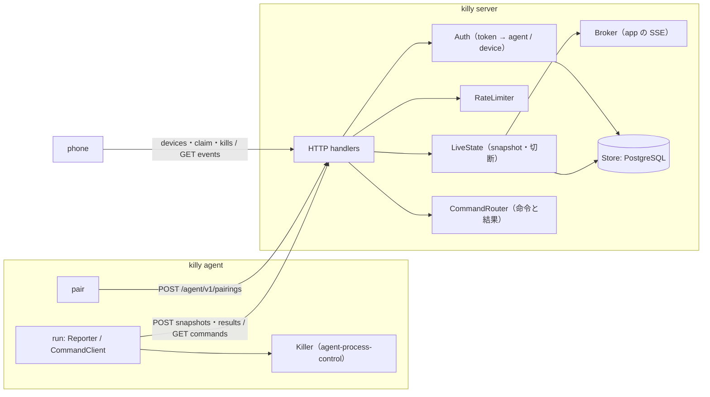
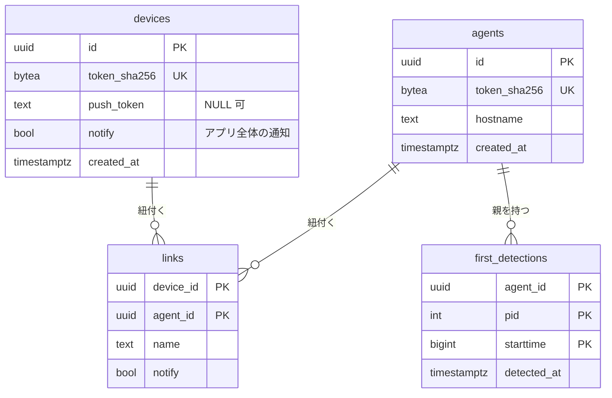

# Design: relay-and-pairing

## Overview

`killy server` は 1 replica の HTTP server で、永続データを PostgreSQL に、今の状態をメモリに持つ（[ARCHITECTURE: State](../../../docs/ARCHITECTURE.md#state)）。`killy agent pair` と `killy agent run` は、Killy server に向けて HTTPS の要求と SSE の stream を開く。protocol とタイミングの正は ARCHITECTURE で、この文書には部品の分け方、DB の table、テストの方法を書く。

## Architecture



図から読み取ること：DB に触れるのは `Store` だけ、SSE に書くのは `Broker` と `CommandRouter` だけで、handler は検証と振り分けしかしない。

## Components and Interfaces

### Store（`internal/server/store`）

`pgx/v5` の pool で PostgreSQL につなぐ。`killy server` は `KILLY_DATABASE_URL` で DB を、`--listen`（既定 `:8080`）で待ち受けるアドレスを受け取る。初回登録の `hostname` は前後の空白を除いて 1〜255 バイトで、それ以外は `400`。migration は `goose` で、`migrations/*.sql` を `embed` してバイナリに入れ、`killy server` の起動時に流す（[ARCHITECTURE: Go dependencies](../../../docs/ARCHITECTURE.md#go-dependencies)）。



- agent の ID と device の ID は UUID v4。agent の ID は App API のサーバーの `id` を兼ねる
- token は 32 バイトの乱数を base64url にしたもので、DB には SHA-256 だけを入れる。照合は SHA-256 の一致で引く
- 通知済みの table は M2（#19）で足す

### LiveState（`internal/server/live`）

agent ごとに最新の snapshot、最後に受け付けた `scanned_at`、最後に受け取った時刻を持つ。snapshot を受けたら、DB の first_detections をその snapshot の親の集合に合わせる（無い親を消し、新しい親を足す）。`scanned_at` が前回より古い snapshot は捨てるが、`204` を返して agent に送り直させない（#1 の D25）。再起動後の最初の snapshot では、DB にあって snapshot に無い親を消す。1 秒ごとの ticker で 60 秒の切断の判定をし、切断と接続の変化を `Broker` に知らせる（ticker と `Broker` への通知は #9 で足す。#7 では `Connected` を問い合わせの時に判定する）。

`scanned_at` が前回と同じ snapshot は受け付ける（古いものだけを捨てる）。最後に受け付けた snapshot からちょうど 60 秒の時刻で切断になる。受け付けた時刻は Killy server の時計で取り、捨てた snapshot では更新しない。first_detections は snapshot ごとに 1 つの transaction で、snapshot に無い親の行を消し、新しい親に今の時刻を入れる。snapshot の本文は 8 MiB まで（agent は `cmd` を 4096 バイトで切る）。openapi.yaml の required の欄が無いもの、PID とゾンビの PID が 1〜2^22 の外のもの、`zombies` が空の親は `400`。最新の snapshot を読む側（`Agent`・`Connected`）は、DB の処理を待たない。

### Broker（`internal/server/sse`）

device ごとに開いている stream の一覧を持つ。`Notify(deviceIDs)` で、それぞれの device の `state` を作り直して送る。heartbeat、`http.ResponseController` による書き込み期限の解除、flush は、命令の stream と共通の `sse.Writer` にまとめる。

`state` の JSON：

```json
{"servers":[{"id":"…","name":"…","hostname":"…","notify":true,"disconnected":false,
  "parents":[{"pid":3801,"starttime":123456,"cmd":"node evil_daemon.js","zombies":[4092],"first_detected_at":"…"}]}]}
```

### CommandRouter（`internal/server/command`）

agent ごとに命令の stream を 1 つ持つ。`Kill(ctx, agentID, cmd)` は：

1. stream が無ければ `unknown` / `agent_disconnected`
2. 同じ `(agentID, id)` が実行中なら、その結果を待つ
3. 命令を送り、`(agentID, id)` で結果を待つ。10 秒で `unknown` / `timeout`

`POST /agent/v1/results` は、token の agent と `id` の組が待っている場合だけ結果を渡す。

### RateLimiter（`internal/server/ratelimit`）

キーごとの固定の窓（期間と上限）をメモリで数える。`Allow(key) bool`、数えた 1 回を取り消せる `Take(key) (refund, ok)`、数えずに窓が埋まっているかを見る `Full(key) bool` を持つ。使う場所：

| 対象 | キー | 数えるもの |
|---|---|---|
| 初回登録 | 接続元 | 受け付けた登録 |
| device の登録 | 接続元 | 受け付けた登録（本文を確かめてから数える） |
| claim の失敗 | 接続元 | 失敗した claim（存在しない・使用済み・期限切れ）。device token を確かめた後の claim をすべて先に `Take` で数え、`400` と成功は取り消す。そのため実行中の claim も数に入り、同時に送った推測が上限をすり抜けない。超えている間は claim をすべて `429`（正しいコードでも）。`401` と `429` は数えない |
| kill | device | 認証を通った要求 |

接続元は `ClientAddr(r)`（`CF-Connecting-IP`、無ければ `r.RemoteAddr` のホスト）。時刻は `Clock` から取る。

窓はキーの最初の要求で始まり、期間のちょうど終わりの時刻の要求は新しい窓に入る。断った要求は数えず、窓も動かさない。初回登録では、本文を確かめてから数えるので、`400` になる要求は数えない。数えた後に DB で失敗した登録（`503`）は数えたままにする（DB が落ちている間に回数制限が外れないように）。

### Devices と claim

- `POST /app/v1/devices`：`push_token` は省略できる。あるなら 1〜512 バイト
- `POST /app/v1/pairings/claim`：device token を確かめ（`401`）、claim の失敗で窓が埋まっていれば `429`、本文（コードは `[A-Z0-9]{6}`、`name` は 100 文字まで）を確かめる（`400`）。`name` が無いか空白だけなら hostname を表示名にする。同じ device が同じ agent をもう一度 claim したときは紐付けを増やさず、`name` があるときだけ表示名を変える。紐付けの書き込みは phone が切れても取り消さない（DB が書いた紐付けのコードを、使えるコードに戻さないため）

### PairingCodes（`internal/server/pairing`）

コード → `{agentID, expiresAt, used}` をメモリに持つ。`crypto/rand` で英大文字と数字の 6 文字を作り、まだ持っているコードと重なれば作り直す。発行からちょうど 10 分の時刻で期限切れになる。同じ agent に新しいコードを出すと、その agent の前のコードは使えなくなる（持つコードを agent ごとに 1 つにし、token を持つ agent が要求を繰り返してもメモリが増えないようにするため）。期限切れのコードは、遅れた claim に `code_expired` を返せるよう、さらに 1 時間持ってから捨てる。claim は mutex の中で「有効か」を確かめて「使用済み」にし、同じコードの同時の claim を 1 つにする。使用済みのコードは、期限が過ぎた後も `code_used` を返す。紐付けを DB に書けなかったら、コードを使用済みから戻す（phone がもう一度試せるように）。

### agent（`internal/agent`）

| 部品 | 役割 |
|---|---|
| `pair` | `agent.json`（`{"server", "token"}`、置き場所は `--config` で変えられ、既定は `/etc/killy/agent.json`）が無ければ token なしで `--server` に送り、token と URL を mode 0600 で保存する（一時ファイルに書いて rename）。URL は https か、localhost への http だけを受け付け、redirect には従わない（token を暗号化されない経路や別の宛先に流さないため）。初回は、`agent.json` を書けることを登録の前に確かめる（token は一度しか返らないので、保存できない登録は使えない agent を残し、初回登録の回数も使うため）。あれば保存した URL に token を付けて送り、`--server` が保存した URL と違えば何も送らずに止める（別の Killy server に token を送らないため）。コードと agent の ID を表示する |
| `run` | `agent.json` から URL と token を読む（unit に `--server` は要らない）。`agent.json` が無ければ、先に `killy agent pair` を実行するよう出して止める |
| `Reporter` | 5 秒ごとに `Scanner.Scan`。最後に送れた snapshot と親の集合（`(pid, starttime)` の集合）が違えばすぐ、同じでも 15 秒ごとに送る（ticker の遅れで 3 回の走査が 15 秒に少し足りなくても 3 回目で送るよう、走査の間隔の半分の余裕をとる）。同じ親のゾンビが増えただけなら次の 15 秒を待つ。送れなかったときは送れたことにしないので、次の走査でまた送る。`version` はビルド時に `-ldflags` で入れる（既定は `dev`） |
| `CommandClient` | 命令の stream を開き続け、切れたら `Backoff`（1・2・4・8・16・30 秒の基準値に揺らぎ）で再接続する。`kill` を `Killer` に渡し、結果を送る |

## Error Handling

| 起きたこと | 扱い |
|---|---|
| DB に届かない | 起動時はエラーで止める。動いている間は、その要求に `503`（`unavailable`）を返す |
| agent の stream が切れた | `CommandRouter` から外し、待っている kill は 10 秒の期限で `timeout` になる |
| 結果の POST が、待っていない `id` | `404`（`command_not_found`）を返し、何もしない |
| SSE の書き込みが失敗 | その stream を閉じ、`Broker` から外す。phone が再接続する |

### Error responses

status と `error` の値の正は [openapi.yaml](../../../docs/openapi.yaml)（#1 の D26）。handler はそこにある値だけを返し、app（mobile-battle-slice の `ClaimError`）も同じ値で文言を選ぶ。kill の outcome（`unknown` を含む）はエラーではなく `200` で返し、`signal_failed` の errno は `reason` に名前で入る（agent-process-control の Requirement 2.12）。

## Testing Strategy

- **書く順**：各 Acceptance Criteria のテストを先に書き、期待した理由の赤を確かめてから実装する
- **DB**：テストは PostgreSQL を使わない。handler と `LiveState` は DB を interface（`server.Store`、`live.Detections`）で受け取り、テストでは `internal/server/memstore` のメモリ上の偽物を渡す。偽物は `store` の SQL と同じ規則（token は SHA-256 で引いて重なりを拒む、first_detections は報告された親の集合に合わせる、紐付けは device と agent の組で 1 つ）を持つ。`store` の SQL と migration は、手元（`make db-up`）と staging で `killy server` を動かして確かめる。自動のテストが無いのは、UUID の発行、`ErrNoRows` から `ErrNotFound` への読み替え、first_detections の SQL、migration の DDL。Requirement 1.15 の「途中で失敗した migration を元に戻す」は、goose が migration を 1 つずつ transaction で流すことに頼り、確かめていない（同じ 1.15 の「起動を止める」は `cmd/killy` のテストが確かめる）。1.16 は、手元で `killy server` を 2 回起動して `goose_db_version` が変わらないことで確かめる
- **時刻**：`Clock` を差し替え、10 分・60 秒・10 秒・回数制限の窓の前・ちょうど・後を確かめる。ちょうどの扱いは PR で決めて書く
- **HTTP と SSE**：`httptest.Server` に本物の handler をつなぎ、SSE は行単位で読んで確かめる
- **中継**：Killy server と agent の `CommandClient` を同じテストでつなぎ、`Killer` は偽物の `PidfdOps` で動かす。同じ ID の 2 回で signal が 1 回であることを、`SendKill` の回数で確かめる
- **並行**：`go test -race ./...`
- **手元の確認**：`curl` で SSE を 10 分以上開き続け、Linux 上の実際のゾンビの親を `POST /app/v1/kills` で kill する
