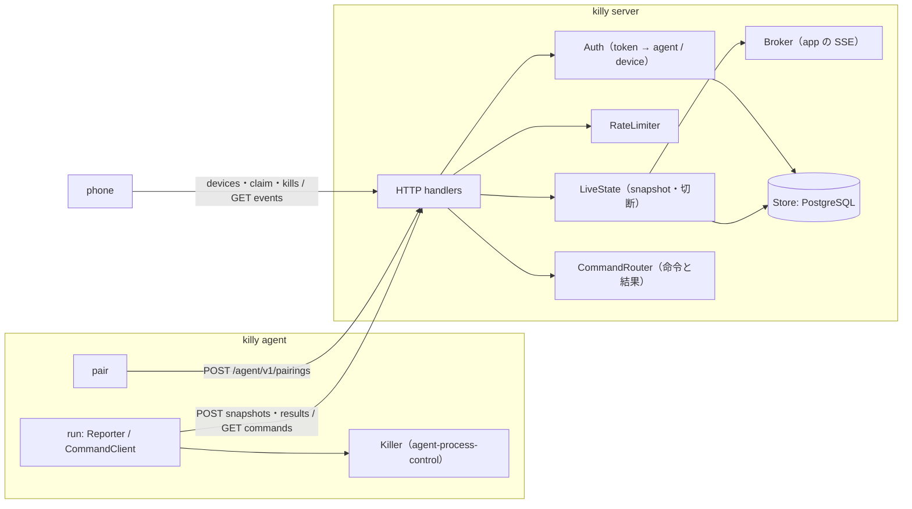
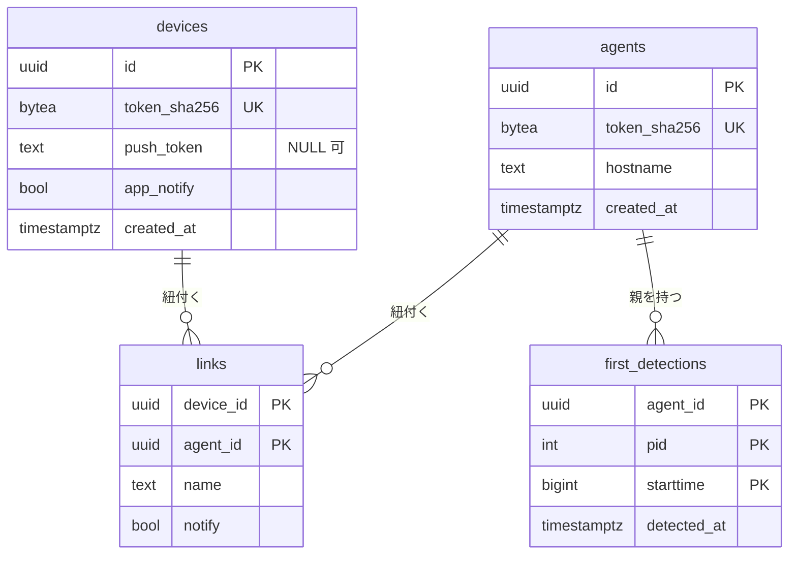

# Design: relay-and-pairing

## Overview

`killy server` は 1 replica の HTTP server で、永続データを PostgreSQL に、今の状態をメモリに持つ（[ARCHITECTURE: State](../../../docs/ARCHITECTURE.md#state)）。`killy agent pair` と `killy agent run` は、Killy server に向けて HTTPS の要求と SSE の stream を開く。protocol とタイミングの正は ARCHITECTURE で、この文書には部品の分け方、DB の table、テストの方法を書く。

## Architecture



図から読み取ること：DB に触れるのは `Store` だけ、SSE に書くのは `Broker` と `CommandRouter` だけで、handler は検証と振り分けしかしない。

## Components and Interfaces

### Store（`internal/server/store`）

`pgx/v5` の pool で PostgreSQL につなぐ。migration は `goose` で、`migrations/*.sql` を `embed` してバイナリに入れ、`killy server` の起動時に流す（[ARCHITECTURE: Go dependencies](../../../docs/ARCHITECTURE.md#go-dependencies)）。



- agent の ID と device の ID は UUID v4。agent の ID は App API のサーバーの `id` を兼ねる
- token は 32 バイトの乱数を base64url にしたもので、DB には SHA-256 だけを入れる。照合は SHA-256 の一致で引く
- 通知済みの table は M2（#19）で足す

### LiveState（`internal/server/live`）

agent ごとに最新の snapshot、最後に受け付けた `scanned_at`、最後に受け取った時刻を持つ。snapshot を受けたら、前回との差から first_detections を足し・消す。再起動後の最初の snapshot では、DB にあって snapshot に無い親を消す。1 秒ごとの ticker で 60 秒の切断の判定をし、切断と接続の変化を `Broker` に知らせる。

### Broker（`internal/server/sse`）

device ごとに開いている stream の一覧を持つ。`Notify(deviceIDs)` で、それぞれの device の `state` を作り直して送る。heartbeat、`http.ResponseController` による書き込み期限の解除、flush は、命令の stream と共通の `sse.Writer` にまとめる。

`state` の JSON：

```json
{"servers":[{"id":"…","name":"…","hostname":"…","notify":true,"disconnected":false,
  "parents":[{"pid":3801,"starttime":123456,"cmd":"node evil_daemon.js","zombies":[4092],"first_detected_at":"…"}]}]}
```

### CommandRouter（`internal/server/command`）

agent ごとに命令の stream を 1 つ持つ。`Kill(ctx, agentID, cmd)` は：

1. stream が無ければ `unknown` / `agent_disconnected`
2. 同じ `(agentID, id)` が実行中なら、その結果を待つ
3. 命令を送り、`(agentID, id)` で結果を待つ。10 秒で `unknown` / `timeout`

`POST /agent/v1/results` は、token の agent と `id` の組が待っている場合だけ結果を渡す。

### RateLimiter（`internal/server/ratelimit`）

キーごとの固定の窓（期間と上限）をメモリで数える。`Allow(key) bool` と、失敗だけを数える `Fail(key)`・`Blocked(key)` を持つ。使う場所：

| 対象 | キー | 数えるもの |
|---|---|---|
| 初回登録 | 接続元 | 受け付けた登録 |
| device の登録 | 接続元 | 受け付けた登録 |
| claim の失敗 | 接続元 | 失敗した claim（超えている間は claim をすべて `429`） |
| kill | device | 認証を通った要求 |

接続元は `ClientAddr(r)`（`CF-Connecting-IP`、無ければ `r.RemoteAddr` のホスト）。時刻は `Clock` から取る。

### PairingCodes（`internal/server/pairing`）

コード → `{agentID, expiresAt, used}` をメモリに持つ。`crypto/rand` で英大文字と数字の 6 文字を作り、重なれば作り直す。claim は mutex の中で「有効か」を確かめて「使用済み」にし、同じコードの同時の claim を 1 つにする。

### agent（`internal/agent`）

| 部品 | 役割 |
|---|---|
| `pair` | `agent.json` が無ければ token なしで `--server` に送り、token と URL を mode 0600 で保存する。あれば保存した URL に token を付けて送り、`--server` が保存した URL と違えば何も送らずに止める（別の Killy server に token を送らないため）。コードと agent の ID を表示する |
| `run` | `agent.json` から URL と token を読む（unit に `--server` は要らない）。`agent.json` が無ければ、先に `killy agent pair` を実行するよう出して止める |
| `Reporter` | 5 秒ごとに `Scanner.Scan`。前回と親の集合が違えばすぐ、同じでも 15 秒ごとに送る |
| `CommandClient` | 命令の stream を開き続け、切れたら `Backoff`（1・2・4・8・16・30 秒の基準値に揺らぎ）で再接続する。`kill` を `Killer` に渡し、結果を送る |

## Error Handling

| 起きたこと | 扱い |
|---|---|
| DB に届かない | 起動時はエラーで止める。動いている間は、その要求に `503` を返す |
| agent の stream が切れた | `CommandRouter` から外し、待っている kill は 10 秒の期限で `timeout` になる |
| 結果の POST が、待っていない `id` | `404` を返し、何もしない |
| SSE の書き込みが失敗 | その stream を閉じ、`Broker` から外す。phone が再接続する |

### Error responses

エラーの本文は `{"error": "<code>"}` にそろえ、app はこの `code` で文言を選ぶ（mobile-battle-slice の `ClaimError`）。ARCHITECTURE には形が無いので、ここを正にする。

| 要求 | 起きたこと | status | `error` |
|---|---|---|---|
| token が要る要求（初回登録と device の登録を除くすべて） | token が無い・不正 | `401` | `unauthorized` |
| どれも | 回数制限 | `429` | `rate_limited` |
| どれも | DB に届かない | `503` | `unavailable` |
| `POST /app/v1/pairings/claim` | コードが存在しない | `404` | `code_unknown` |
| 同上 | コードが使用済み | `409` | `code_used` |
| 同上 | コードが期限切れ | `410` | `code_expired` |
| `POST /app/v1/kills` | `id` が UUID v4 でない | `400` | `invalid_id` |
| 同上 | サーバーが紐付いていない（存在しないことと区別しない） | `404` | `server_not_found` |

kill の outcome（`unknown` を含む）は、エラーではなく `200` の本文 `{outcome, reaped, reason}` で返す（[ARCHITECTURE: Commands](../../../docs/ARCHITECTURE.md#commands)）。`signal_failed` の errno は `reason` に名前で入る（agent-process-control の Requirement 2.12）。

## Testing Strategy

- **書く順**：各 Acceptance Criteria のテストを先に書き、期待した理由の赤を確かめてから実装する
- **DB**：本物の PostgreSQL を使う。`KILLY_TEST_DATABASE_URL` があればテストごとに schema を作り直し、無ければ DB のテストは skip して理由を出す。各 PR の本文には、DB のテストが skip されずに実行されたログを載せる。CI ができた後は、CI が値を与えて skip が 0 件であることを確かめる（#14）
- **時刻**：`Clock` を差し替え、10 分・60 秒・10 秒・回数制限の窓の前・ちょうど・後を確かめる。ちょうどの扱いは PR で決めて書く
- **HTTP と SSE**：`httptest.Server` に本物の handler をつなぎ、SSE は行単位で読んで確かめる
- **中継**：Killy server と agent の `CommandClient` を同じテストでつなぎ、`Killer` は偽物の `PidfdOps` で動かす。同じ ID の 2 回で signal が 1 回であることを、`SendKill` の回数で確かめる
- **並行**：`go test -race ./...`
- **手元の確認**：`curl` で SSE を 10 分以上開き続け、Linux 上の実際のゾンビの親を `POST /app/v1/kills` で kill する
