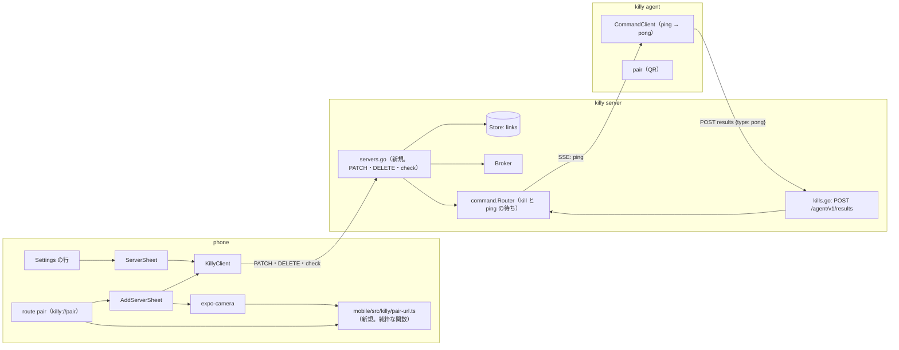

# Design: server-management

## Overview

M1 で作った部品に、サーバーを扱う 3 つの経路を足す。Killy server には、紐付けの更新と削除（`PATCH`・`DELETE /app/v1/servers/{id}`）と接続確認（`POST /app/v1/servers/{id}/check`）の handler を足し、`command.Router` に ping を足す。agent には、命令の stream の `ping` に `pong` を返す処理と、`killy agent pair` の QR を足す。app には server sheet と、Add server sheet の QR の読み取りと、`killy://pair` の deep link を足す。

protocol とタイミングの正は [ARCHITECTURE](../../../docs/ARCHITECTURE.md)、要求と応答の形の正は [openapi.yaml](../../../docs/openapi.yaml)、画面の正は [DESIGN](../../../docs/DESIGN.md)。この文書には、部品の分け方、M1 のコードのどこに何を足すか、テストの方法を書く。

## Architecture



図から読み取ること：QR と deep link は同じ `mobile/src/killy/pair-url.ts` で確かめてから Add server sheet に渡すので、どちらから来ても Killy server に要求を送る経路は「追加する」の 1 つだけである。接続確認は kill と同じ `command.Router` と命令の stream を通るので、確認が通れば kill も届く。

## Components and Interfaces

### 紐付けの更新と削除（Requirement 1、（新規）`internal/server/servers.go`）

| 項目 | 選択 | 理由 |
|---|---|---|
| 変える範囲 | この device と agent の紐付け（`links` の 1 行）だけ。他の device の行にも `agents` にも触れない | 表示名と通知の設定は紐付けのもの（#16、#1 の D4 e）。削除しても agent は動き続け、他の phone は影響を受けない（#16） |
| 表示名の規則 | claim と同じ。100 文字（rune）を超えたら、空白を除く前の長さで `400` `invalid_request`。前後の空白を除いて保存し、除いて空になる名前は「無い」として扱い、表示名を変えない。`claimPairing` の中の規則を `displayName(*string) (*string, bool)` に出して、claim と `PATCH` の両方から呼ぶ | 同じ名前が入口によって通ったり拒まれたりしないようにする（#16、`internal/server/devices.go` の claim） |
| migration | 足さない | `links.name`・`links.notify` は M1 の `00003_devices_links.sql` にある（#16） |
| 確かめる順 | `PATCH`：device token（`401`・`503`）→ 本文（`400`）→ 紐付け（`404`・`503`）→ 更新。`DELETE`：device token → 紐付け → 削除 | `postKill` と同じ順（本文を紐付けより先に見る） |
| 紐付けの確認 | 更新の前に `s.linked`（`kills.go`）で、その device の紐付けに `{id}` があるかを Go の文字列で確かめる。無ければ `404` `server_not_found` | UUID の形でない `{id}` を SQL に渡すと、PostgreSQL が uuid の変換で失敗して `503` になる。存在しない ID と同じ `404` にするため |
| 本文が `{}` のとき | `204` を返し、何も変えない | openapi の `ServerPatch` には必須の項目が無く、成功は `204`。PRD UC5 の「An empty name keeps the previous one」のとおり、名前を変えない要求は前の値を残す |
| 変えた後 | `s.NotifyDevice(device.ID)` で、その device の開いている stream にだけ `state` を送り直す（#16） | `state` は stream の側が `LinksOfDevice` から作り直すので、変更も削除もそのまま反映される |
| 削除と battle | 削除した device の `state` からサーバーと親が消え、app の列からも消える。agent にも Killy server の `LiveState` にも何もしない | UC5。同じ agent を紐付けた他の device はそのまま |

`server.Store` に足すもの。`store.Store`（SQL）と `memstore.Memory` に同じ規則で入れる（#16）：

```go
// UpdateLink changes this device's link only. A nil name or notify leaves it as it is.
// It returns store.ErrNotFound when the device is not linked to the agent.
UpdateLink(ctx context.Context, deviceID, agentID string, name *string, notify *bool) (store.Link, error)
// UnlinkDevice removes this device's link only, or returns store.ErrNotFound.
UnlinkDevice(ctx context.Context, deviceID, agentID string) error
```

```sql
UPDATE links SET name = COALESCE($3, name), notify = COALESCE($4, notify)
WHERE device_id = $1 AND agent_id = $2 RETURNING name, notify;

DELETE FROM links WHERE device_id = $1 AND agent_id = $2;
```

更新と削除で行が 0 だったとき（`s.linked` の後に同じ device の別の要求で消えたとき）は `store.ErrNotFound` で、handler は `404` を返す。`memstore.SetLink` は消さず、テスト用の helper として残す。#16 は `UpdateLink`・`UnlinkDevice` を足すだけで、`events_test.go` の 2 か所の `SetLink` は、そのままにするか `UpdateLink` に替えるかを PR で決める。

### 接続確認（Requirement 2）

#### `command.Router`（`internal/server/command`）

| 項目 | 選択 | 理由 |
|---|---|---|
| 経路 | kill と同じ。agent の命令の stream に `ping {id}` を送り、`POST /agent/v1/results` の `{id, type: pong, version}` を待つ | stream があるかだけを見ると、snapshot は届くのに命令だけ届かない状態を見分けられない（#17、#1 の D8） |
| 待ちの種類 | `wait` に種類（`protocol.ResultKill`・`protocol.ResultPong`）を持たせ、`Deliver` は `res.Type` が待ちの種類と同じときだけ渡す。違えば `false` で、handler は `404` `command_not_found` を返す | 待ちの表は `(agent, id)` で引くので、種類を確かめないと、kill の ID の付いた `pong` で kill の待ちが outcome の無いまま終わる（#17）。status は openapi の `/agent/v1/results` の `404`（No request is waiting for this `id` from this agent、`command_not_found`）に当たる。種類の合う待ちが無いので、この agent からこの `id` を待つ要求は無い |
| ping の ID | Killy server が `uuid.NewV4()` で作る（`store` と同じ標準ライブラリの `uuid`） | phone の kill ID と重ならないようにする。重なっても種類で分かれる |
| 締め切り | `PingTimeout = 5 * time.Second`。送ってから 5 秒より前に届いた `pong` だけを使い、ちょうど 5 秒以降は遅すぎる（`Deliver` が `false`、check は `no_response`）。時刻は `clock.Clock`、タイマーは `New` に渡す `after` | kill の結果を 10 秒ちょうど以降は受け付けない `Deliver` に揃え、締め切りの扱いを 1 つにする（#17） |
| 2 秒の制限 | `CheckInterval = 2 * time.Second`。agent ごとに最後の確認（始めた時刻・終わったか・結果）を 1 つ持つ。前の確認を始めた時刻から 2 秒以内（ちょうど 2 秒を含む）の確認は ping を送らず、前の確認が実行中ならその結果を待って返し、終わっていればその結果を返す。2 秒を過ぎたら、前の確認が実行中でも新しい ping を送る（M2 の spec の確認で sumire が決めた） | 連打した operator にエラーを見せない（#17、#1 の D8 a）。ARCHITECTURE の「for the same server」のとおり、device ではなくサーバーごとに数える |
| 記録する確認 | ping を送った確認と、stream が無くて `agent_disconnected` になった確認。2 秒以内で前の結果を返しただけの確認は、記録を変えない | 連打が続いても、2 秒ごとに 1 回は agent まで確かめる |
| phone が切ったとき | 確認は 5 秒まで待ち続ける。その間の確認はこの結果に加わる | `RelayKill` の待ちと同じ。切った phone の確認も、後の確認が使える |
| 測らないもの | 応答の時間と最後の受信の時刻は測らず、返さない | #17、#1 の D8 b・c |

```go
// Check sends a ping to the agent and returns ok with the agent's version, agent_disconnected,
// or no_response. Within CheckInterval of the previous check of the same agent it sends nothing
// and returns that check's result, waiting for it when it is still running.
func (r *Router) Check(ctx context.Context, agentID string) CheckResult

type CheckResult struct {
	Result  string // "ok", "agent_disconnected" or "no_response"
	Version string // set for ok
}
```

`internal/protocol` には `PingCommand{ID string}`（openapi の `PingCommand`）と、check の結果の値（`ok`・`agent_disconnected`・`no_response`）を置く。`agent_disconnected` は kill の `ReasonAgentDisconnected` と同じ文字列だが、意味が違うので別の定数にする。

#### handler（（新規）`internal/server/servers.go`・`kills.go`）

- `POST /app/v1/servers/{id}/check`：device token（`401`・`503`）→ 紐付け（`s.linked`。`404` `server_not_found`、`503`）→ `Commands.Check` → `200` `{result, version?}`。応答の struct は `result` と `version`（`omitempty`）だけを持つ。DB に届かないときの `503` は今の openapi の check に無いので、同じ PR で openapi.yaml の check に `503` を足す（#17）
- `POST /agent/v1/results`：今は `type` が `kill` 以外を `400` にしている。`kill` は今のまま（`outcome` が `IsAgentOutcome`）、`pong` は `version` が空でないものを受け付け、それ以外の `type` は `400`。どちらも、token の agent と `id` の組が待っていて種類が合うときだけ渡す（M2 の spec の確認で sumire が決めた）

#### agent（`internal/agent/commands.go`・`run.go`）

| 項目 | 選択 | 理由 |
|---|---|---|
| ping の受け取り | `CommandClient.stream` の event の振り分けに `ping` を足す。`protocol.PingCommand` を読み、`id` が空でなければ goroutine で `POST /agent/v1/results` `{id, type: pong, version}` を送る。`id` が空なら記録して捨てる | kill は 1 つずつ別の goroutine で `Killer` に渡しているので、ping も別に送れば走っている kill を待たない（#17） |
| 版 | `CommandClient` に `Version string` を足し、`agent.Run` が `RunOptions.Version`（`cmd/killy` が `version.Version` を入れている）を渡す | 今の `CommandClient` は版を持たない（#17） |
| 触らないもの | ping では `Killer` を呼ばず、`/proc` も `outcomes.jsonl` も読み書きしない | 接続確認は Linux サーバーの上で何も変えない（#17、UC4） |
| 停止のとき | `pong` の送信は `kills` の `WaitGroup` に入れず、`Run` は待たない | 止まる agent の `pong` には意味が無い。kill は signal と記録の間にありうるので待つ（M1 のまま） |

今の `TestOtherEventsAreIgnored`（`internal/agent/commands_test.go`）は、`ping` を読み捨てることを確かめている。この PR で、`ping` 以外の名前の event を読み捨てるテストに直す。

#### app：Connection の欄（`ServerSheet`）

| 項目 | 選択 | 理由 |
|---|---|---|
| 呼び出し | `KillyClient.check(serverId): Promise<CheckResult>`。例外を投げず、次の 5 つのどれかを返す：`{kind: 'ok', version}`・`{kind: 'agent_disconnected'}`・`{kind: 'no_response'}`・`{kind: 'unreachable'}`（応答が無い。15 秒の `requestTimeout` を含む）・`{kind: 'failed'}`（`401`・`404`・`503`、JSON でない応答、知らない `result`） | #17 の表の 5 行 |
| 表示 | 確認の前は「確認する」、結果が出たら「もう一度確認」。確認の間はボタンを押せず、spinner と `connChecking`。`ok` は `green` の ✓ と `connOk`（`{ver}` に版）、失敗は薄い赤の `!` と次の表の文 | DESIGN: Server sheet |
| 結果の持ち方 | sheet を開いている間だけ持つ。閉じたら捨てる | 常時の接続表示は作らない（PRD: Not guaranteed） |

| 結果 | 翻訳のキー | 文（en） |
|---|---|---|
| `ok` | `connOk`（ある） | Connected (agent {ver}) |
| `agent_disconnected` | `connFail`（ある） | No response from the agent. Check that killy agent is running on the server. |
| `no_response` | `connNoResponse`（足す） | Commands are not reaching the agent. Restart the agent.（PRD UC4） |
| `unreachable` | `pairUnreachable`（ある。新しい key は作らない） | Cannot reach the Killy server. Check your network.（PRD UC4 の「Check your network」と #17 の「通信を確かめる」を含む） |
| `failed` | `connFailed`（足す） | 文言は PR で決めて翻訳ファイルに足す（#17） |

### app：server sheet（Requirement 1、`mobile/src/components/ServerSheet.tsx`）

| 項目 | 選択 | 理由 |
|---|---|---|
| 開き方 | Settings の Servers の行（`settings.tsx`）を `Pressable` にし、押した行のサーバーの `id` で `ServerSheet` を開く。sheet は `useKilly().state` からその `id` のサーバーを引き、`state` から消えたら閉じる | Settings の行は今は押せない（#16） |
| 中身 | 表示名の入力欄（開いた時点の `name`、100 文字まで）、ホスト名の行（`state` の `hostname`、mono、読み取り専用）、Connection の欄（Requirement 2）、このサーバーの通知の switch、「このサーバーを削除」と `removeHint`、「完了」 | DESIGN: Server sheet。ホスト名は agent が初回登録で送った値で、表示名を変えても元のどのサーバーかを確かめられる（#16、D5） |
| 表示名を送る時点 | 「完了」を押したとき。前後の空白を除いた名前が空でなく、今の `name` と違うときだけ `PATCH {name}` を送り、`204` で閉じる。それ以外は送らずに閉じる | #16。空の名前は Killy server でも変わらないので、送っても何も起きない |
| 通知を送る時点 | switch を切り替えた時点で `PATCH {notify}` を送る。送っている間は switch を押せない。送れなかったら、sheet を閉じず、switch の下に赤い行で理由を出す。switch は `state` の値に戻す（M2 の spec の確認で sumire が決めた） | #16 の決定（切り替えた時点で送る。送れなかったら sheet を閉じず、その欄の下に赤い行で理由を出す）。戻すのは、#20 のアプリ全体の switch（失敗したら元に戻す）と同じ扱いにするため |
| 表示の正 | 表示名と switch は、成功の後に届く `state` で変わる（`PATCH` の応答は `204` で本文が無い）。Settings の行の名前も `state` から出す | M1 の「`state` を丸ごと置き換える」に揃える |
| 削除 | 1 回目の押下では何も送らず、赤い枠のボタンを赤く塗り、`removeConfirm` に変える。2 回目で `DELETE` を送り、`204` で閉じる | DESIGN: Server sheet、UC5 |
| 失敗 | `PATCH` か `DELETE` に応答が無いとき、またはエラーが返ったときは、sheet を閉じず、その操作をした欄（表示名・通知・削除）の下に赤い行で理由を出す（M2 の spec の確認で sumire が決めた） | 失敗はそれが起きた場所で示す（DESIGN: When the Killy server cannot be reached、#16）。この 2 つ（送る時点と失敗の表示）は DESIGN にまだ無いので、同じ PR で DESIGN の Server sheet に書き足す（#16） |
| 通知が off のサーバー | battle の列はそのまま（`buildQueue` は `notify` を見ない） | 通知を止めても親は battle に出続ける（#16、UC5） |

`settings.tsx` は #16・#18・#20・#21 が触る。

`KillyClient` に足すもの（#16・#17）：

```ts
interface KillyClient {
  // …M1 のもの
  updateServer(id: string, patch: { name?: string; notify?: boolean }): Promise<void>; // ServerError: unreachable | other
  removeServer(id: string): Promise<void>;                                              // ServerError: unreachable | other
  check(id: string): Promise<CheckResult>;                                               // 例外を投げない
}
```

- `id` は `encodeURIComponent` して path に入れる
- `ServerError` の `unreachable` は応答が無いとき（15 秒の `requestTimeout` を含む）、`other` はそれ以外の `204` でない応答。送り直しはしない（`PATCH`・`DELETE` は phone が結果を見て押し直せる）
- `ServerError` に `not_registered` は無い。server sheet は device の登録の後にしか開けない（Settings のサーバーの行は、device token で読む `state` から出る）

| 失敗 | 翻訳のキー | 文（ja） |
|---|---|---|
| 応答が無い | `pairUnreachable`（ある。新しい key は作らない） | Killy server に接続できません。ネットワークを確認してください。 |
| エラーが返った | `serverSaveFailed`（足す） | 変更を保存できませんでした。しばらくしてから、もう一度お試しください。（案） |

### agent：`killy agent pair` の QR（Requirement 3、`internal/agent/pair.go`）

| 項目 | 選択 | 理由 |
|---|---|---|
| QR の中身 | （新規）`pairURL(code, server string) string` が `"killy://pair?" + url.Values{"code": {code}, "server": {server}}.Encode()` を返す。`Encode` が `server` を percent-encode する | #18。手で文字列をつなぐと `server` の `&` や `?` で壊れる |
| `server` の値 | 初回は `--server` を `normalizeURL` した値（`agent.json` に保存する値）、2 回目以降は `agent.json` の `server`。`Pair` と `firstPair` から `printCode` に渡す | 2 回目以降の `killy agent pair` は `--server` を省けるため（#18） |
| 表示 | `printCode(out, resp, server, renderQR)` が、コード、QR、10 分で切れる案内、agent ID の順に出す。agent token は出さない（relay-and-pairing の Requirement 1.12） | 今の `printCode` はコードと agent ID だけ（#18） |
| QR の生成 | `PairOptions.RenderQR func(content string) (string, error)`。nil なら `TerminalQR`：`github.com/skip2/go-qrcode` の `qrcode.New(content, qrcode.Medium)` を `ToSmallString(false)` で文字にする。テストは `RenderQR` に受け取った文字列を記録する関数を渡す | go-qrcode は [ARCHITECTURE: Go dependencies](../../../docs/ARCHITECTURE.md#go-dependencies) にある（#18、D9）。`go.mod` に足す。QR に渡した文字列をテストで確かめるため |
| QR を作れなかったとき | コードと agent ID は出し、QR の代わりに作れなかったことを出して、終了の status は 0 のままにする（M2 の spec の確認で sumire が決めた） | コードは発行済みで、手で打てば使える |

### app：QR の読み取りと deep link（Requirement 3）

#### （新規）`mobile/src/killy/pair-url.ts`（純粋な関数）

```ts
type PairCheck = { ok: true; code: string } | { ok: false; reason: 'invalid' | 'other_server' };
function parsePairURL(text: string, appServer: string): PairCheck;          // QR の文字列
function checkPairParams(params: Record<string, string | string[] | undefined>, appServer: string): PairCheck; // deep link の route の params
function sameServer(a: string, b: string): boolean;
```

| 項目 | 選択 | 理由 |
|---|---|---|
| 受け付ける形 | `killy://pair?` で始まり、query に `code` と `server` が 1 つずつある URL だけ。`code` は `^[A-Z0-9]{6}$`（openapi の `ClaimRequest` と同じ）。それ以外の scheme・host・path、`code` か `server` が無いか 2 つある URL、6 文字の英大文字と数字でない `code` は `invalid` | `killy://pair` 以外の URL や形の違う URL は受け付けない（#18） |
| 接続先との比較 | `sameServer` は、scheme と host を小文字にし、`https` の `:443` と `http` の `:80` を省き、末尾の `/` を除いてから、文字列で比べる。app の接続先は `buildServerURL()` の値（`useServerURL()`） | `--server` は operator が手で打つので、書き方の違いだけで正しい QR を拒まない（#18） |
| 違う接続先 | `other_server`。app は build に設定された Killy server にだけ接続し、`server` は一致するかを確かめるだけに使う | 悪意のある QR に device token を別の宛先へ送らされないため（#18、#1 の D4 c） |
| URL の分け方 | `URL` に頼らず、scheme・host・port・path と query を小さな関数で分ける。query の値は `+` を空白にしてから `decodeURIComponent` する | jest（Node の `URL`）と端末で結果が変わらないようにする。`url.Values.Encode` は空白を `+` にする |

#### Add server sheet（`AddServerSheet.tsx`）

| 項目 | 選択 | 理由 |
|---|---|---|
| ボタン | コードの入力欄の下に「QR コードを読み取る」（翻訳の `scanQr` はあるが、ボタンはまだ無い） | DESIGN: Add server sheet、#18 |
| カメラ | `expo-camera` の `useCameraPermissions` で権限を求め、`CameraView`（`barcodeScannerSettings={{ barcodeTypes: ['qr'] }}`）を sheet の中に出す。最初に読めた 1 つだけを `parsePairURL` に渡し、カメラを閉じる（入れたときに版の文書で確かめる） | 読み取りは 1 回で終える。`onBarcodeScanned` は同じ QR で何度も呼ばれる |
| 読めたとき | `ok` ならコードを入力欄に入れる（`cleanCode` を通す）。表示名の欄はそのまま。claim は送らない | 追加は「追加する」で行い、表示名を入れる機会を残し、追加までの経路を 1 つにする（#18） |
| 読めないとき | `other_server` は `qrOtherServer` を sheet のエラーの箱に出し、Killy server に何も送らない。`invalid` は `qrInvalid` を sheet のエラーの箱に出す。どちらも入力欄は変えない（M2 の spec の確認で sumire が決めた） | 別の Killy server の QR は、DESIGN の Add server sheet の error の状態（「QR code for another Killy server」）と #18（違えばエラーを出して何も送らない）で決まっている。形の違う QR と deep link は、#18 が受け付けないことだけを決めていたので、表示は M2 の spec の確認で sumire が決めた |
| 権限が無い | `cameraDenied` で、コードの入力で追加できることを案内する。入力欄はそのまま使える | #18 |
| 開き方 | `AddServerSheet` に `initialCode?`・`initialError?` を足し、deep link から開くときに使う | deep link も同じ sheet の入力欄に入れる（#18） |

「QR コードを読み取る」（#18）と「デモサーバーを試す」（#24）は、どちらも Add server sheet の副ボタン（モックの `.ghost-btn` の形）である。#18 と #24 の先に着手したほうが副ボタンの部品を作り、後のほうはそれを使う。

`expo-camera` は native module なので、`npx expo install expo-camera` で入れ、`app.json` の `plugins` に `expo-camera`（`cameraPermission` に説明の文、マイクは使わないので `recordAudioAndroid: false`）を足し、development build を作り直す（#18）。説明の文は `expo.locales` で日本語と英語の両方を持つ（M2 の spec の確認で sumire が決めた）

#### deep link（`mobile/src/app/pair.tsx`）

| 項目 | 選択 | 理由 |
|---|---|---|
| 受け口 | `app.json` の scheme は `killy` なので、expo-router は `killy://pair?…` を route `/pair` に渡す。`src/app/pair.tsx` を足し、`useLocalSearchParams()` を `checkPairParams` で確かめてから Settings に移る。app が開いていない（root の stack に `(tabs)` が無い）ときは `<Redirect>`、開いているときは `router.dismissTo('/settings')` で、開いている tabs に戻る（#18 の PR で決めた） | OS のカメラで読んで app が開いたときも、app のカメラで読んだときと同じに扱う（#15 の決定、#18）。扱わないと、一致する route の無い画面が出る。app が開いているときに Settings を積み重ねると、2 つ目の Add server sheet を iOS が出せず、app が操作を受けなくなった（iOS シミュレーターで確かめた） |
| Settings への渡し方 | 確かめた結果は URL の params ではなく、`mobile/src/killy/pair-link.tsx` の `PairLinkProvider`（app の状態）で Settings に渡す。Settings はそれがあれば Add server sheet を開き、sheet を閉じたら消す。sheet が開いている間に次の link が来たら、開き直さずに中身を置き換える。受け付けられない link は入力欄を変えず、エラーの箱に理由を出す。claim の途中に来た link は、form に戻ってから入れる（#18 の PR で決めた） | Settings が自分の params からコードを入れると、`killy://settings?pairCode=…` が確認を通らずにコードを入れられた。開き直すと iOS が 2 つ目の Modal を出せない。いずれもレビューで見つかった |
| `killy://pair` 以外の deep link | 受け付けない。Add server sheet を開かず、Killy server に何も送らない。表示は expo-router の一致する route の無い画面のままにする（M2 の spec の確認で sumire が決めた） | #18 の制約（`killy://pair` 以外の URL は受け付けない）のとおり。ただし #18 が `pair` の route を足すのは、一致する route の無い画面を出さないためなので、pair 以外の deep link でその画面を出すことは、M2 の spec の確認で sumire が決めた |
| 文書 | 同じ PR で、ARCHITECTURE（と ARCHITECTURE.ja.md）の Pairing の QR の項に、deep link も同じ確認をすることを書き足す（#18） | #18 |

翻訳に足すキー（日本語と英語の両方。#18）：`qrOtherServer`（別の Killy server の QR コードであること）、`qrInvalid`（Killy のペアリングの QR コードではないこと）、`cameraDenied`（カメラが使えないので、コードを入力して追加できること）。

## Error Handling

| 起きたこと | 扱い |
|---|---|
| `PATCH`・`DELETE`・check で DB に届かない | `503`（`unavailable`）。app は「エラーが返った」として扱う |
| `PATCH`・`DELETE` の間に紐付けが消えた | `UpdateLink`・`UnlinkDevice` が `store.ErrNotFound` を返し、`404` |
| ping を送るとき stream が命令を受け取らない（channel が埋まっている） | ping を送らずに `no_response`。agent はつながっているが、命令が agent に届いていない状態で、UC4 の「Commands are not reaching the agent. Restart the agent.」に当たる（#17 の後に sumire が決めた）。kill の `RelayKill` は今のまま `unknown`（`agent_disconnected`） |
| ping を送った後に agent の stream が切れた | 待ちは 5 秒まで続き、その間に `pong` が届けば `ok`、届かなければ `no_response` |
| 種類の違う結果・待っていない `id`・別の agent からの `pong` | `404`（`command_not_found`）。どの待ちも終わらない |
| agent の `pong` の POST が失敗した | 記録して終わる。送り直さない（check は `no_response` になる） |
| app の `PATCH`・`DELETE` に応答が無い | sheet を閉じず、その欄の下に `pairUnreachable` |
| app の check に応答が無い | Connection の欄に `pairUnreachable` |
| カメラの権限が無い | `cameraDenied` を出し、コードの入力で続けられる |

## Testing Strategy

- **書く順**：各 Acceptance Criteria のテストを先に書き、期待した理由の赤を確かめてから実装する
- **DB**：テストは PostgreSQL を使わず、`memstore` で書く（[ARCHITECTURE: Deployment](../../../docs/ARCHITECTURE.md#deployment) の Database の行）。`memstore` の `UpdateLink`・`UnlinkDevice` は SQL と同じ規則（nil は変えない、行が無ければ `ErrNotFound`、紐付けは device と agent の組で 1 つ）を持つ。`store` の SQL は、手元の PostgreSQL（`make db-up`）に `killy server` を向けて、変更・停止・削除が Killy server の再起動の後も保たれることで確かめ、PR 本文に書く（#16 の完了条件 9）
- **2 台の device**：同じ agent に 2 つの device を紐付け、片方の `PATCH`・`DELETE` の後に、両方の `state` を `GET /app/v1/events` から読んで比べる（`events_test.go` の helper を使う）
- **時刻**：`command.Router` は `clock.Fake` と、テストが閉じる `after` の channel で動かす。5 秒の締め切りは、4.999 秒・ちょうど 5 秒・それより後の `pong` を確かめる。2 秒の制限は、前の確認から 2 秒より前・ちょうど 2 秒・2 秒を過ぎた確認で、命令の stream に ping が届いたかを数える
- **種類の取り違え**：kill を待たせたまま、その ID の `pong` を送って `404` と待ちが続くことを、ping を待たせたまま、その ID の kill の結果を送って `404` と待ちが続くことを確かめる
- **agent の ping**：`commands_test.go` の `blockingKiller` で 5 秒かかる kill を作り、その間に送った `ping` に、kill が終わる前に `pong` と版が返ることを確かめる。ping では `Killer` が呼ばれないことを回数で見る
- **QR の文字列**：`PairOptions.RenderQR` に記録する関数を渡し、初回と `--server` を省いた 2 回目で、渡された文字列が `killy://pair?code=<表示したコード>&server=<保存した URL を percent-encode したもの>` であることを確かめる
- **app**：`FakeServer` に `PATCH`・`DELETE /app/v1/servers/<id>` と `POST /app/v1/servers/<id>/check` の応答を置き、`hold`・`unreachable` で実行中と応答の無い場合を作る。要求が送られないことは `FakeServer.count` で見る。`mobile/src/killy/pair-url.ts` は表の 1 行を 1 テストにする
- **カメラ**：jest で `expo-camera` を偽物に置き換え、権限（あり・なし）と、`onBarcodeScanned` に渡す文字列をテストから与える
- **deep link**：`renderRouter(routes, { initialUrl: '/pair?code=…&server=…' })` で開き、Add server sheet の入力欄のコードと、`FakeServer` が受けた要求の数を確かめる
- **実機**：#17 は実機かエミュレータで、agent を動かしているときと止めたときの確認の表示を、#18 は development build を作り直した実機で、端末の QR を app のカメラで読み取って追加したことと、OS のカメラで読み取って app が開いたことを、PR 本文に書く
- **並行**：`go test -race ./...`
