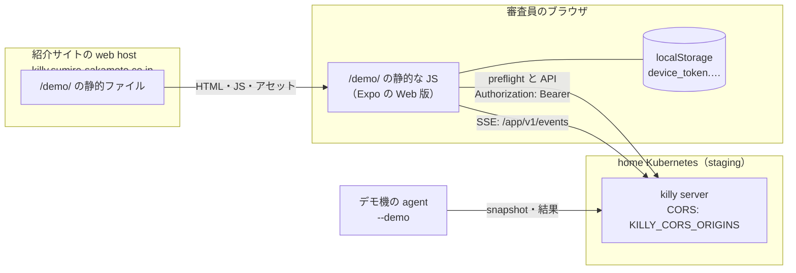
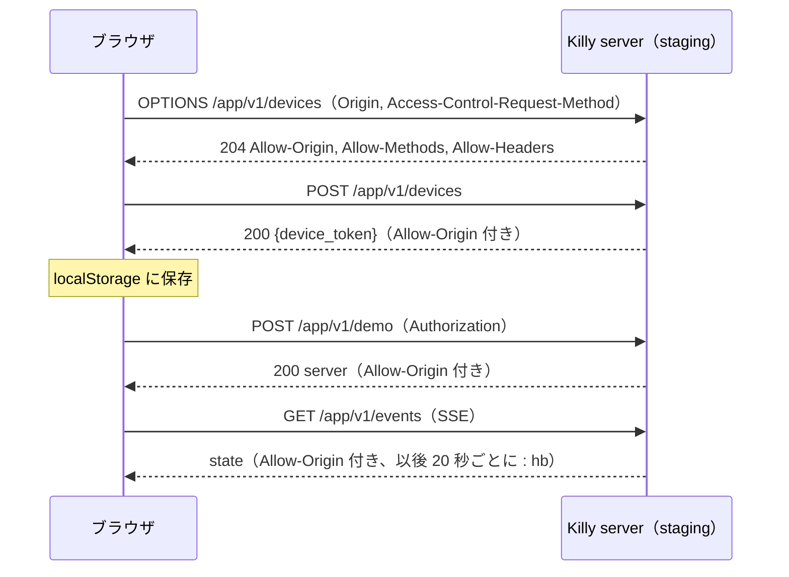
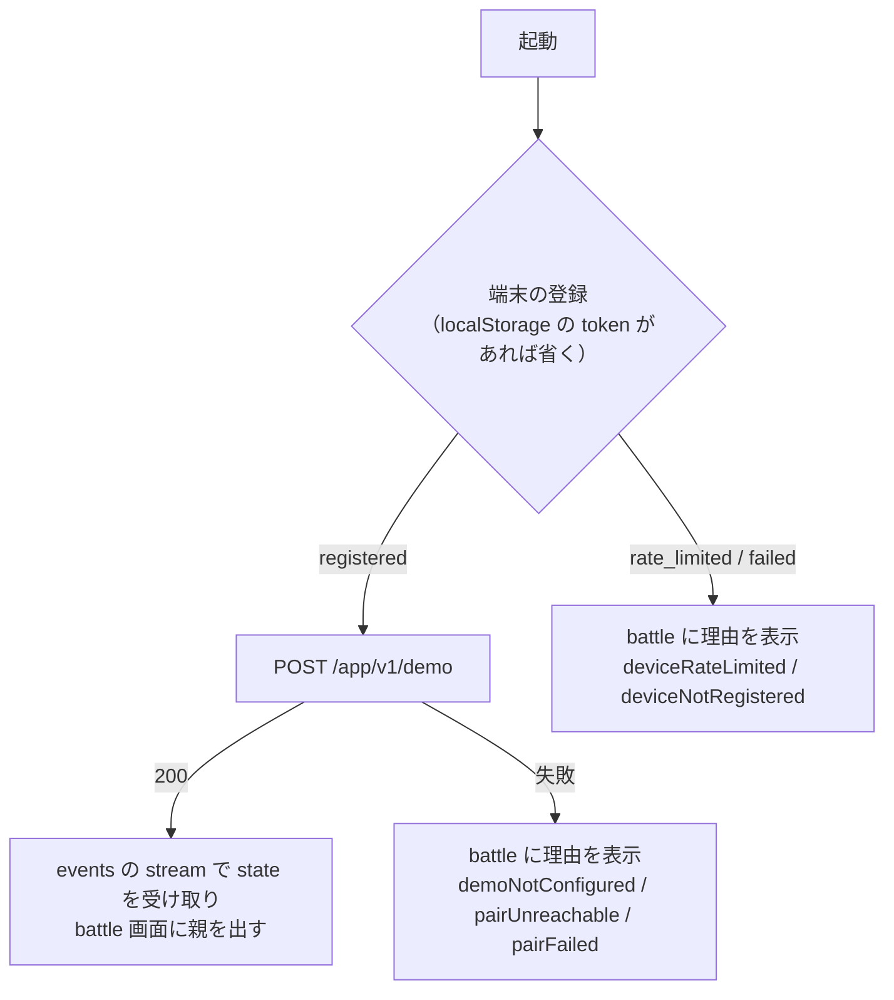
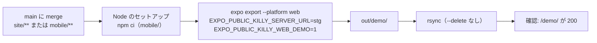

# Design: web-demo

## Overview

`mobile/` の Expo アプリを Expo の Web 版として静的にビルドし、紹介サイトの `/demo/` に置く。Web 版は staging の Killy server を呼ぶ。部品は 3 つ。

1. Killy server に、許可したオリジンにだけ付ける CORS の層を足す（Go）。
2. app に、Web でだけ使う実装（保存先・通知）と、Web のデモ専用の起動（登録 → デモの追加）と、PC の幅の枠を足す。
3. 紹介サイトの workflow が、Web 版をビルドして `out/demo/` に置く。

Killy の安全の保証（agent の `not_demo`、kill の再確認、回数制限）は変えない。Web 版は、今のネイティブの app と同じ API を同じ token で呼ぶ、もう 1 つの client である。

保証の正は [PRD](../../../docs/PRD.md)、protocol と配置の正は [ARCHITECTURE](../../../docs/ARCHITECTURE.md)、画面の正は [DESIGN](../../../docs/DESIGN.md)。この文書には、部品の分け方と、既存のコードのどこに何を足すか、テストの方法を書く。

## Architecture



図から読み取ること：ブラウザは web host から静的ファイルだけを受け取り、API は直接 staging の Killy server に送る。web host は API を中継しない。そのため `https://killy.sumire-sakamoto.co.jp` と `https://stg-killy.sumire.pink` のオリジンの違いを、server が許可する CORS で越える。



図から読み取ること：preflight は `Authorization` か `Content-Type: application/json` を持つ要求ごとに先に走る。応答はエラー（`401`・`429`）にも `Allow-Origin` が付く。付かないと、ブラウザの JS は status を読めず、`401` での登録し直し（`renewToken`）が動かない。

## Components and Interfaces

### Killy server の CORS（Requirement 2、#130）

`internal/server` に `cors.go` を置き、`Server.Handler()` が返す handler を包む。

```go
// CORSOrigins reads KILLY_CORS_ORIGINS: comma-separated origins. Empty means none.
func ParseCORSOrigins(value string) ([]string, error)

// Server.CORSOrigins is the allowed origins; nil adds no CORS header at all.
type Server struct { /* … */ CORSOrigins []string }
```

| 項目 | 選択 | 理由 |
|---|---|---|
| 掛ける範囲 | path が `/app/v1/` で始まる要求だけ | agent の API はブラウザから呼ばれない。開く面を最小にする |
| 一致 | 項目と `Origin` ヘッダの完全一致（大文字小文字も区別する） | ブラウザは `Origin` を小文字のスキームとホストで送る。ゆるい一致（部分一致、`*`）は別のオリジンに開いてしまう |
| 起動時の検査 | `ParseCORSOrigins` が、`*`・パス・クエリ・空のホスト・スキームが `http`/`https` でないものを拒み、起動を失敗させる | 設定の間違いが「全部に開く」「黙って無効」にならないようにする |
| preflight | 許可したオリジンの `OPTIONS` で、`Access-Control-Request-Method` がある要求を、mux より前で `204` で答える | mux は `OPTIONS` の route を持たず、`405` を返してしまう。認証も回数制限も通さない |
| ヘッダ | `Access-Control-Allow-Origin`（そのオリジン）、`Vary: Origin`、preflight には `Allow-Methods`・`Allow-Headers`・`Max-Age: 600` | `Allow-Credentials` は返さない。app は cookie を使わず、Bearer token だけを送る |
| 許可していないオリジン | 何も足さずに次の handler へ。`Vary: Origin` は、CORS が有効なときの `/app/v1/` の応答に付ける | キャッシュが、許可したオリジン向けの応答を他のオリジンに返さないようにする |
| SSE | ヘッダを `next.ServeHTTP` の前に `ResponseWriter` に足す。`ResponseWriter` を包まない | `http.ResponseController` の flush と書き込み期限の解除（[SSE rules](../../../docs/ARCHITECTURE.md#sse-rules)）が、そのまま動く |

`cmd/killy/server.go` が `KILLY_CORS_ORIGINS` を読んで `Server.CORSOrigins` に渡す。`deploy/overlays/stg/` の Deployment の環境変数に `KILLY_CORS_ORIGINS` を足す。値は秘密ではないので `SealedSecret` には入れない。

### app の Web 用の実装（Requirement 3、#131）

Metro は Web のビルドで `name.web.ts` を `name.ts` より先に選ぶ。native が読む `.ts` を変えずに、Web 用を横に置く。

| 既存のファイル | 足す Web 用のファイル | 内容 |
|---|---|---|
| `mobile/src/killy/deps.ts` | `deps.web.ts` | `makeDeps(baseURL)`：`tokens` が `localStorage` の `tokenKey(baseURL)`、`randomBytes` が `crypto.getRandomValues`。`tokenKey` は native の依存を持たない `token-key.ts` に移し、`deps.ts` と `deps.web.ts` が使う |
| `mobile/src/prefs.ts` | `prefs.web.ts` | `makePrefs()`：`localStorage` に `language`・`notify` |
| `mobile/src/killy/notifications.ts` | `notifications.web.ts` | `makeNotifications()`：許可は `denied`、`pushToken` は拒否、残りは何もしない |

`deps.ts` は `expo-secure-store`・`expo-crypto` を、`prefs.ts` は `expo-secure-store` を、`notifications.ts` は `expo-notifications` を import する。Web のビルドは `.web.ts` を選ぶので、この 3 つは Web の bundle に入らない（Requirement 3.8）。型（`Deps`・`TokenStore`・`NotificationsDeps`・`NotificationPermission`・`Prefs`・`Stored`）は、`.web.ts` が `import type` で `.ts` から読む。`import type` は Babel が消すので、native の依存は Web の bundle に入らない。TypeScript は `.web.ts` を別のファイルとして検査し、`import … from './deps'` は `deps.ts` を見るので、2 つの実装が同じ型を満たすことは、型検査が確かめる。値（`tokenKey`、`channelId`）を `.web.ts` が使うときは、`.web.ts` 自身に解決されてしまうので、native の依存を持たない別のファイルに置いて両方から読む。

| 項目 | 選択 | 理由 |
|---|---|---|
| `localStorage` が使えない | 読み出しは `null`、書き込みは何もしない。アクセスで例外が出る場合も同じ | 保存できないブラウザでも、そのページの間は動く。token が読めない場合に再登録しない native の規則（「読めない token を置き換えない」）は、token が既に存在し得ない Web には当てはまらない |
| 通知の許可 | `denied` | `NotificationsProvider` は `denied` のとき push token を取らず、送らない。`prepare`・`requestPermission` も呼ばれない |
| 通知の行（Settings） | Web では描かない | `denied` を出すと、実在しない「システムの設定」への案内が出る |
| QR | `AddServerSheet` で、Web ではカメラのボタンを描かない | Web のデモ専用では Add server 自体を出さないが、Requirement 3.6 は専用でない Web のビルドでも守る |

### Web のデモ専用の起動（Requirement 4、#132）



- `mobile/src/config.ts` に `webDemoEnabled(value)`（`1` のときだけ true）と `buildWebDemoEnabled()` を足す。`buildWebDemoEnabled()` は `process.env.EXPO_PUBLIC_KILLY_WEB_DEMO` を直接書いて読む（Expo は名前をそのまま書いた参照だけを置き換える）。native では、変数が設定されていても `Platform.OS === 'web'` でなければ無効とする（Requirement 4.3）。
- `mobile/src/killy/web-demo.tsx` に `WebDemoProvider` を置き、`KillyProvider` の内側に差す。有効なとき、`registration` が `registered` になったら `client.addDemoServer()` を 1 回呼ぶ。状態（`idle`・`adding`・`added`・`failed` と、失敗の文言の `Key`）を `useWebDemo()` で返す。無効なときは何もせず、`useWebDemo()` は無効を返す。
- `claimMessages`（`ClaimErrorKind` から文言の `Key` への表）は `AddServerSheet.tsx` にある。`web-demo.tsx` と共有するため、`mobile/src/killy/claim-messages.ts` に移して両方から使う。文言は足さない。
- battle 画面は、`registration` が `rate_limited`・`failed` のとき、または `useWebDemo()` が失敗のとき、既存の `notice`（赤い system text の枠）に理由を出す。`rate_limited` は今も同じ枠に出ている。
- Settings は、Web のデモ専用が有効なとき Add server のボタンを描かない。通知の行は Web では描かない（Requirement 3.5）。
- 毎回の起動で `POST /app/v1/demo` を呼ぶのは、`state` を見て呼ぶかを決めるより少ないコードで、Killy server が 2 回目以降を同じ紐付けのまま返す（[demo-environment Requirement 3.3](../demo-environment/requirements.md)）から。Settings から Remove したデモは、再読み込みで戻る。
- PC の幅の枠は、root layout の `Stack` を包む `View` で作る。Web のとき、`maxWidth: 430`・`width: '100%'`・`alignSelf: 'center'`・`flex: 1`・枠の外は `colors.bg`。タブバーは `position: 'absolute'` なので、枠の中にあるよう枠を `position: 'relative'`（Web の既定）にして `overflow: 'hidden'` にする。

### 配置（Requirement 5、#133）



- `app.json` に `expo.experiments.baseUrl: "/demo"` と `expo.web.output: "static"`（`bundler: "metro"`）を足す。`baseUrl` は Web のビルドにだけ効く（native の build は読まない）。
- 出力（`mobile/dist/`）は `out/demo/` に置く。既存の「確認が全部通るまで何もアップロードしない」の並びに入れる。
- `mobile/**` の変更で走るので、`paths` に `mobile/**` を足す。`mobile/` の変更が `site/` に影響しなくても、`/demo/` を最新に保つほうを選ぶ。
- Web のビルドが外のホストを読まないことは、出力に `https://` で始まる URL を `grep` して確かめる（許可するのは `stg-killy.sumire.pink` だけ）。

## Data Models

新しい保存されるデータはない。ブラウザの `localStorage` に、native と同じ名前のキーで次の 3 つを置く。

| キー | 値 |
|---|---|
| `device_token.<接続先 URL を整えたもの>` | device token（`POST /app/v1/devices` の応答） |
| `language` | `ja` または `en` |
| `notify` | `on` または `off`（Web では書かれないが、読む規則は同じ） |

## Error Handling

| 場面 | 見えるもの |
|---|---|
| 端末の登録が `429` | battle 画面に `deviceRateLimited`。次の起動で登録をやり直す |
| 端末の登録が届かない、そのほか | battle 画面に `deviceNotRegistered` |
| `POST /app/v1/demo` が `demo_not_configured` | battle 画面に `demoNotConfigured` |
| `POST /app/v1/demo` が届かない・そのほか | battle 画面に `pairUnreachable`・`pairFailed` |
| server が CORS を許可していない（staging が古い image のまま） | ブラウザが応答を読ませず、`fetch` は届かない失敗になる。端末の登録が失敗し、`deviceNotRegistered` が出る |
| `401`（server が token を知らない） | 既存の `renewToken`（#124）が登録し直す。`Allow-Origin` がエラーの応答にも付くので、Web でも動く |

## Testing Strategy

テストは実装より先に書き、期待した理由で赤になることを確かめる。

| 対象 | 方法 |
|---|---|
| CORS（Go） | `internal/server` のテストで `httptest` を使い、許可したオリジン・許可していないオリジン・`Origin` なし・未設定・preflight・エラーの応答・SSE・`/agent/v1/` を確かめる。SSE は、ヘッダがボディの前に付くことを、開いたままの応答で確かめる。`ParseCORSOrigins` は表のテスト（正しい値、`*`、パス、空の項目、空白と末尾の `/`）。ルールを外すと落ちることを、`*` を返す・完全一致を前方一致に変える・`/agent/v1/` にも付ける、の 3 つの変異で確かめる |
| Web 用の実装（app） | `deps.web.ts`・`prefs.web.ts`・`notifications.web.ts` を、`localStorage` の偽物（Map）と、例外を出す偽物で、jest から直接 import して確かめる。`.web.ts` が native の依存を import しないことは、ファイルの import を調べるテストで確かめる |
| 型 | `.ts` と `.web.ts` が同じ型を満たすことは `npm run typecheck` が確かめる |
| デモ専用の起動 | 既存の画面のテストの流儀（`demo.test.tsx`）に合わせ、`makeDeps` と `fetch` を差し替えて、`WebDemoProvider` を含む画面を描く。登録の有無・`POST /app/v1/demo` の呼び出し回数・失敗の文言・Settings に Add server が出ないこと・native（`Platform.OS` が `ios`）では呼ばないことを確かめる |
| 枠 | 幅 430px を境に、枠の `maxWidth` が効くことをスタイルで確かめる。実際のブラウザでの見え方は PR 本文に書く |
| 配置 | 手元で `expo export --platform web` を実行し、出力を `/demo/` の下に置いて静的な server で開く。出力が外の URL を読まないことを `grep` で確かめる |
| 実機に近い確認 | 手元の Killy server（CORS を許可、PostgreSQL は `make db-up`）と、snapshot を送る擬似 agent で、Chrome から開いて、ゾンビが出て、1 秒の長押しで kill が送られることを確かめる。結果は #129・#132 に書く |

native の既存のテスト（26 suites）は、変更前に結果を取り、変更後も緑のままにする。
