# Killy

Put zombie processes to rest, from your phone.

<p align="center"></p>

A zombie process (`<defunct>`) is a child that has exited but whose parent never collected it with `wait()`. Signalling the zombie does nothing; the only fix is to deal with the parent. Killy does that from your phone:

1. An agent on each Linux server reports the parents that hold zombies.
2. Your phone gets a push notification when a new one appears.
3. You check the server, PID and command line on the battle screen, then hold a button for 1 second. The agent re-checks the process and sends `SIGKILL` to that parent.

Killy is a small, silent apprentice reaper. It never speaks; everything that needs explaining is system text beside it. This is our entry for Kiroween 2026, Frankenstein category: Linux process control, a mobile game and push notifications stitched together. See also the [introduction site](https://killy.sumire-sakamoto.co.jp).

## Get the app

| Platform | How |
|---|---|
| Android (APK) | `killy-android.apk` on the latest [GitHub Release](https://github.com/sumiredc/killy/releases/latest). Allow installing from unknown sources, or run `adb install killy-android.apk` |

The iOS build (TestFlight) and the Android build on Google Play are installed from the links in our Kiroween submission.

These builds connect to the staging Killy server, `https://stg-killy.sumire.pink`, and show the demo button. A phone connects only to the one Killy server its build was made for.

## Try the public demo

No server of your own? In the app, open **Settings → Add server** and tap **Try the demo server** (in the Japanese UI, **デモサーバーを試す**). A demo machine keeps creating parents that hold zombies, and only those parents can be killed. Hold the kill button for 1 second.

The demo is shared: a parent that someone else kills disappears from your screen too.

The Killy server runs on the team's home Kubernetes cluster as a single instance. Its uptime is not guaranteed, including during judging.

## Watch your own Linux server

You need Linux 5.3 or later (the agent signals through a pidfd), `amd64` or `arm64`, and root. The agent only connects out to the Killy server; it opens no port.

Download the binary from the [introduction site](https://killy.sumire-sakamoto.co.jp/download/) (the site serves it, not GitHub, so it stays available when this repository is private), check it and put it in `/usr/local/bin`. For the store release of the app, which connects to `https://killy.sumire.pink`, follow the [support page](https://killy.sumire-sakamoto.co.jp/support/) instead; the steps are the same except for the `--server` URL:

```sh
arch=$(uname -m | sed 's/x86_64/amd64/; s/aarch64/arm64/')
curl -fLO "https://killy.sumire-sakamoto.co.jp/download/killy-linux-$arch"
curl -fLO https://killy.sumire-sakamoto.co.jp/download/SHA256SUMS
grep " killy-linux-$arch\$" SHA256SUMS | sha256sum -c -
sudo install -m 0755 "killy-linux-$arch" /usr/local/bin/killy
```

Pair the server with the Killy server the app connects to. It prints a 6-character code and a QR code, valid for 10 minutes and usable once:

```sh
sudo killy agent pair --server https://stg-killy.sumire.pink
```

In the app, open **Settings → Add server**, enter the code (or scan the QR code) and tap **Add**. Then keep the agent running with the systemd unit from the same site. It needs the `agent.json` that `pair` wrote, so enable it after pairing:

```sh
sudo curl -fL -o /etc/systemd/system/killy-agent.service https://killy.sumire-sakamoto.co.jp/download/killy-agent.service
sudo systemctl daemon-reload
sudo systemctl enable --now killy-agent.service
```

To check that a command can reach the agent, open **Settings**, tap the server, and tap **Check** under Connection.

The agent runs as root so that it can signal other users' processes. It never kills PID 1, itself or its own ancestors, and it sends `SIGKILL` only to the process you were shown. Whether that parent is safe to kill is your decision. The server's hostname and the command lines of parents that hold zombies pass through the Killy server; the [privacy policy](https://killy.sumire-sakamoto.co.jp/privacy/) lists what it keeps.

## Try it on a Mac

Docker Desktop and OrbStack run Linux containers, so you can run the agent and a zombie maker (`killy summon`) in one throwaway container and kill the zombies' parents from the app.

Download the binary that matches your Mac: `killy-linux-arm64` on Apple silicon, `killy-linux-amd64` on an Intel Mac. An `amd64` container on Apple silicon runs under emulation, where pidfd is not available, so the agent refuses every kill. Start the container with `--init`, so that PID 1 collects the zombies once their parent is killed:

```sh
curl -fL -o killy https://killy.sumire-sakamoto.co.jp/download/killy-linux-arm64
chmod +x killy
docker run -d --init --name killy-lab -v "$PWD/killy:/usr/local/bin/killy:ro" alpine sleep infinity
docker exec -d killy-lab killy summon
docker exec killy-lab killy agent pair --server https://stg-killy.sumire.pink
```

Add the server in the app with the code, as above, then start the agent:

```sh
docker exec -d killy-lab killy agent run
```

`summon` starts a parent at once (named like `php queue_worker.php`) and a new one every 2 minutes, up to 3 alive; each adds zombies over time. They show up on the battle screen. When you are done:

```sh
docker rm -f killy-lab
```

Then remove the server in the app (**Settings → the server → Remove**).

## Where to read more

| What | Where |
|---|---|
| What Killy must do and must not do | [docs/PRD.md](docs/PRD.md) |
| Components, protocol, safety checks, deployment | [docs/ARCHITECTURE.md](docs/ARCHITECTURE.md) (also [in Japanese](docs/ARCHITECTURE.ja.md)) |
| How the app looks and moves | [docs/DESIGN.md](docs/DESIGN.md), with a working prototype in [mock/](mock/index.html) |
| Request and response shapes | [docs/openapi.yaml](docs/openapi.yaml) |
| Privacy policy | [docs/PRIVACY.md](docs/PRIVACY.md) (also [in Japanese](docs/PRIVACY.ja.md)) |
| How we used Kiro | [.kiro/](.kiro/): [steering](.kiro/steering/) (product rules and Killy's character rules, loaded in every session), [specs](.kiro/specs/) (requirements, design and tasks per feature, written in Japanese) and a [hook](.kiro/hooks/merge-gate.json) that blocks merging a pull request before CI succeeds |

The code is in [cmd/killy](cmd/killy) and [internal/](internal/) (the Go binary: `agent`, `server`, `summon`), [mobile/](mobile/) (the Expo app) and [deploy/](deploy/) (Kubernetes manifests and systemd units).

## License

[MIT](LICENSE)
