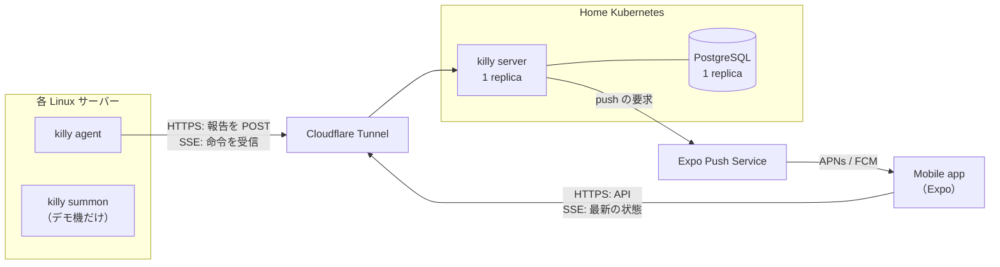
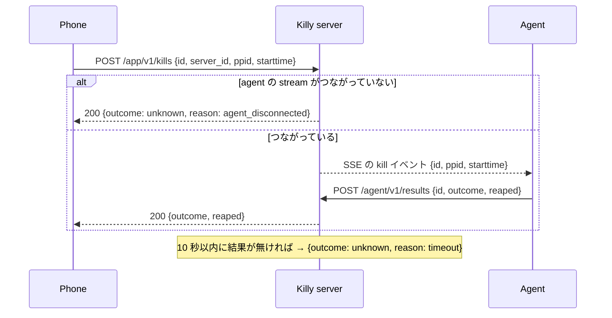
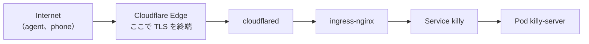

# Killy — アーキテクチャ（日本語訳）

この文書は [ARCHITECTURE.md](ARCHITECTURE.md) の日本語訳で、正は英語版です。食い違ったときは英語版に従ってください。訳の元は commit `8f025b7` 時点の英語版です。

英語版は **Killy をどう作るか** の正です。構成要素、それらの間の protocol、安全の保証をどう守るか、どうデプロイするかを書きます。
Killy が何をしなければならないかは [PRD.md](PRD.md)、app の画面と動きは [DESIGN.md](DESIGN.md) にあります。

## 構成要素



どの接続も、agent か phone の側から Killy server に向けて開きます。Killy server から agent に接続することはないので、どの Linux サーバーも inbound のポートを開く必要がありません。

| 構成要素 | 責務 |
|---|---|
| `killy agent` | `/proc` を走査してゾンビを見つけ、報告し、命令を受け取り、kill を確かめてから実行し、ping に答える。 |
| `killy server` | agent と phone の間を中継する。登録情報を PostgreSQL に保存し、最新の状態をメモリに持ち、SSE で状態を配り、push 通知を送り、命令を届けてその結果を待つ。 |
| `killy summon` | デモ専用。ゾンビを残す親プロセスを作り続ける。 |
| Mobile app | ペアリング、設定、battle 画面、通知の受け取り。 |

`agent`・`server`・`summon` は、1 つの Go のバイナリ `killy` のサブコマンドです。

### Go の依存

`/proc` の走査と kill の手順（`internal/proc` と agent の kill のコード）は、Killy の安全の保証を担うので、Go の標準ライブラリだけを使います。それ以外のコードが使ってよい外部モジュールは、下の一覧にあるものだけです。使う前に、まずこの一覧に足してください。

| モジュール | 用途 |
|---|---|
| `github.com/jackc/pgx/v5` | PostgreSQL のドライバ |
| `github.com/pressly/goose/v3` | schema の migration（1 つずつ transaction で流し、失敗すれば元に戻す） |
| `github.com/skip2/go-qrcode` | `killy agent pair` が表示する QR コード |

## Agent

### 走査

agent は 5 秒ごとに全プロセスの `/proc/<pid>/stat` を読み、状態が `Z` のものを残します。親 PID ごとに、親の `/proc/<ppid>/stat`（start time。22 番目の値）と `/proc/<ppid>/cmdline` を読みます。

親は `(ppid, starttime)` で見分けます。親が PID 1 のゾンビは報告しません。init が回収し、Killy は PID 1 を kill してはいけないためです。demo mode（`killy agent run --demo`）の agent は、`killy-summon.service` の cgroup に属する親だけを報告します。公開デモに kill できないものを出さず、デモ機の他のコマンドラインも出さないためです。

### 報告

agent は 15 秒ごとと、親の集合が変わったときにすぐ、snapshot をすべて送ります。snapshot は差分ではなく丸ごとの置き換えなので、報告が 1 つ失われても次の報告で直ります。

### kill の手順

`kill` 命令 `{id, ppid, starttime}` を受け取ったら:

1. `id` が UUID v4 でなければ、命令を無視する。`id` が処理済みなら、保存した outcome を送り直して終わる。同じ `(ppid, starttime)` への kill は 1 つずつ処理する。kill は、その親への前の kill が outcome を保存するまで待つ。
2. `ppid` の pidfd を開く（`pidfd_open`）。そのプロセスが無ければ → outcome `already_gone`。pidfd が使えなければ（Linux 5.3 より前、または seccomp の制限）→ outcome `refused`（`pidfd_unavailable`）。PID を指定して送る方法には切り替えない。
3. `/proc/<ppid>/stat` を読み直す。無ければ → `already_gone`。start time が `starttime` と違えば → `refused`（`pid_reused`）。プロセスそのものが状態 `Z`（すでに kill され、自分の親にまだ回収されていない）なら → `already_gone`。
4. 次のどれかに当てはまれば、拒否する（outcome `refused` と理由。signal は送らない）。
   - そのプロセスにゾンビの子がもういない（`not_a_zombie_parent`）
   - `ppid` が 1、agent 自身、または agent の祖先である（`protected`）
   - demo mode で、そのプロセスの cgroup（`/proc/<ppid>/cgroup` の `0::` の行。cgroup v2）が `/system.slice/killy-summon.service` と完全には一致しない（`not_demo`）。一致は完全一致で比べる。利用者が自分で作った同じ名前の unit は `/user.slice/…` の下にあり、数に入らない。cgroup のファイルが読めないときは、プロセスがもう無ければ `already_gone`、それ以外は `not_demo` にする。`0::` の行が無いファイル（cgroup v1 だけの system）も `not_demo` にする。由来を確かめられない親は kill しない
5. pidfd を通して `SIGKILL` を送る（`pidfd_send_signal`）。手順 2 の後に PID が再利用されても、pidfd は元のプロセスを指したままなので、signal は新しいプロセスに届かない。手順 3 の後にプロセスが終わって回収されていたら（`ESRCH`）→ `already_gone`。終わっていてもまだ回収されていなければ、kernel は signal を受け付け（効果は無い）、outcome は手順 6 で決まる。手順 3 から送るまでのこの隙間は塞げないので、受け入れる。それ以外のエラーなら → `signal_failed` と errno。
6. 元のゾンビがすべて消えるまで最大 5 秒待つ → 消えれば outcome `killed` と回収された数。消えなければ `zombies_remain`。
7. outcome を `id` に結びつけて `/var/lib/killy/outcomes.jsonl`（追記のみ、mode 0600、期限なし。agent の再起動後も同じ `id` を見分けられる）に保存し、POST する。書き込みに失敗したら、ログに出して outcome はそのまま POST する。書き込みは繰り返さない。outcome はメモリには残るので、agent が再起動する前に同じ `id` が届けば、二度目の signal を送らずにその outcome を返す。PRD は、書き込みに失敗した `id` と、手順 5 から 7 の間に agent が止まった `id` が、もう一度処理されうることを受け入れている。

pidfd の呼び出しは `syscall` パッケージで直接行います。`os.Process.Signal` は、pidfd が無いと PID 指定の送信に黙って切り替えるためです。agent は起動時に pidfd が使えるかを確かめ、使えなければエラーを記録します。

agent には、他のユーザーのプロセスに signal を送る権限が要ります。systemd の下で root として動かすか、`CAP_KILL` を与えてください。

### ペアリング

`killy agent pair --server <url>` は Killy server に登録し、6 文字のコード（英大文字と数字）、`killy://pair?code=<code>&server=<url>` を表す QR コード、agent の ID を表示します。agent の ID は秘密情報ではありません。App API のサーバーの `id` と同じ値で、`KILLY_DEMO_AGENT_ID` に入れる値です（「デモ環境」を参照）。`killy agent run` は常駐するサービスです。

- **初回**（`/etc/killy/agent.json` が無いとき）：token なしで `POST /agent/v1/pairings` を送り、hostname を伝える。誰でも登録できる。新しい agent は何も見られず、phone がコードを claim するまで、どの phone にも出ない。返された agent token は `/etc/killy/agent.json`（mode 0600）に保存する。
- **2 回目以降**：同じ要求に agent token を付けると、同じ agent の新しいコードが作られる。token の無い要求では、既存の agent のコードは発行しない。
- **claim**：コードが有効なら claim はすぐに成功し、agent を待たない。表示名が無ければ、登録時に送られた hostname を使う。
- **紐付け**：表示名とサーバーごとの通知の switch は、1 台の device と 1 つの agent の紐付けに属する。そのため、ある phone での変更は他の phone に影響しない。
- **QR**：app は、build に設定された Killy server にだけ接続する。QR コードの `server` はそれと一致しなければならず、違えば app はエラーを出して何も送らない。QR コードで、app の device token を別の宛先に送らせることはできない。一致は、scheme と host の大文字・小文字、既定の port、末尾の `/` の違いを無視して比べる。読み取ったコードはコードの入力欄に入れるだけで、claim は手で入れたコードと同じく「追加する」で送る。app は `killy://pair?…` の link（端末のカメラで QR コードを読み取ったとき）でも開き、同じ確認をした上で、Add server sheet をコードの入った状態で開く。それ以外の `killy://` の link は扱わない。

#### 回数制限

接続元のアドレスごとにメモリで数えます。接続元は `CF-Connecting-IP` で、このヘッダが無いとき（Cloudflare を通さずに Killy server を手元で動かすときなど）は TCP の接続元のアドレスです。再起動で数え直しになりますが、短い時間の大量の試行を防ぐにはそれで足ります。kill の要求は、送るのに device token が要るので、接続元ではなく device ごとに数えます。

| 要求 | 制限 | 超えたとき |
|---|---|---|
| claim の失敗（存在しない・使用済み・期限切れのコード） | 接続元ごとに 10 分に 10 回 | 期間が過ぎるまで、その接続元からの claim はすべて `429`（正しいコードでも）。app は、しばらく待ってからやり直すよう案内する |
| 初回登録 | 接続元ごとに 1 時間に 10 回 | `429`。`killy agent pair` は待つよう表示する |
| device の登録（`POST /app/v1/devices`） | 接続元ごとに 1 時間に 10 回 | `429`。app はその旨を出し、次に起動したときにやり直す |
| kill の要求（`POST /app/v1/kills`） | device ごとに 1 分に 30 回 | `429`。agent には何も送らない。app は kill ボタンの下に出し、送り直さない |

kill の制限は、1 秒の長押しで届く回数よりずっと多く、公開デモを通して agent の保存する outcome（期限なし）を誰かが増やせる速さを抑えます。device の登録も制限します。制限しないと、新しい device を登録し直して、device ごとの kill の制限を回避できてしまうためです。

多くのアドレスに分散した試行は、これでは防げません。そうなったら Cloudflare の rate limiting を足してください。

## Killy server

### 状態

| 状態 | 置き場所 | 再起動で失うか |
|---|---|---|
| agent、device、それらの紐付け、表示名、通知の switch | PostgreSQL | 失わない |
| 親 `(agent, ppid, starttime)` ごとの最初の検出時刻 | PostgreSQL | 失わない |
| 通知済みの `(親, device)` の組 | PostgreSQL | 失わない |
| ペアリングコード | メモリ | 失う（operator が `pair` をやり直す） |
| agent ごとの最新の snapshot と最後に受け取った時刻、開いている SSE の stream、応答待ちの命令、回数制限のカウンタ | メモリ | 失う（agent が再接続して報告すると戻る） |
| `(親, device)` ごとの push の失敗の回数 | メモリ | 失う（数え直しになるが、上限は再起動の後も働く） |

永続データの置き場所は PostgreSQL だけで、Killy server は自分のファイルを持ちません。schema は、バイナリに埋め込んだ migration でだけ変え、`killy server` の起動時に流します。親が agent の snapshot から消えたら、その親の最初の検出時刻、通知済みの組、push の失敗の回数を消します。`scanned_at` が同じ agent から最後に受け付けたものより古い snapshot は捨てます。遅れて届いた報告で、消えた親が戻らないようにするためです。捨てた snapshot にも成功を返すので、agent はそれを送り直しません。agent の時計が戻ると、追いつくまでその報告は無視され、その間 agent は切断に見えますが、それは受け入れます。

token は 32 バイトの乱数で、保存するのは SHA-256 だけです。

### 通知

snapshot の中の親ごとに、紐付いた device のうち、push token があり、アプリ全体の switch とサーバーの switch が両方 on で、まだその親を通知していないものに、push を 1 つずつ送ります。親が snapshot から消えるとその親の通知済みの組を消すので、同じ親がまたゾンビを持って戻ってくると、もう一度通知します（新しい回）。組を永久に残すと、table が際限なく増えるためです。`(親, device)` の組は、Expo Push Service が push を受け付けた後にだけ記録します。送信に失敗したら何も記録せず、次の snapshot（遅くとも 15 秒後）でまた送ります。失敗が続いても止まらずに繰り返さないよう、送り直しには上限があります。Expo が push token をもう受け付けないと返したら（`DeviceNotRegistered`）、その device の push token を消し、app が新しい token を登録するまでその device には送りません。それ以外の失敗は、後の snapshot で最大 3 回まで送り直し、それでも失敗したら通知済みとして記録して諦めます。Expo が要求を丸ごと `400` で拒んだときは、数える前に 1 件ずつ送り直します。Expo は 1 つの message の中身（別の Expo project の push token）で要求全体を拒み、push token は誰でも登録できるので、1 台の device がほかの device への通知を止めないようにするためです。Expo が push を受け付けた後、組を記録する前に Killy server が止まると、その 1 件は再起動の後にもう一度送られます。Expo の応答が失われたか、Killy server が待つ 10 秒より遅れたときは失敗として数えるので、その 1 件は、ほかの失敗と同じく最大 3 回まで送り直されます。「受け付けた」とは、その message に Expo が返した push ticket が `ok` であることです。Killy server は push receipt を取りに行かないため、receipt にだけ出る `DeviceNotRegistered` には気づかず、その device の push token は残ります。通知の文面は DESIGN.md の「Push notification」で決めています。push は app が開いているかどうかに関わらず送ります。app が前面にある間は、app がその push を表示しません。そのため Killy server は、どの phone が app を開いているかを知らなくてよい。

### 命令

kill と接続確認は、どちらも「agent の SSE の stream で送り、agent の POST を待つ」やり取りです。Killy server は、phone の HTTP 要求にその結果を同期的に返します。

kill の `id` は phone が選ぶ UUID v4 で、それ以外の形なら Killy server は `400` を返します。phone は、HTTP の応答がまったく得られなかったとき（通信のエラー）に、同じ `id` で同じ要求を 1 回だけ送り直します。agent の手順 1 があるので、送り直しても安全です。Killy server は中継するだけです。結果は命令を送った agent からのものだけを受け付け、同じ `id` の要求が同時に 2 つ届いたら、命令を 1 つだけ送って両方にその結果を返します。`id` が処理済みかを決めるのは agent です。



接続確認も同じやり取りで、`ping {id}` / `pong {id, version}` を使い、期限は 5 秒、結果は `ok`（agent の版付き）・`agent_disconnected`・`no_response` です。kill と同じ stream を通るので、確認が通れば kill も届きます。phone の要求そのものが失敗したら、phone が Killy server に届いていないということです。同じサーバーへの確認は 2 秒に 1 回までです。前の確認から 2 秒以内の確認では ping を送らず、実行中の確認か直前の確認の結果を返します。応答の時間（round trip）や最後の受信の時刻は、測りも返しもしません。

## Protocol

本文はすべて JSON です。agent は `Authorization: Bearer <agent token>`、phone は `Authorization: Bearer <device token>` で認証します。

要求と応答の形、status、エラーの値は [openapi.yaml](openapi.yaml) で決めていて、そちらが正です。エラーの本文はすべて `{"error": "<code>"}` です。kill の outcome は、`unknown` を含めてエラーではなく `200` の応答です。下の表には、各 API が何のためにあるかを書きます。

### Agent API

| メソッドとパス | 用途 |
|---|---|
| `POST /agent/v1/pairings` | token なし：登録し（初回）、agent token・agent の ID・コードを受け取る。agent token 付き：agent の ID と新しいコードを受け取る |
| `GET /agent/v1/commands` | `kill` と `ping` のイベントの SSE の stream |
| `POST /agent/v1/snapshots` | ゾンビを持つ親をすべて報告する |
| `POST /agent/v1/results` | `kill` か `ping` の結果を返す |

### App API

| メソッドとパス | 用途 |
|---|---|
| `POST /app/v1/devices` | device を登録し、device token を受け取る。push token は省略できるので、通知を使わない phone もペアリングして戦える |
| `PATCH /app/v1/devices/me` | アプリ全体の通知の switch、push token の更新 |
| `POST /app/v1/pairings/claim` | ペアリングコードで、この device を agent と紐付ける |
| `POST /app/v1/demo` | 公開デモのサーバーを追加する（`KILLY_DEMO_AGENT_ID` の agent。未設定なら失敗する） |
| `GET /app/v1/events` | SSE の stream：紐付いた全サーバーとその親を載せた `state` イベント。親ごとに最初の検出時刻が付く（app はこれで battle の列を古い順に並べる） |
| `PATCH /app/v1/servers/{id}` | サーバーの名前を変える、通知を止める。この device の紐付けだけを変える |
| `DELETE /app/v1/servers/{id}` | この device とサーバーの紐付けを外す |
| `POST /app/v1/servers/{id}/check` | 接続確認（「命令」を参照） |
| `POST /app/v1/kills` | kill（「命令」を参照） |

### SSE の決まり

- 各 stream は 20 秒ごとにコメントの行（`: hb`）を送る。Cloudflare と ingress が、何も流れない stream を閉じないようにするため。
- （再）接続したら、Killy server はまず現在の状態をすべて送る。
- Go の handler は、SSE の route では `http.ResponseController` で書き込みの期限を外し、イベントごとに flush する。
- client は、指数的に延ばす待ち時間（1 秒 → 30 秒）にランダムな揺らぎを足して再接続する。Killy server の再起動で再接続が一斉に起きないようにするため。

## 時間

| 値 | 設定 |
|---|---|
| agent の走査の間隔 | 5 秒 |
| 変化が無いときの snapshot の間隔 | 15 秒 |
| snapshot が無い agent を切断とみなすまで | 60 秒 |
| SSE の heartbeat | 20 秒 |
| 接続確認の期限 | 5 秒 |
| kill の結果の期限 | 10 秒 |
| ペアリングコードの有効期間 | 10 分 |
| 接続元ごとの claim の失敗 | 10 分に 10 回 |
| 接続元ごとの初回登録 | 1 時間に 10 回 |
| 接続元ごとの device の登録 | 1 時間に 10 回 |
| device ごとの kill の要求 | 1 分に 30 回 |

## デモ環境

デモ用の Linux マシンでは、`killy agent run --demo` と `killy summon` を、どちらも systemd のサービスとして動かします。summon は `killy-summon.service` として動かします。`summon` は、いろいろな名前（例 `node evil_daemon.js`、`python3 worker.py`）の親プロセスを起動し、親はすぐに終わる子を作って、回収しません。親はサービスの cgroup を受け継ぎ、demo mode は kill の前にそれを求めます。プロセスを別の cgroup に移せるのは root だけなので、普通のプロセスはこの確認を偽れません。`summon` は生きている親を最大 3 つに保ち、2 分ごとに新しい親を 1 つ起動し、親が終わったらすぐに回収します（回収しないと、summon 自身が自分の cgroup の中でゾンビを持つ親になり、デモから kill されてしまう）。

デモのゾンビを agent 自身に作らせてはいけません。agent がその親になり、agent は kill から守られているためです。

Killy server は、`KILLY_DEMO_AGENT_ID` で指定された agent を公開デモとして出します。agent の ID はデモ機を Killy server とペアリングした後で初めて分かり（`killy agent pair` が表示する）、秘密情報ではないので、overlay に書きます。未設定なら `POST /app/v1/demo` は失敗し、app はデモサーバーが使えないと表示します。

デモはハッカソンの審査のためだけにあるので、staging に置きます。デモ機は `stg-killy.sumire.pink` とペアリングし、`KILLY_DEMO_AGENT_ID` は `deploy/overlays/stg/` にだけ書きます。production にデモの agent はありません。審査員向けの build は staging につなぎ、`EXPO_PUBLIC_KILLY_DEMO=1` で build します。これで「デモサーバーを試す」が出ます。production につなぐ build のように、これを付けない build には、そのボタンがありません。審査の間は、審査員が使っているので、staging の image を更新しません。

## デプロイ

Killy server は home Kubernetes の cluster で動かし、既存の Cloudflare Tunnel で公開します。cluster の決まり（GitOps、registry、秘密情報、ノードの配置）は aidd-infra リポジトリの `DEPLOY.md` が持ちます。この節には Killy の選択だけを書きます。



DNS のレコード、tunnel の route、証明書は追加しません。tunnel はすでに `*.sumire.pink` を ingress-nginx に送っていて、Ingress の `host` が Killy を選びます。

| 項目 | 設定 |
|---|---|
| ホスト名 | `killy.sumire.pink`（production）、`stg-killy.sumire.pink`（staging。ハッカソンの審査員向けの公開デモも兼ねる。「デモ環境」を参照） |
| Namespace | `killy`（staging は `stg-killy`） |
| Manifest | このリポジトリの Kustomize：`deploy/base/`（`Deployment`、`Service`、`Ingress`、PostgreSQL の `StatefulSet` と `Service`）と、`deploy/overlays/stg/`・`deploy/overlays/prd/`（それぞれ自分の `SealedSecret` を持つ）。Argo CD の Application `stg-killy` と `killy`（AppProject `killy`）が overlay を見る。手で `kubectl apply` はしない |
| Deployment | `replicas: 1`、`strategy: Recreate`、requests と limits を設定、control-plane のノードを除く node affinity |
| Ingress | `ingressClassName: nginx`。annotation は `nginx.ingress.kubernetes.io/proxy-buffering: "off"`、`proxy-read-timeout: "3600"`、`proxy-send-timeout: "3600"` |
| SSE の応答 | `Content-Type: text/event-stream`、`Cache-Control: no-cache`、20 秒ごとの heartbeat のコメント |
| Database | 同じ namespace の PostgreSQL 18.7（`StatefulSet`、replica 1）。公式の image（`postgres:18.7`）を mirror 経由で取り、digest で固定する。cluster に共有の DB は無い。テストは PostgreSQL を使わない。DB を使うコードは interface に依存させ、ユニットテストはメモリ上の偽物を使う。SQL と migration を動かすのは、PostgreSQL につないで `killy server` を動かすとき（手元と staging）だけ |
| Storage | PostgreSQL の `StatefulSet` が `local-path` の 5Gi の PVC を持つ（後から広げられない）。そのため Pod が storage のノードに固定されるので、その toleration と node affinity を足す。Killy server の Pod は volume を持たない |
| バックアップ | 置かない。DB を持つアプリに日次のバックアップの `CronJob` を求める cluster の規約（aidd-infra の `DEPLOY.md`）の例外とする。DB を失って消えるのは登録だけ（agent・device・その間の link・表示名・通知の switch）だが、agent と phone が持つ token はすべて `401` で拒まれる。agent は、operator が `/etc/killy/agent.json` を消して `killy agent pair` をやり直せば戻る（コマンドがそう表示する）。phone は自分では戻らない。app は device token を持ち続け、登録し直さないので、Android では app のデータを消す必要がある。iOS では token が Keychain にあり、app を入れ直しても残ることがある（実機では確かめていない）。ゾンビは次の報告で戻り、まだゾンビを抱えている親はもう一度通知される |
| Image | `10.1.1.10:5000/killy/server:<変えない tag>`。kustomize の `images[]` で digest で固定する。base image は `10.1.1.10:5001` の mirror から取る |
| Image の build | private の間：cluster の self-hosted runner（`runs-on: arc-runner-killy`）の GitHub Actions で、共有の BuildKit（`docker/setup-buildx-action` の remote driver で `tcp://buildkitd.arc-runners.svc:1234`）を使い、上の registry に push する。runner の image には Go も Node も無いので、job の中で入れる（`actions/setup-go`、`actions/setup-node`）。runner の pod は ephemeral storage が 5Gi、`_work` が 4Gi で、大きな成果物を残す job は evict される。registry は tag の上書きを許すので、デプロイは digest だけで行う。public にする前の最後の image はこの方法で build し、digest を固定する。public にした後：CI は GitHub-hosted runner だけにする（self-hosted runner だと、fork からの pull request が LAN の中でコードを実行できてしまう）。GitHub-hosted runner は LAN の registry に届かないので、その後の production の image は aidd-infra リポジトリの `workflow_dispatch` の workflow（public にするときに infra の担当者が作る）で build する。この workflow は指定した Killy の commit を build して registry に push し、digest を報告する。Killy はその digest を pull request で `deploy/` に反映する |
| Secrets | `EXPO_ACCESS_TOKEN`、PostgreSQL のパスワードなどは `SealedSecret`（`kubeseal --controller-namespace kube-system --controller-name sealed-secrets-controller --scope strict`）でだけ持ち、overlay ごとに置く。strict の scope は暗号文を Secret の名前と namespace に結びつけるので、staging と production で 1 つを共有できず、値も環境ごとに違う。平文の秘密情報をリポジトリにもチャットにも置かない |
| 設定 | `KILLY_DATABASE_URL`（PostgreSQL のパスワードを含むので `SealedSecret` から渡す）、`KILLY_DEMO_AGENT_ID`（「デモ環境」を参照）。`EXPO_ACCESS_TOKEN` は Expo の push security を有効にしたときだけ要る（有効にしていない） |
| 接続元のアドレス | `CF-Connecting-IP` を読む。TCP の相手のアドレスは cluster のもので、client のものではない。ペアリングの回数制限に使う |
| アクセスの制御 | 認可はすべて app 側（token）で行う。cluster は NetworkPolicy を使っていない。ペアリングの回数制限は Killy server にあり、それ以上の rate limiting が要るなら Cloudflare のダッシュボードで設定する |
| CPU | AVX の無い x86_64。static な Go のバイナリには特別なものは要らない |

production の前に:

- `stg-killy.sumire.pink` を通して SSE を 10 分以上流す。この cluster の Cloudflare → cloudflared → ingress-nginx の経路で SSE を流したことはまだ無い。
- `deploy/` が `main` に入ったら、infra の担当者に、Argo CD の AppProject `killy`、Application `stg-killy` と `killy`、deploy key `argocd-killy` の登録を依頼する。

可用性：replica 1 で `Recreate` なので、ノードの再起動や evict が起きると、Argo CD と Kubernetes が戻すまで、数秒から数分 Killy server が止まります。home の cluster は、審査の期間も含めて稼働を保証しません。agent と phone は自分で再接続します（「SSE の決まり」を参照）。

## Mobile app

| 関心ごと | 選択 |
|---|---|
| Framework | Expo（最新の SDK）、TypeScript、development build（Expo Go は push を受け取れない） |
| 描画 | `react-native-svg`（アートは `mock/art.js` から移す） |
| 動き | `react-native-reanimated` |
| SSE | `expo/fetch` の streaming（Expo が global の `fetch` に入れている）を、app の小さな parser で event に分ける |
| Push | `expo-notifications` |
| QR | `expo-camera` |
| 秘密情報 | device token は `expo-secure-store` に置く |
| Build | EAS：iOS は TestFlight（公開リンク）、Android の APK は GitHub Release に添付する（「配布」を参照）。Killy server は build ごとに `EXPO_PUBLIC_KILLY_SERVER_URL` で決まる。`EXPO_PUBLIC_KILLY_DEMO=1` で「デモサーバーを試す」が出る（「デモ環境」を参照）。ハッカソンの審査員向けの build は、staging につなぎ、デモを出す |

## 配布

operator と審査員は、iOS の app 以外のすべてを、このリポジトリの GitHub Releases から入手します。リポジトリが public になるまでは、チームだけがダウンロードできます。

| 成果物 | 作り方 |
|---|---|
| linux/amd64 と linux/arm64 の `killy` | ファイルは `killy-linux-amd64`・`killy-linux-arm64`・`SHA256SUMS`。version の tag（`v*`）が push されたら workflow（`release.yml`）が、static（`CGO_ENABLED=0`）に、tag を version として build する。リポジトリが private の間は self-hosted runner で、その後は GitHub-hosted runner で動く（LAN の registry は使わない） |
| Android の APK | EAS が build し、同じ Release に添付する |
| systemd の unit | `deploy/systemd/`：`killy-agent.service`（`killy agent run` を root で）、`killy-agent-demo.service`（`killy agent run --demo`）、`killy-summon.service`（`killy summon`） |

## リポジトリの構成

```text
killy/
├── .kiro/            # Kiro の steering と spec（commit する）
├── cmd/killy/        # main：agent・server・summon のサブコマンド
├── internal/
│   ├── proc/         # /proc の解析
│   ├── agent/
│   ├── server/
│   ├── summon/
│   └── protocol/     # 共有する要求と応答の型
├── mobile/           # Expo の app
├── deploy/           # kustomize の base と overlay（stg、prd）。Argo CD が適用する
│   └── systemd/      # Linux サーバーで agent と summon を動かす unit
├── docs/             # PRD、ARCHITECTURE、DESIGN、openapi.yaml
└── mock/             # app の HTML のプロトタイプ（参考用。配布しない）
```
