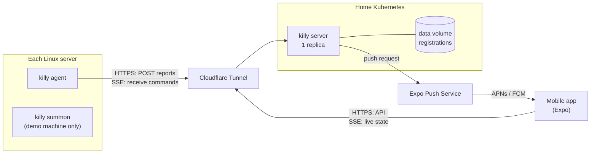
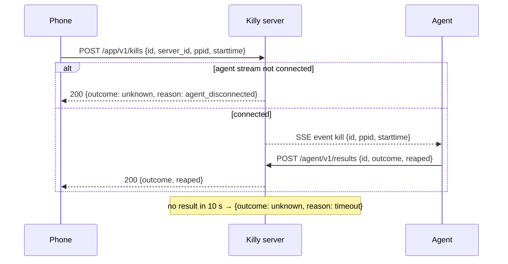
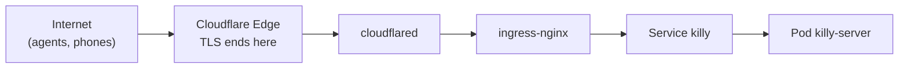

# Killy — Architecture

This document is the source of truth for **how Killy is built**: components, the protocol between them, how the safety guarantees are enforced, and how it is deployed.
What Killy must do is in [PRD.md](PRD.md); the app's screens and motion are in [DESIGN.md](DESIGN.md).

## Components



Every connection is opened from the agent or the phone toward the Killy server; the server never connects to an agent, so no server needs an open inbound port.

| Component | Responsibility |
|---|---|
| `killy agent` | Scans `/proc` for zombies, reports them, receives commands, verifies and executes kills, answers pings. |
| `killy server` | Relays between agents and phones: stores registrations, keeps live state in memory, fans out state over SSE, sends push notifications, routes commands and waits for their results. |
| `killy summon` | Demo only: keeps creating parent processes that leave zombies. |
| Mobile app | Pairing, settings, the battle screen, receiving notifications. |

`agent`, `server` and `summon` are subcommands of one Go binary, `killy`.

## Agent

### Scanning

Every 5 s the agent reads `/proc/<pid>/stat` for all processes and keeps those in state `Z`. For each distinct parent PID it reads the parent's `/proc/<ppid>/stat` (start time, field 22) and `/proc/<ppid>/cmdline`. Only the Go standard library is used.

A parent is identified by `(ppid, starttime)`. A zombie whose parent is PID 1 is not reported: init reaps it and Killy may not kill PID 1.

### Reporting

The agent sends a full snapshot every 15 s and immediately when the set of parents changes. A snapshot is a full replacement, never a diff, so a lost report is fixed by the next one.

### Kill procedure

On a `kill` command `{id, ppid, starttime}`:

1. If `id` was already handled, resend the stored outcome and stop.
2. Re-read `/proc/<ppid>/stat`. If it is missing → outcome `already_gone`.
3. Refuse (outcome `refused` with a reason, no signal) when any of these holds:
   - the start time differs from `starttime` (`pid_reused`),
   - the process has no zombie children any more (`not_a_zombie_parent`),
   - `ppid` is 1, the agent itself, or an ancestor of the agent (`protected`),
   - demo mode is on and the process does not carry the summon marker (`not_demo`).
4. Send `SIGKILL`. On error → outcome `signal_failed` with the errno.
5. Poll for up to 5 s until none of the former zombies remain → outcome `killed` with the number reaped; otherwise `zombies_remain`.
6. Store the outcome under `id` (kept for 10 minutes) and post it.

The agent needs permission to signal other users' processes and to read their environment: run it as root under systemd, or grant `CAP_KILL` and `CAP_SYS_PTRACE`.

### Pairing

`killy agent pair --server <url>` registers with the server, stores the returned agent token in `/etc/killy/agent.json` (mode 0600), and prints a 6-character code and a QR code encoding `killy://pair?code=<code>&server=<url>`. `killy agent run` is the long-running service.

## Killy server

### State

| State | Where | Lost on restart? |
|---|---|---|
| Agents, devices, links between them, display names, notification switches | JSON file on a persistent volume, written atomically | No |
| Pairing codes | Memory | Yes (operator re-runs `pair`) |
| Latest snapshot per agent, first-detection time per parent, open SSE streams, pending commands, notified parent keys | Memory | Yes (rebuilt as agents reconnect and report) |

Tokens are 32 random bytes; only their SHA-256 is stored.

### Notifications

When a snapshot contains a parent key `(agent, ppid, starttime)` not seen before, the server sends one push per linked device whose app switch and server switch are on. The notification text is specified in DESIGN.md ("Push notification").

### Commands

Kill and connection check are both "send over the agent's SSE stream, wait for the agent's POST". The server answers the phone's HTTP request synchronously with the result.



The connection check is the same exchange with `ping {id}` / `pong {id, version}`, a 5 s timeout, and results `ok`, `agent_disconnected` or `no_response`. A failed request from the phone itself means the phone cannot reach the server. Checks for the same server are limited to one per 2 seconds.

## Protocol

All bodies are JSON. Agents authenticate with `Authorization: Bearer <agent token>`, phones with `Authorization: Bearer <device token>`.

### Agent API

| Method and path | Purpose |
|---|---|
| `POST /agent/v1/pairings` | Register (first run) or create a new pairing code; returns token and code |
| `GET /agent/v1/commands` | SSE stream of `kill` and `ping` events |
| `POST /agent/v1/snapshots` | `{hostname, version, scanned_at, parents: [{pid, starttime, cmd, zombies: [pid]}]}` |
| `POST /agent/v1/results` | `{id, type: kill \| pong, outcome, reaped, reason, version}` |

### App API

| Method and path | Purpose |
|---|---|
| `POST /app/v1/devices` | Register the device: `{push_token, locale}` → device token |
| `PATCH /app/v1/devices/me` | App-wide notification switch, push token refresh |
| `POST /app/v1/pairings/claim` | `{code, name?}` → the added server |
| `POST /app/v1/demo` | Add the public demo server |
| `GET /app/v1/events` | SSE stream: `state` events with every linked server and its parents, each parent with its first-detection time (the app orders the battle queue by it, oldest first) |
| `PATCH /app/v1/servers/{id}` | `{name?, notify?}` |
| `DELETE /app/v1/servers/{id}` | Unlink this device from the server |
| `POST /app/v1/servers/{id}/check` | Connection check (see Commands) |
| `POST /app/v1/kills` | Kill (see Commands) |

### SSE rules

- Each stream sends a comment line (`: hb`) every 20 s so Cloudflare and the ingress do not close idle streams.
- On (re)connect the server first sends the full current state.
- The Go handlers disable write deadlines for SSE routes with `http.ResponseController` and flush after every event.
- Clients reconnect with exponential backoff (1 s → 30 s) plus random jitter, so a server restart does not cause a reconnect burst.

## Timing

| Value | Setting |
|---|---|
| Agent scan interval | 5 s |
| Snapshot interval when nothing changes | 15 s |
| Agent considered disconnected after no snapshot | 60 s |
| SSE heartbeat | 20 s |
| Connection check timeout | 5 s |
| Kill result timeout | 10 s |
| Pairing code lifetime | 10 min |

## Demo environment

The demo Linux machine runs `killy agent run --demo` and `killy summon`, both as systemd services. `summon` starts parent processes under varied names (e.g. `node evil_daemon.js`, `python3 worker.py`) that fork children which exit immediately and are never waited for. Each parent carries the environment variable `KILLY_SUMMONED=1`, which demo mode requires before killing. `summon` keeps at most 3 parents alive and starts a new one every 2 minutes.

Demo zombies must not be created by the agent itself: the agent would be their parent and is protected from kills.

## Deployment

The Killy server runs on the home Kubernetes cluster and is published through the existing Cloudflare Tunnel. The cluster's conventions (GitOps, registry, secrets, node layout) are owned by the aidd-infra repository's `DEPLOY.md`; this section records only Killy's choices.



No DNS record, tunnel route or certificate is added: the tunnel already sends `*.sumire.pink` to ingress-nginx, and the Ingress `host` selects Killy.

| Item | Setting |
|---|---|
| Hostnames | `killy.sumire.pink` (production), `stg-killy.sumire.pink` (staging) |
| Namespace | `killy` (staging: `stg-killy`) |
| Manifests | Kustomize in this repository: `deploy/base/` (`Deployment`, `Service`, `Ingress`, `PersistentVolumeClaim`, `SealedSecret`) and `deploy/overlays/stg/`, `deploy/overlays/prd/`. Argo CD applications `stg-killy` and `killy` (AppProject `killy`) watch the overlays. Never `kubectl apply` by hand |
| Deployment | `replicas: 1`, `strategy: Recreate`, requests and limits set, node affinity that excludes control-plane nodes |
| Ingress | `ingressClassName: nginx`; annotations `nginx.ingress.kubernetes.io/proxy-buffering: "off"`, `proxy-read-timeout: "3600"`, `proxy-send-timeout: "3600"` |
| SSE responses | `Content-Type: text/event-stream`, `Cache-Control: no-cache`, heartbeat comment every 20 s |
| Storage | 1Gi PVC on `local-path` (cannot be expanded later), which pins the Pod to the storage node: add its toleration and node affinity |
| Image | `10.1.1.10:5000/killy/server:<immutable tag>`, pinned by digest in kustomize `images[]`; base images pulled through the mirror at `10.1.1.10:5001` |
| Image build | While the repository is private: GitHub Actions on the cluster's self-hosted runner (`runs-on: arc-runner-killy`) with the shared BuildKit (`docker/setup-buildx-action` with the remote driver at `tcp://buildkitd.arc-runners.svc:1234`), pushing to the registry above. The runner image has no Go; install it in the job with `actions/setup-go`. The last image before going public is built this way and its digest pinned. Once public: GitHub-hosted runners only for CI (a self-hosted runner would let fork pull requests run code inside the LAN); they cannot reach the LAN registry, so later production images are built by a `workflow_dispatch` workflow in the aidd-infra repository (created by the infrastructure owner when the repository goes public) that builds a given Killy commit, pushes it to the registry and reports the digest; Killy then updates the digest in `deploy/` by pull request |
| Secrets | `EXPO_ACCESS_TOKEN` and similar only as `SealedSecret` (`kubeseal --controller-namespace kube-system --controller-name sealed-secrets-controller --scope strict`). No plain secrets in the repository or in chat |
| Configuration | `KILLY_PUBLIC_URL=https://killy.sumire.pink`, `KILLY_DATA_DIR` (the PVC mount) |
| Client address | Read `CF-Connecting-IP`; the TCP peer address is the cluster's, not the client's |
| Access control | All authorization is in the app (tokens). The cluster does not enforce NetworkPolicy; rate limiting, if needed, is set in the Cloudflare dashboard |
| CPU | x86_64 without AVX; the static Go binary needs nothing special |

Before production:

- Stream SSE through `stg-killy.sumire.pink` for at least 10 minutes. SSE has not yet been run through this cluster's Cloudflare → cloudflared → ingress-nginx path.
- Ask the infrastructure owner to register the Argo CD AppProject and Application for Killy.

Availability: with one replica and `Recreate`, a node reboot or eviction stops the server for seconds to minutes until Argo CD and Kubernetes bring it back. The home cluster gives no uptime guarantee, including during judging. Agents and phones reconnect on their own (see "SSE rules").

## Mobile app

| Concern | Choice |
|---|---|
| Framework | Expo (current SDK), TypeScript, development builds (Expo Go cannot receive push) |
| Drawing | `react-native-svg` (artwork is ported from `mock/art.js`) |
| Animation | `react-native-reanimated` |
| SSE | `react-native-sse` or `expo/fetch` streaming |
| Push | `expo-notifications` |
| QR | `expo-camera` |
| Secrets | Device token in `expo-secure-store` |
| Builds | EAS: iOS to TestFlight (public link), Android APK |

## Repository layout

```text
killy/
├── .kiro/            # steering and specs for Kiro (committed)
├── cmd/killy/        # main: agent, server, summon subcommands
├── internal/
│   ├── proc/         # /proc parsing
│   ├── agent/
│   ├── server/
│   ├── summon/
│   └── protocol/     # shared request/response types
├── mobile/           # Expo app
├── deploy/           # kustomize base and overlays (stg, prd), applied by Argo CD
├── docs/             # PRD, ARCHITECTURE, DESIGN
└── mock/             # HTML prototype of the app (reference, not shipped)
```
