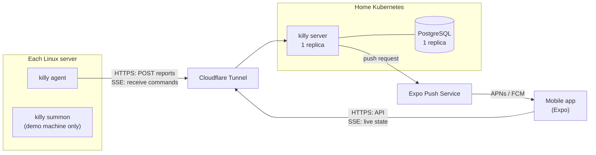
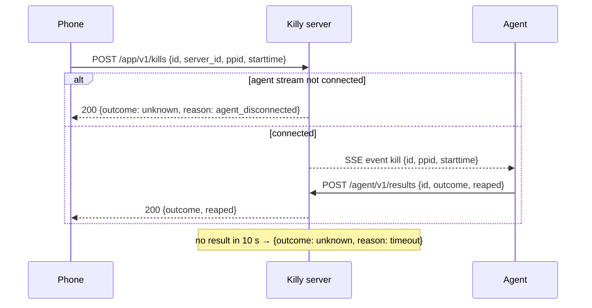
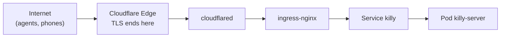

# Killy — Architecture

This document is the source of truth for **how Killy is built**: components, the protocol between them, how the safety guarantees are enforced, and how it is deployed.
What Killy must do is in [PRD.md](PRD.md); the app's screens and motion are in [DESIGN.md](DESIGN.md).

## Components



Every connection is opened from the agent or the phone toward the Killy server; the server never connects to an agent, so no server needs an open inbound port.

| Component | Responsibility |
|---|---|
| `killy agent` | Scans `/proc` for zombies, reports them, receives commands, verifies and executes kills, answers pings. |
| `killy server` | Relays between agents and phones: stores registrations in PostgreSQL, keeps live state in memory, fans out state over SSE, sends push notifications, routes commands and waits for their results. |
| `killy summon` | Demo only: keeps creating parent processes that leave zombies. |
| Mobile app | Pairing, settings, the battle screen, receiving notifications. |

`agent`, `server` and `summon` are subcommands of one Go binary, `killy`.

### Go dependencies

Scanning `/proc` and the kill procedure (`internal/proc` and the agent's kill code) use only the Go standard library, because they carry Killy's safety guarantees. Everything else may use only the external modules listed here; add a module to this list before using it.

| Module | Use |
|---|---|
| `github.com/jackc/pgx/v5` | PostgreSQL driver |
| `github.com/pressly/goose/v3` | Schema migrations (each runs in a transaction and rolls back on failure) |
| `github.com/skip2/go-qrcode` | QR code printed by `killy agent pair` |

## Agent

### Scanning

Every 5 s the agent reads `/proc/<pid>/stat` for all processes and keeps those in state `Z`. For each distinct parent PID it reads the parent's `/proc/<ppid>/stat` (start time, field 22) and `/proc/<ppid>/cmdline`.

A parent is identified by `(ppid, starttime)`. A zombie whose parent is PID 1 is not reported: init reaps it and Killy may not kill PID 1. In demo mode (`killy agent run --demo`) the agent reports only parents in the cgroup of `killy-summon.service`, so the public demo shows nothing it cannot kill and no other command lines of the demo machine.

### Reporting

The agent sends a full snapshot every 15 s and immediately when the set of parents changes. A snapshot is a full replacement, never a diff, so a lost report is fixed by the next one.

### Kill procedure

On a `kill` command `{id, ppid, starttime}`:

1. If `id` is not a UUID v4, ignore the command. If `id` was already handled, resend the stored outcome and stop. Kills for the same `(ppid, starttime)` are handled one at a time: a kill waits until the previous one for that parent has stored its outcome.
2. Open a pidfd for `ppid` (`pidfd_open`). If no such process exists → outcome `already_gone`. If pidfd is not available (Linux older than 5.3, or blocked by seccomp) → outcome `refused` (`pidfd_unavailable`); the agent never falls back to signalling by PID.
3. Re-read `/proc/<ppid>/stat`. If it is missing → `already_gone`. If the start time differs from `starttime` → `refused` (`pid_reused`). If the process itself is in state `Z` (already killed, not yet reaped by its own parent) → `already_gone`.
4. Refuse (outcome `refused` with a reason, no signal) when any of these holds:
   - the process has no zombie children any more (`not_a_zombie_parent`),
   - `ppid` is 1, the agent itself, or an ancestor of the agent (`protected`),
   - demo mode is on and the process's cgroup (the `0::` line of `/proc/<ppid>/cgroup`, cgroup v2) is not exactly `/system.slice/killy-summon.service` (`not_demo`). The match is exact: a user's own unit with the same name lives under `/user.slice/…` and does not count. When the cgroup file cannot be read, a process that no longer exists is `already_gone` and any other is `not_demo`; a file without a `0::` line (cgroup v1 only) is `not_demo` too, so a parent whose origin cannot be checked is never killed.
5. Send `SIGKILL` through the pidfd (`pidfd_send_signal`). If the PID was reused after step 2, the pidfd still refers to the old process, so the signal cannot reach the new one. If the process has exited and been reaped since step 3 (`ESRCH`) → `already_gone`. If it has exited but is not reaped yet, the kernel accepts the signal, which has no effect, and step 6 decides the outcome; this window between step 3 and the send cannot be closed and is accepted. On any other error → `signal_failed` with the errno.
6. Poll for up to 5 s until none of the former zombies remain → outcome `killed` with the number reaped; otherwise `zombies_remain`.
7. Store the outcome under `id` in `/var/lib/killy/outcomes.jsonl` (append-only, mode 0600, never expired, so a repeated `id` is recognised even after the agent restarts) and post it. If the write fails, the agent logs it and posts the outcome anyway; it does not retry the write. The outcome is still kept in memory, so the same `id` arriving again before the agent restarts gets that outcome without a second signal. The PRD accepts that such an `id`, or one whose agent stopped between steps 5 and 7, may be handled again.

The pidfd calls are made directly through the `syscall` package: `os.Process.Signal` silently falls back to signalling by PID when pidfd is missing. At startup the agent checks that pidfd is available and logs an error if it is not.

The agent needs permission to signal other users' processes: run it as root under systemd, or grant `CAP_KILL`.

### Pairing

`killy agent pair --server <url>` registers with the server and prints a 6-character code (upper-case letters and digits), a QR code encoding `killy://pair?code=<code>&server=<url>`, and the agent ID. The agent ID is not a secret; it is the same value as the server `id` in the App API and is what `KILLY_DEMO_AGENT_ID` takes (see "Demo environment"). `killy agent run` is the long-running service.

- **First run** (no `/etc/killy/agent.json`): `POST /agent/v1/pairings` with no token, sending the hostname. Anyone may register: a new agent sees nothing and appears on no phone until a phone claims its code. The returned agent token is stored in `/etc/killy/agent.json` (mode 0600).
- **Later runs**: the same request with the agent token creates a new code for the same agent. No code is issued for an existing agent without its token.
- **Claim**: a claim succeeds as soon as the code is valid; it does not wait for the agent. Without a display name, the hostname sent at registration is used.
- **Links**: the display name and the per-server notification switch belong to the link between one device and one agent, so a change on one phone does not affect another.
- **QR**: the app connects only to the Killy server it was built for. The `server` in a QR code must match it; otherwise the app shows an error and sends nothing, so a QR code cannot make the app send its device token elsewhere. The match ignores the case of the scheme and host, a default port and a trailing `/`. A scanned code only fills the code field; the claim is sent by Add, as for a typed code. The app also opens from a `killy://pair?…` link (the phone's own camera reading the QR code); the link gets the same checks, then the Add server sheet opens with the code in its field. Any other `killy://` link is not handled.

#### Rate limits

Counted per client address (`CF-Connecting-IP`; when the header is missing, as when the server runs locally without Cloudflare, the TCP peer address), in memory; a restart resets them, which is enough against short bursts. Kill requests are counted per device instead, because a device token is required to send them.

| Request | Limit | Over the limit |
|---|---|---|
| Failed claims (unknown, used or expired code) | 10 per 10 min per client address | `429` for every claim from that address, even one with a valid code, until the window passes; the app asks to wait and try again |
| First-run registrations | 10 per hour per client address | `429`; `killy agent pair` asks to wait |
| Device registrations (`POST /app/v1/devices`) | 10 per hour per client address | `429`; the app says so and tries again the next time it starts |
| Kill requests (`POST /app/v1/kills`) | 30 per minute per device | `429`; nothing is sent to the agent, the app shows it under the kill button and does not resend |

The kill limit is far above what holding the button for 1 s allows, and it bounds how fast anyone can grow an agent's stored outcomes (which never expire) through the public demo. Device registrations are limited too, because a client could otherwise register new devices to get around the per-device kill limit.

Attempts spread over many addresses are not stopped by this; add Cloudflare rate limiting if that happens.

## Killy server

### State

| State | Where | Lost on restart? |
|---|---|---|
| Agents, devices, links between them, display names, notification switches | PostgreSQL | No |
| First-detection time per parent `(agent, ppid, starttime)` | PostgreSQL | No |
| Notified `(parent, device)` pairs | PostgreSQL | No |
| Pairing codes | Memory | Yes (operator re-runs `pair`) |
| Latest snapshot and last snapshot time per agent, open SSE streams, pending commands, rate-limit counters | Memory | Yes (rebuilt as agents reconnect and report) |
| Failed push attempts per `(parent, device)` | Memory | Yes (counting starts again; the limit still applies after the restart) |

PostgreSQL is the only persistent store; the server keeps no files of its own. The schema is changed only by migrations embedded in the binary and applied when `killy server` starts. When a parent leaves an agent's snapshot, its first-detection time, notified pairs and failed push attempts are deleted. A snapshot whose `scanned_at` is older than the last one accepted from the same agent is discarded, so a late report cannot bring back a parent that is gone. The discarded snapshot is still answered with success, so the agent does not resend it; if the agent's clock steps back, its reports are ignored until the clock catches up and the agent looks disconnected meanwhile, which is accepted.

Tokens are 32 random bytes; only their SHA-256 is stored.

### Notifications

For each parent in a snapshot, the server sends one push to every linked device that has a push token, has both the app switch and the server switch on, and has not yet been notified of that parent. Because the notified pairs of a parent are deleted when it leaves the snapshot, a parent that comes back with zombies is notified again (a new episode); keeping them forever would let the table grow without end. The `(parent, device)` pair is recorded only after Expo Push Service accepts the push; if sending fails, nothing is recorded and the next snapshot (at most 15 s later) tries again. Retries are bounded so a lasting failure does not loop: when Expo reports that the push token is no longer valid (`DeviceNotRegistered`), the device's push token is removed and nothing more is sent to it until the app registers a new one; any other failure is retried with at most 3 later snapshots, after which the pair is recorded as notified and the push is given up. A whole request that Expo refuses with `400` is sent again one message at a time before anything is counted, because Expo refuses a request for what one message carries (a push token of another Expo project), and anyone can register a token: one device must not stop the pushes to the others. If the server stops after Expo accepts a push but before the pair is recorded, that one push is sent again after the restart; a push whose answer from Expo is lost or later than the 10 s the server waits counts as failed and is sent again, up to 3 more times like any other failure. "Accepted" means the push ticket Expo returns for the message is `ok`; the server does not fetch push receipts, so a `DeviceNotRegistered` that Expo reports only in a receipt goes unnoticed and that device's token is kept. The notification text is specified in DESIGN.md ("Push notification"). Pushes are sent whether or not the app is open; the app does not display them while it is in the foreground, so the server does not need to know which phones have the app open.

### Commands

Kill and connection check are both "send over the agent's SSE stream, wait for the agent's POST". The server answers the phone's HTTP request synchronously with the result.

The kill `id` is a UUID v4 chosen by the phone; the server answers `400` to any other form. If the phone gets no HTTP response at all (network error), it resends the same request with the same `id` once; the agent's step 1 makes the resend safe. The server only relays: it accepts a result only from the agent the command was sent to, and when two requests with the same `id` arrive together it sends one command and answers both with its result. Deciding that an `id` was already handled stays with the agent.



The connection check is the same exchange with `ping {id}` / `pong {id, version}`, a 5 s timeout, and results `ok` (with the agent version), `agent_disconnected` or `no_response`. It goes through the same stream as a kill, so a passing check means a kill can get through too. A failed request from the phone itself means the phone cannot reach the server. Checks for the same server are limited to one per 2 seconds: a check within 2 s of the previous one sends no ping and returns the result of the check in progress or of the last one. No round-trip time or last-heard time is measured or returned.

## Protocol

All bodies are JSON. Agents authenticate with `Authorization: Bearer <agent token>`, phones with `Authorization: Bearer <device token>`.

The request and response shapes, status codes and error codes are specified in [openapi.yaml](openapi.yaml), which is their source of truth. Every error has the body `{"error": "<code>"}`; kill outcomes, including `unknown`, are `200` responses, not errors. The tables below say what each endpoint is for.

### Agent API

| Method and path | Purpose |
|---|---|
| `POST /agent/v1/pairings` | With no token: register (first run) and get an agent token, the agent ID and a code. With the agent token: get the agent ID and a new code |
| `GET /agent/v1/commands` | SSE stream of `kill` and `ping` events |
| `POST /agent/v1/snapshots` | Report the full set of parents with zombies |
| `POST /agent/v1/results` | Return the result of a `kill` or `ping` |

### App API

| Method and path | Purpose |
|---|---|
| `POST /app/v1/devices` | Register the device and get a device token. The push token is optional, so a phone without notifications can still pair and fight |
| `PATCH /app/v1/devices/me` | App-wide notification switch, push token refresh |
| `POST /app/v1/pairings/claim` | Link this device to an agent with a pairing code |
| `POST /app/v1/demo` | Add the public demo server (the agent named by `KILLY_DEMO_AGENT_ID`; fails when it is unset) |
| `GET /app/v1/events` | SSE stream: `state` events with every linked server and its parents, each parent with its first-detection time (the app orders the battle queue by it, oldest first) |
| `PATCH /app/v1/servers/{id}` | Rename or mute the server, for this device's link only |
| `DELETE /app/v1/servers/{id}` | Unlink this device from the server |
| `POST /app/v1/servers/{id}/check` | Connection check (see Commands) |
| `POST /app/v1/kills` | Kill (see Commands) |

### SSE rules

- Each stream sends a comment line (`: hb`) every 20 s so Cloudflare and the ingress do not close idle streams.
- On (re)connect the server first sends the full current state.
- The Go handlers disable write deadlines for SSE routes with `http.ResponseController` and flush after every event.
- Clients reconnect with exponential backoff (1 s → 30 s) plus random jitter, so a server restart does not cause a reconnect burst.

### CORS

A browser page of another origin may call the App API only if the Killy server says so. The Web version of the demo (see "Demo environment") is such a page: it is served from `https://killy.sumire-sakamoto.co.jp` and calls `https://stg-killy.sumire.pink`. The native app is not a browser page and needs none of this.

- `KILLY_CORS_ORIGINS` is a comma-separated list of origins (scheme, host and an optional port; no path and no `*`). The server refuses to start when an item is not an origin. An item is read the way a browser sends it: the scheme and host in lower case, the default port left out. Unset or empty, the server adds no CORS header to any response (`Vary: Origin` included), as before.
- A request under `/app/v1/` whose `Origin` equals one of the listed origins gets `Access-Control-Allow-Origin` with that origin, on every response: successes, errors (`401`, `429`; without it the page cannot read the status) and the event stream. While the list is set, every response under `/app/v1/` also has `Vary: Origin`, whatever the origin. `*` is never returned, and neither is `Access-Control-Allow-Credentials`, because the app sends a Bearer token and no cookie.
- A preflight (`OPTIONS` with `Origin` and `Access-Control-Request-Method`) from a listed origin is answered `204` with `Access-Control-Allow-Methods: GET, POST, PATCH, DELETE`, `Access-Control-Allow-Headers: Authorization, Content-Type` and `Access-Control-Max-Age: 600`, before authentication and the rate limits, so a preflight uses up no limit. From any other origin it gets no `Access-Control-*` header and the answer it always had (`405`).
- `/agent/v1/` gets none of this: agents are not browsers.
- CORS does not authenticate anyone. A listed origin's request without a valid token is `401` like any other, and the rate limits are unchanged.
- Only `deploy/overlays/stg/` sets it, to `https://killy.sumire-sakamoto.co.jp`. Production sets none.

## Timing

| Value | Setting |
|---|---|
| Agent scan interval | 5 s |
| Snapshot interval when nothing changes | 15 s |
| Agent considered disconnected after no snapshot | 60 s |
| SSE heartbeat | 20 s |
| Connection check timeout | 5 s |
| Kill result timeout | 10 s |
| Pairing code lifetime | 10 min |
| Failed claims per client address | 10 per 10 min |
| First-run registrations per client address | 10 per hour |
| Device registrations per client address | 10 per hour |
| Kill requests per device | 30 per minute |

## Demo environment

The demo Linux machine runs `killy agent run --demo` and `killy summon`, both as systemd services; summon runs as `killy-summon.service`. `summon` starts parent processes under varied names (e.g. `node evil_daemon.js`, `python3 worker.py`) that fork children which exit immediately and are never waited for. The parents inherit the service's cgroup, which demo mode requires before killing; only root can move a process into another cgroup, so the check cannot be faked by an ordinary process. `summon` keeps at most 3 parents alive, starts a new one every 2 minutes, and reaps a parent as soon as it exits (otherwise summon itself would become a parent with zombies, inside its own cgroup, and could be killed through the demo).

Demo zombies must not be created by the agent itself: the agent would be their parent and is protected from kills.

The Killy server offers the demo agent named by `KILLY_DEMO_AGENT_ID`. The agent ID is known only after the demo machine is paired with the server (`killy agent pair` prints it), and it is not a secret, so it is set in the overlay. When it is unset, `POST /app/v1/demo` fails and the app says the demo server is not available.

The demo is for the hackathon's judging only, so it lives on staging: the demo machine is paired with `stg-killy.sumire.pink` and `KILLY_DEMO_AGENT_ID` is set in `deploy/overlays/stg/` only. Production has no demo agent. The builds for the judges connect to staging and are built with `EXPO_PUBLIC_KILLY_DEMO=1`, which shows "Try the demo server"; without it, as in builds that connect to production, the app has no such button. While judging runs, the staging image is not updated, because the judges are using it.

The Web demo is the same app built for the browser, for judges who install nothing: `https://killy.sumire-sakamoto.co.jp/demo/` (see "Distribution"). It is built with `EXPO_PUBLIC_KILLY_SERVER_URL=https://stg-killy.sumire.pink` and `EXPO_PUBLIC_KILLY_WEB_DEMO=1`, so it opens straight onto the demo: once the device is registered it calls `POST /app/v1/demo` (once per start; the server keeps a repeat as the one link) and shows the battle screen, with no pairing code, QR code or notifications. It calls the staging server from another origin, which is why staging sets `KILLY_CORS_ORIGINS` (see "CORS"); production sets none and has no Web demo. The safety checks and rate limits are the ones every client has: the agent in demo mode still kills only what `killy summon` made, and the server adds nothing for the Web.

## Deployment

The Killy server runs on the home Kubernetes cluster and is published through the existing Cloudflare Tunnel. The cluster's conventions (GitOps, registry, secrets, node layout) are owned by the aidd-infra repository's `DEPLOY.md`; this section records only Killy's choices.



No DNS record, tunnel route or certificate is added: the tunnel already sends `*.sumire.pink` to ingress-nginx, and the Ingress `host` selects Killy.

| Item | Setting |
|---|---|
| Hostnames | `killy.sumire.pink` (production), `stg-killy.sumire.pink` (staging; also the public demo for the hackathon's judges, see "Demo environment") |
| Namespace | `killy` (staging: `stg-killy`) |
| Manifests | Kustomize in this repository: `deploy/base/` (`Deployment`, `Service`, `Ingress`, PostgreSQL `StatefulSet` and `Service`) and `deploy/overlays/stg/`, `deploy/overlays/prd/`, each with its own `SealedSecret`. Argo CD applications `stg-killy` and `killy` (AppProject `killy`) watch the overlays. Never `kubectl apply` by hand |
| Deployment | `replicas: 1`, `strategy: Recreate`, requests and limits set, node affinity that excludes control-plane nodes |
| Ingress | `ingressClassName: nginx`; annotations `nginx.ingress.kubernetes.io/proxy-buffering: "off"`, `proxy-read-timeout: "3600"`, `proxy-send-timeout: "3600"` |
| SSE responses | `Content-Type: text/event-stream`, `Cache-Control: no-cache`, heartbeat comment every 20 s |
| Database | PostgreSQL 18.7 as a `StatefulSet` with one replica in the same namespace, run from the official image (`postgres:18.7`) pulled through the mirror and pinned by digest. There is no shared database on the cluster. Tests do not use PostgreSQL: the code that needs the database depends on interfaces, and unit tests use an in-memory fake. The SQL and the migrations are exercised only by running `killy server` against PostgreSQL (locally and on staging) |
| Storage | The PostgreSQL `StatefulSet` has a 5Gi PVC on `local-path` (cannot be expanded later), which pins its Pod to the storage node: add its toleration and node affinity. The Killy server Pod has no volume |
| Backup | None, as an exception to the cluster's rule (aidd-infra's `DEPLOY.md`) that an app with a database runs a daily backup `CronJob`. Losing the database loses only registrations: agents, devices, the links between them, display names and notification switches. Every token stored by an agent or a phone is then rejected with `401`. An agent recovers when its operator removes `/etc/killy/agent.json` and runs `killy agent pair` again, as the command says. A phone recovers by itself: when a call with its device token gets `401`, the app registers again once and repeats the call (see "Mobile app"); its links are gone and are added again. Zombies come back with the next reports, and a parent that still holds zombies is notified again |
| Image | `10.1.1.10:5000/killy/server:<immutable tag>`, pinned by digest in kustomize `images[]`; base images pulled through the mirror at `10.1.1.10:5001` |
| Image build | This repository has no image workflow, and all of its workflows run on GitHub-hosted runners (`ubuntu-24.04`; the Go tests also run on `ubuntu-24.04-arm`, because the agent is released for arm64), because a self-hosted runner would let fork pull requests run code inside the LAN once the repository is public. GitHub-hosted runners cannot reach the LAN registry. The last image built from this repository (on the cluster's self-hosted runner, before it was removed) is the one pinned in `deploy/overlays/stg/` and `deploy/overlays/prd/`. After the repository is public, a production image is built by a `workflow_dispatch` workflow in the aidd-infra repository that takes a Killy commit SHA, builds it with the shared BuildKit, pushes `10.1.1.10:5000/killy/server:<commit SHA>` and reports the digest; Killy then pins that digest in `deploy/overlays/` by pull request. The infrastructure owner has been asked for that workflow; it does not exist yet. The registry allows overwriting tags, so deploy only by digest |
| Secrets | `EXPO_ACCESS_TOKEN`, the PostgreSQL password and similar only as `SealedSecret` (`kubeseal --controller-namespace kube-system --controller-name sealed-secrets-controller --scope strict`), one per overlay: strict scope binds the ciphertext to the Secret's name and namespace, so staging and production cannot share one, and their values differ. No plain secrets in the repository or in chat |
| Configuration | `KILLY_DATABASE_URL` (from the `SealedSecret`, because it contains the PostgreSQL password), `KILLY_DEMO_AGENT_ID` (see "Demo environment"), `KILLY_CORS_ORIGINS` (see "CORS"; staging only); `EXPO_ACCESS_TOKEN` only if Expo's push security is turned on (it is not) |
| Client address | Read `CF-Connecting-IP`; the TCP peer address is the cluster's, not the client's. Used for the pairing rate limits |
| Access control | All authorization is in the app (tokens). The cluster does not enforce NetworkPolicy; the pairing rate limits are in the server, and further rate limiting, if needed, is set in the Cloudflare dashboard |
| CPU | x86_64 without AVX; the static Go binary needs nothing special |

Before production:

- Stream SSE through `stg-killy.sumire.pink` for at least 10 minutes. SSE has not yet been run through this cluster's Cloudflare → cloudflared → ingress-nginx path.
- Once `deploy/` is on `main`, ask the infrastructure owner to register the Argo CD AppProject `killy`, the Applications `stg-killy` and `killy`, and the deploy key `argocd-killy`.

Availability: with one replica and `Recreate`, a node reboot or eviction stops the server for seconds to minutes until Argo CD and Kubernetes bring it back. The home cluster gives no uptime guarantee, including during judging. Agents and phones reconnect on their own (see "SSE rules").

## Mobile app

| Concern | Choice |
|---|---|
| Framework | Expo (current SDK), TypeScript, development builds (Expo Go cannot receive push) |
| Drawing | `react-native-svg` (artwork is ported from `mock/art.js`) |
| Animation | `react-native-reanimated` |
| SSE | `expo/fetch` streaming (Expo installs it as the global `fetch`), split into events by a small parser in the app |
| Push | `expo-notifications` |
| QR | `expo-camera` |
| Secrets | Device token in `expo-secure-store`, under a key made from the Killy server's URL (`device_token.<URL with every character other than letters, digits, `.`, `-` and `_` replaced by `_`>`), so a phone that has run builds for staging and production, which iOS allows because it keeps Keychain items when an app is replaced, never sends one server's token to the other. When a call with the token gets `401` (the server does not know it), the app registers the device again once, saves the new token and repeats the call once; a `401` for a token it just registered is not answered with another registration. A token saved by an earlier version under the single key `device_token` is not read |
| Web | The same code built by Expo for the browser (`react-native-web`, `web.output: static`, served under `/demo/` through `experiments.baseUrl`, which `mobile/app.config.js` adds only when `EXPO_PUBLIC_KILLY_WEB_DEMO=1`, so phone builds never get it). Files named `*.web.ts` replace the native ones in a Web build: the device token and the settings are kept in the browser's `localStorage` (`deps.web.ts`, `prefs.web.ts`; the same key as the Secrets row), and notifications do nothing (`notifications.web.ts`). The Web version of the demo has no Add server, no QR code and no Notifications row, and sits in a 430 px frame on a wide screen |
| Builds | EAS: iOS to TestFlight (public link), Android to Google Play open testing and as an APK attached to the GitHub Release (see "Distribution"). The Killy server is fixed per build by `EXPO_PUBLIC_KILLY_SERVER_URL`; `EXPO_PUBLIC_KILLY_DEMO=1` shows "Try the demo server" (see "Demo environment"). The builds for the hackathon's judges (profiles `testflight`, `play`, `apk`) connect to staging with the demo on. The store release builds (profile `production`: App Store and Google Play Production) connect to `https://killy.sumire.pink` and do not set `EXPO_PUBLIC_KILLY_DEMO`, so they have no demo button |

## Distribution

Operators and judges get the agent binaries from the introduction site's `/download/` (not from GitHub, so they stay available when the repository is private), the judges' iOS app through a TestFlight public link and their Android app through a Google Play open testing link (the store release goes through the App Store and Google Play Production, see the table); the Android APK is on the GitHub Releases, for anyone who does not use Google Play and in case the Play review is late. Before the repository is public, and again once it is private, only the team can download from the Releases.

| Artifact | How it is produced |
|---|---|
| `killy` for linux/amd64 and linux/arm64 | Files `killy-linux-amd64`, `killy-linux-arm64` and `SHA256SUMS`. A workflow (`release.yml`) builds them when a version tag (`v*`) is pushed, statically (`CGO_ENABLED=0`) with the tag as the version, and puts them on that tag's GitHub Release. It runs on a GitHub-hosted runner (it does not need the LAN registry). Users do not download from the Release: see "Agent download" |
| Agent download | `https://killy.sumire-sakamoto.co.jp/download/` holds `killy-linux-amd64`, `killy-linux-arm64`, `SHA256SUMS`, `killy-agent.service` and `VERSION`. The release tag to serve is the one line of `site/download/VERSION`, so a new tag reaches users only through a pull request that changes it. `deploy-site.yml` takes the binaries and `SHA256SUMS` of that tag from its GitHub Release with the job's `GITHUB_TOKEN` (which reads a private repository too), checks them with `sha256sum -c`, checks with `go version -m` that each carries that tag as its version, copies the unit from `deploy/systemd/killy-agent.service` of the commit being deployed (`site/` holds no copy) and uploads them with the site. Nothing is uploaded when a check fails. The binaries are never committed. `release.yml` stays the only place that builds them |
| Android on Google Play | Open testing track, joined through its link; the Play developer account is an organisation's, so no closed test is needed first. Built by EAS with the `play` profile of `mobile/eas.json` (an AAB, staging, with the demo). EAS's keystore is the upload key and Play App Signing holds the signing key. The privacy policy Play links to is the `/privacy/` page of the introduction site (next row), which opens while the repository is private, so the build can be sent for review before the repository is public |
| Introduction site | `site/`, published at `https://killy.sumire-sakamoto.co.jp`: a static top page (what Killy is, the App Store and Google Play badges that link to the store pages, how to install the agent), `/support/` and `/privacy/`, each in English and Japanese. `/support/` is for people who use the store release: how to install the agent for `https://killy.sumire.pink` (requirements, the download and its `SHA256SUMS` check, pairing, the systemd unit, the connection check), what Killy promises, and a link to a Google Form for contact, opened in a new tab (no iframe). It does not mention staging or the demo. The form's URL is written once, in `site/support/form-url`; the page carries a `__CONTACT_FORM_URL__` mark that `deploy-site.yml` replaces, and while the file is empty or is not a Google Forms `…/viewform` URL the workflow fails before uploading anything, so no placeholder address is published. The site only links to the form and loads nothing from Google; the repository's pages link to no GitHub URL. The badges in `site/badges/` are the images Apple and Google distribute, unaltered, in English and Japanese; the top page shows the one for the page's language, and a badge links nowhere until its store page exists. The workflow `deploy-site.yml` copies `site/` (with `/download/`, see "Agent download", and `/demo/`, see "Web demo") to the team's web host with rsync when `site/`, `mobile/` or the agent's unit changes on `main`. It does not use `--delete`, because the host holds an `.htaccess`; the subdomain, TLS and `.htaccess` belong to the sumiredc/sumire-sakamoto repository. It runs on a GitHub-hosted runner. `/privacy/` is generated by `go run ./tools/privacypage` from [PRIVACY.md](PRIVACY.md), the source of truth, and [PRIVACY.ja.md](PRIVACY.ja.md), its translation; `go test ./...` fails when the committed page differs from them, when the two documents differ in structure, or when the translation's date differs. `tools/siteassets/build.sh` builds the site's images from `mock/art.js` and the app icon. The site loads nothing from a third party |
| Web demo | `https://killy.sumire-sakamoto.co.jp/demo/`, for judges who install nothing. every run of `deploy-site.yml` builds it (the workflow runs when `site/`, `mobile/` or the agent's unit changes on `main`): `npx expo export --platform web` with `EXPO_PUBLIC_KILLY_SERVER_URL=https://stg-killy.sumire.pink` and `EXPO_PUBLIC_KILLY_WEB_DEMO=1`, into `out/demo/`, then uploads it with the rest of the site. Each page's `<route>.html` is also written to `<route>/index.html`, so a route opened directly (a reload on Settings) works without changing the host's `.htaccess`. A failing build uploads nothing, and the deploy key is placed only after the build. `ci.yml` runs the same export on pull requests. The upload adds files and does not delete, so an older build stays on the host until someone removes `demo/` there |
| Store release (App Store and Google Play Production) | The `production` profile of `mobile/eas.json`: `distribution: store`, `autoIncrement`, an AAB on Android, `EXPO_PUBLIC_KILLY_SERVER_URL=https://killy.sumire.pink` and no `EXPO_PUBLIC_KILLY_DEMO`, so the app has no demo button. `submit.production` holds the App Store Connect app ID for iOS, the same as `submit.testflight`; there is no Android submit setting, because the Play service account key is not kept in the repository. The builds are made and submitted by a person (`npx eas-cli build --profile production`, then `npx eas-cli submit --profile production` for iOS and Play Console for Android). The judges' builds stay on TestFlight and the Play open test; the release builds do not replace them |
| Android APK | File `killy-android.apk`. Built by EAS with the `apk` profile of `mobile/eas.json` (staging, with the demo) and attached by hand to the Release whose binaries it goes with; EAS's own download links are not used, because how long they are kept is not known |
| systemd units | `deploy/systemd/`: `killy-agent.service` (`killy agent run`, as root), `killy-agent-demo.service` (`killy agent run --demo`) and `killy-summon.service` (`killy summon`) |

Attaching the APK, with `TAG` set to the Release (for example `v0.1.0`):

```sh
cd mobile && npx eas-cli build --platform android --profile apk
```

```sh
curl -fL -o killy-android.apk "$(npx eas-cli build:list --platform android --build-profile apk --status finished --limit 1 --json | jq -r '.[0].artifacts.buildUrl')"
```

```sh
gh release upload "$TAG" killy-android.apk -R sumiredc/killy
```

## Repository layout

```text
killy/
├── .kiro/            # steering and specs for Kiro (committed)
├── cmd/killy/        # main: agent, server, summon subcommands
├── internal/
│   ├── proc/         # /proc parsing
│   ├── agent/
│   ├── server/
│   ├── summon/
│   └── protocol/     # shared request/response types
├── mobile/           # Expo app
├── deploy/           # kustomize base and overlays (stg, prd), applied by Argo CD
│   └── systemd/      # units for the agent and summon on Linux servers
├── site/             # introduction site and privacy policy page, copied to the web host (see "Distribution")
├── tools/            # mergegate (merge hook), privacypage and siteassets (generate site/)
├── docs/             # PRD, ARCHITECTURE, DESIGN, PRIVACY (and Japanese translations), openapi.yaml
└── mock/             # HTML prototype of the app (reference, not shipped)
```
