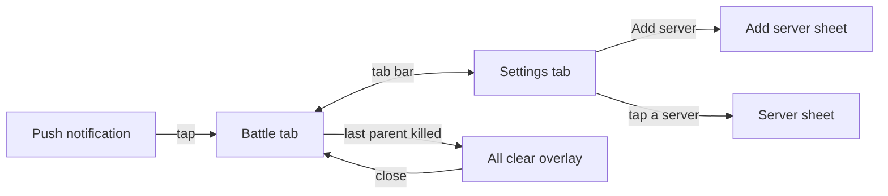

# Killy — App Design

This document is the source of truth for **how the mobile app looks and moves**: design tokens, screens, characters and animation timing.
The HTML prototype in [`mock/`](../mock/) shows all of it running; open `mock/index.html` in a browser. Exact artwork (SVG paths and colours) lives in [`mock/art.js`](../mock/art.js) and is ported as is. Starting copy for both languages is the `I18N` table in [`mock/app.js`](../mock/app.js); once moved into the app's translation files, those files become the source. Requirements are in [PRD.md](PRD.md); Killy's behaviour rules are in [.kiro/steering/killy-character.md](../.kiro/steering/killy-character.md).

## Principles

- **Looks like Kiro.** Pure black, violet-tinted greys, one strong purple (`#9046FF`), generous rounding, a semi-monospace voice.
- **One memorable thing per screen.** On the battle screen it is the scene: Killy facing right with the Enter-key scythe, the necromancer in front of the moon pulling marionette strings. Everything around it stays quiet.
- **Killy never speaks.** All explanation is plain system text next to Killy; Killy only reacts.
- **Always say which server.** Every enemy shows the server it lives on.

## Design tokens

| Token | Value | Use |
|---|---|---|
| `bg` | `#000000` | Screen background |
| `elev-1` | `#19161F` | Arena, cards, sheets |
| `elev-2` | `#26222D` | Inputs, stat tiles, segmented control |
| `elev-3` | `#322C3A` | Disabled button, switch off |
| `line` | `#3A3443` | Borders, dividers |
| `text` | `#FAFAFA` | Primary text |
| `muted` | `#958F9E` | Secondary text |
| `purple` | `#9046FF` | Primary buttons, active states |
| `purple-300` | `#BF9EFF` | Accents, links, glowing eyes, strings |
| `purple-100` | `#E2D4FF` | Flash, soul, server chip text |
| `red` | `#F7506A` | Hold-to-kill fill, destructive actions, "SIGKILL" text |
| `green` | `#4FDB8F` | Success text ("PID … killed", connection OK) |

| Font | Use |
|---|---|
| Geist | Body text |
| Geist Mono | Numbers, PIDs, command lines, headings, button labels |
| Zen Kaku Gothic New | Japanese glyphs (fallback after Geist / Geist Mono) |

Radii: 24 (arena, sheets, cards), 20 (setting groups), 16 (primary button), 12 (inputs), 999 (pills, chips). Screen side gutter: 16. Reference screen: 390 × 844.

## Screens

The app has two tabs, Battle and Settings, in a footer tab bar. Sheets and the All-clear overlay cover the tab bar.

### Push notification

| Line | Content |
|---|---|
| Title | `Killy` |
| Body | `zombie ×3 on demo-linux-01`: the new parent's zombie count and the server's display name on this phone (monospace in the mock) |
| Last line | Killy symbol only: `……！` |

The command line and PID are not in the notification; the battle screen shows them.

### Battle tab

Top to bottom: arena (fills the space), kill button, tab bar. No header.

| Region | Content |
|---|---|
| Arena card | `elev-1`, radius 24, 1px `line` border, purple radial glow behind the necromancer, faint stars, a lavender moon (150px) behind the necromancer, a darker ground band (44px) at the bottom |
| Info (top-left) | Server chip (`demo-linux-01`, purple pill) → big zombie count (56px mono, 600) with label "体のゾンビプロセス" / "zombie processes" → `親 PID 3801` / `parent PID 3801` in `purple-300` → command line in `muted` |
| Queue order | Oldest detection first across all servers (the mock orders by server instead) |
| Parent counter (top-right) | One hood icon per parent in the queue, like lives: current = purple with glowing eyes and raised 2px; waiting = dark grey; killed = 22% opacity. With 5 or more parents: one hood and `× <remaining>` |
| Necromancer | 150px wide, centred at 63% of the arena width, top at 27%; floats and rocks the control bar |
| Zombies | On the ground, facing left. Slots (left %, bottom px, scale): front row (47, 40, 1), (63, 40, 1), (79, 40, 1); back row (55, 96, .84), (71, 96, .84), (87, 96, .84). PID under each in 10px mono. With more than 6, draw the first 6 and a `+N` chip next to the last slot; the big count still shows the real total (not in the mock) |
| Strings | 1px `purple-300` lines at 60% opacity from the nearest control-bar anchor to each zombie's head and front hand, recomputed every frame |
| Killy | 164px wide, bottom-left, facing right |
| Kill button | Full width, 64px, radius 16, `purple`. Label "長押しで kill" / "Hold to kill"; sub-label `SIGKILL → PID 3801 on demo-linux-01` |

After a kill, the info block briefly shows `PID 3801 を kill しました` / `PID 3801 killed` in `green` and `ゾンビ 3 体は init に回収されました` / `3 zombies reaped by init`.

Empty states replace the info block and hide the enemies; the kill button is disabled:

| State | Title | Text |
|---|---|---|
| No zombies | ゾンビプロセスはいません / No zombie processes | ゾンビプロセスは見つかっていません。見つかったら通知します。 / No zombie processes found. You will be notified when one appears. |
| No servers | サーバーがありません / No servers yet | 設定からサーバーを追加すると、監視が始まります。 |

### All clear overlay

Dimmed, blurred backdrop over everything. Card with Killy bowing (no scythe) and 🤍, title `All clear`, "すべてのサーバーのゾンビが成仏しました", two stat tiles (parents killed, zombies released), and one primary button "閉じる" / "Close". The app counts both numbers itself: parents whose kill outcome was `killed` in this battle, and the zombies shown for them when each kill started; `already_gone` is not counted.

### Settings tab

Title "設定" / "Settings" (mono 22px). Groups:

| Group | Rows |
|---|---|
| サーバー / Servers | One row per server: name (mono), sub-line `ゾンビプロセス 5 / 親 2` or "ゾンビプロセスなし" or "最新の状態を取得できていません", a purple count badge when there are zombies, and `›`. Tapping opens the server sheet. Below the group: dashed "＋ サーバーを追加" button |
| アプリ / App | Language (segmented 日本語 / English), Notifications (switch, with the hint "ゾンビプロセスが見つかったら知らせる") |

While Settings is open, the Battle tab shows a purple badge with the number of zombie processes waiting.

When the OS blocks notifications for Killy, the app Notifications row shows "OS で通知がブロックされています" / "Notifications are blocked by the OS" with a link to the system settings, and the switch is disabled (not in the mock).

### Add server sheet

1. Step list: "監視したいサーバーで、次のコマンドを実行します" with `killy agent pair` in a black code box; "表示された 6 文字のペアリングコードを入力します".
2. Code input: 24px mono, centred, letter-spaced, upper-case letters and digits only, max 6. "QR コードを読み取る" secondary button.
3. Display name (optional), placeholder "省略するとサーバーのホスト名を使います".
4. Actions: "キャンセル" (text) and "追加する" (primary, enabled at 6 characters).
5. Below the form: secondary button "デモサーバーを試す" / "Try the demo server", which adds the public demo server without a code (not in the mock). When no demo server is configured, the error box shows "デモサーバーは今使えません" / "The demo server is not available right now".

States: waiting (spinner, "追加しています…" / "Adding…"), added (Killy with 🤍, "‹name› を追加しました", closes after ~1.3 s), error (red box above the actions with the reason and what to do: unknown, used or expired code; QR code for another Killy server; too many attempts, wait and try again; Killy server unreachable).

### Server sheet

Display name input; group with Hostname (ホスト名; mono, read-only: the hostname the agent reports, so the server can be recognised after renaming), Connection (row title, result line, "確認する" pill button that becomes "もう一度確認"), and the server's notification switch; red outlined "このサーバーを削除" that turns solid red with "もう一度押すと削除します" on the first tap; hint "削除しても、サーバー上のエージェントは止まりません。"; "完了" button.

Connection results: checking (spinner + "エージェントに問い合わせています…"), OK (`green`, ✓, agent version), failure (light red, `!`, the message for the failing part as listed in PRD UC4). When the Killy server answers with an error instead of a result, the failure line says the connection could not be checked (not in the mock). The result is kept only while the sheet is open.

The notification switch is saved as soon as it is flipped. While a change is on its way, nothing else in the sheet can be changed and the sheet cannot be closed, until the Killy server answers. The display name is saved when "完了" is pressed, only if it is not empty after trimming and differs from the current name; otherwise "完了" just closes. The sheet closes once the name or the removal is saved. When a change cannot be saved (no answer, or an error), the sheet stays open and a `red` line under the name field, the switch or the remove button gives the reason; the switch goes back to the value the Killy server has (not in the mock).

### When the Killy server cannot be reached

There is no permanent connection indicator. Each request that fails shows its own error where it was made: the Add server error box, the Connection result, a red line under the control in the server sheet, or a red line under the kill button with the button re-enabled. The battle screen keeps showing the last snapshot until the event stream reconnects, which replaces it (not in the mock).

### Tab bar

84px including the home-indicator area, translucent black with blur, top border `line`. Two tabs: Battle (ghost outline icon, "撃退" / "Battle") and Settings (gear icon, "設定" / "Settings"). Active tab in `purple-300`. The Settings tab is disabled while a kill animation is running. Hidden on the lock-screen preview.

## Characters

All artwork is flat vector, drawn in `mock/art.js` (`killySVG`, `parentSVG`, `zombieSVG`, `soulSVG`, `hoodIconSVG`). Port each to a `react-native-svg` component, keeping the class-named parts below as separately animatable elements.

| Character | Look | Animatable parts |
|---|---|---|
| Killy | White ghost with a soft lavender gradient, two black oval eyes on the right side of the face (facing right), **no mouth**, tail trailing to the back-left, a small round hand holding the scythe | `ghost`, `eye` (blink), `scythe`, `arm` |
| Scythe | Curved dark shaft with a highlight and a purple butt cap; broad crescent blade sweeping forward with a dark spine and a white edge; a 3D purple Enter keycap (⏎) as the collar joining blade and shaft | Rotates around Killy's hand |
| Necromancer (a parent process) | Dark hooded robe facing left (hood tip trailing back-right), black face with two glowing `purple-300` eyes, wide sleeves, wispy hem; holds a marionette control bar (cross) in both hands with 5 string anchors | `glow`, `anchor` |
| Zombie (a zombie process) | Green skin, dark green hair, stitched mouth, purple torn shirt, dark trousers; faces left with arms stretched forward | `face-normal`, `face-dead` (× eyes, same stitched mouth — the mouth never opens), `arm-back`, `arm-front`, `hand` and `head-pt` (string ends) |
| Soul | Small lavender ghost (`purple-100`, 90% opacity) with closed, calm eyes | Whole |
| Hood icon | Mini necromancer head for the parent counter | `hood-eye` |

## Motion

### Idle loops

| Element | Motion |
|---|---|
| Killy | Bob 5px, 2.8 s; blink every 4.5 s |
| Necromancer | Float 8px, 3.2 s; control bar rocks ±4°, 1.6 s; eyes pulse, 2.4 s |
| Zombies | Puppet jerk (up 5px, ±4° tilt), 1.6 s, alternate zombies half a cycle apart |

### Hold to kill

Holding the button fills it with `red` from left to right over **1000 ms**; Killy leans back and the scythe winds up proportionally (up to −42°). Releasing early resets both. When full, the kill starts.

### Kill sequence

Times are from the moment the hold completes, as in the mock.

| t (ms) | What happens |
|---|---|
| 0 | Killy dashes 70px forward and swings (700 ms); bubble `……！！` |
| 320 | Arena flashes `purple-100`; "SIGKILL" floats up in `red` above the necromancer; strings fade out; necromancer shakes and brightens |
| 670 | Each zombie, 70 ms apart: white flash, face switches to `face-dead`, arms drop 65° |
| +380 + 70·n | Zombies sag backward (rotate to 22°, slightly squashed), 500 ms |
| +600 | Each zombie, 130 ms apart: body fades out (700 ms) while its soul rises ~130px with a gentle sway (1.3 s) |
| +1300 + 130·n | Necromancer fades upward with blur (900 ms) — only after all zombies are gone |
| +900 | Info shows the kill result in `green`; Killy hops twice; bubble `……！` |
| +1300 | Next parent drops in (600 ms) and Killy fidgets (`……！`), or All clear: Killy bows with 🤍 and the overlay appears 600 ms later |

In the real app the steps up to t = 670 ms play immediately; the zombie defeat starts only when the agent reports `killed`. If the result is later than 670 ms, the necromancer keeps trembling until it arrives.

### Kill outcomes other than killed

Not in the mock; decided as follows.

| Outcome | Motion and text |
|---|---|
| `already_gone` | Same defeat sequence, then the info line reads "PID … はすでに終了していました" / "PID … had already exited" |
| `refused`, `signal_failed`, `zombies_remain`, `unknown` | Killy's swing lands, the necromancer flashes and recoils but stays; strings stay; the info line shows the reason in `red` (`signal_failed` and `zombies_remain` are the PRD's "failed", each with its own reason); Killy bubble `……？`; the kill button is enabled again |

### Other motion

| Event | Motion |
|---|---|
| New zombie for the current parent | Drops in from 60px above on its strings (600 ms); Killy fidgets with `……！` |
| Parent changes to another server | Server chip pops (scale 1.08, brighter) for 500 ms |
| Sheets | Slide up 300 ms; backdrop fades 200 ms |

With "reduce motion" enabled, loops stop and transitions become instant.

### Killy's reactions

| Event | Bubble | Gesture |
|---|---|---|
| Battle opens / a new parent appears | `……！` | Fidget left-right |
| A new zombie appears | `……！` | Fidget |
| Kill starts | `……！！` | Dash and swing |
| A parent is killed | `……！` | Two small hops |
| All clear / server added | `🤍` | Bow |

The bubble sits just above Killy's head, extends to the left, and its tail drops from the bubble's lower right onto the head.
